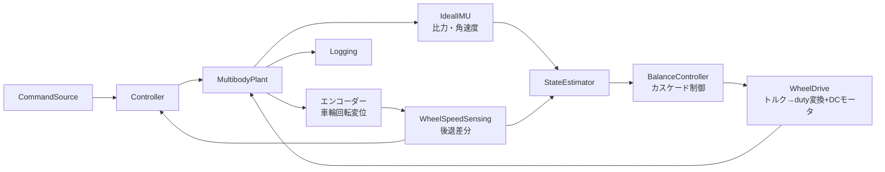

# 玉乗り3WDオムニローバー

`ball_balancing_omni3_multibody_lqi_rev1.slx` は、直径100 mm、質量285 gの薄肉球、3個のNexus 14108オムニホイール、3個のDFRobot FIT0521エンコーダー付きDCモータ、2枚のCytron MDD3A、上部ペイロードで構成する閉ループSimscape Multibodyモデルです。本モデルをシステムの正本とします。

## 正本モデル

`ball_balancing_omni3_multibody_lqi_rev1.slx` を現行の正式開発モデルとします。実機rev1ハードウェア構成を再現し、車輪駆動はFIT0521モータ＋MDD3AドライバのSimscape Electrical回路（PWM duty、エンコーダー量子化341.2 PPR）としてモデル化しています。機体上部のペイロードは質量0.50 kg（公称設計点）、フレーム構造は `ball_balancing_omnirover3wd_assembly` をABS素材で簡易再現しています。

球―地面と3組のホイール―球はすべて `Spatial Contact Force` で接続し、ホイール―球接触は `ballbotCustomFriction.m` による異方性摩擦を `Provided by Input` で与えます。

パラメーターは `ballbotRev1Parameters` が生成する構造体 `ballbotParams` をモデルワークスペースへ設定します（`PreLoadFcn` が未設定時に自動で呼び出します）。`ballbotRev1Parameters` は `ballbotFullPlantParameters` → `ballbotParameters` の順で基礎値を引き継ぎ、rev1向けに電気系アクチュエータ量（電機子インダクタンス、MDD3A論理・ブリッジ抵抗）と移動/停止/ヨー繰り返し指令プロファイルを追加します。

| モデル | パラメーター関数 |
|---|---|
| `ball_balancing_omni3_multibody_lqi_rev1.slx` | `ballbotRev1Parameters` |

## モデル階層



### Controller 内サブシステム

| サブシステム | 役割 | 主な内容 |
|---|---|---|
| `WheelSpeedSensing` | 車輪回転変位の後退差分で輪速を算出 | `WheelRateInputs`、`WheelRateCalculation`、`PreviousWheelDisplacement` |
| `StateEstimator` | 14状態推定器の更新と状態保持 | `EstimatorInputs`、`EstimatorUpdate`、`EstimatorStateMemory`、`SelectEstimate`、`SelectNextEstimatorState`、`SelectYawBiasDiagnostics` |
| `BalanceController` | 指令・推定値から3輪トルク指令を生成 | `ControlInputs`、`LqiController`、`LqiFeedbackInputs`、`LqiFeedbackState`、`VelocityIntegralMemory`、`SelectMode`、`SelectWheelSpeedCommand`、`SelectYawBiasReady` |
| `WheelDrive` | トルク→duty変換＋MDD3A電圧制限＋DCモータで輪トルクを生成 | `SelectDutyCommand`、`SpeedPiDuty`、`SpeedPiMotorInputs` |

### MultibodyPlant 内サブシステム

| サブシステム | 役割 | 主な内容 |
|---|---|---|
| `Environment` | 世界座標・ソルバー・床面 | `World`、`SolverConfig`、`MechanismConfig`、`GroundFrame`、`GroundPlane` |
| `Ball` | 球剛体と球―床接触 | `BallFreeJoint`、`BallSolid`、`BallGroundContact`、位置・姿勢の物理信号計測 |
| `RoverChassis` | 機体・ペイロード・モータハウジング | `RoverFreeJoint`、`ChassisSolid`、`PayloadRodMount`＋`PayloadRod500g`、`Motor1..3Solid`、位置・加速度・角速度・姿勢の物理信号計測 |
| `WheelAssembly1..3` | 車輪回転自由度・車輪固体・輪―球接触 | `WheelNMount`、`WheelNJoint`、`WheelNSolid`、`WheelNBallContact`、回転変位・接触状態・法線力・すべりの計測変換 |

## 制御構成

制御器は MiaPURE方式（Xiao et al., arXiv:2304.02887）に倣ったカスケード構造で、外側の速度→リーン変換と内側の傾きLQR＋ボール速度PIの2層とします。

1. `ballbotLqiControllerUpdate` は `p.controller.cascade.enabled` が真のとき `ballbotCascadeUpdate` へ委譲します。
2. `ballbotCascadeUpdate` は速度誤差から指令リーン角を生成し（スルーレート・上限制限付き）、6状態LQR `[pitch; -roll; q; -p; vBallBody(2)]` で輪トルクを合成します。有界・漏洩付きPIが接触摩擦の定常偏差を補償します。
3. 補助経路として、輪速差動減衰（滑り輪の制動。共通モードは除去してボール鉛直スピンのポンプを防止）、ボール垂直スピンブレーキ、ヨー静止ゲート付き同相トルクを持ちます。
4. `ballbotTorqueDutyStep` が輪トルクをモータ式 `duty = (R*I + Ke*w)/Vs` でdutyへ変換し、ドライバ連続限界とトラクション限界で飽和します。

カスケードゲインは `ballbotCascadeGains` が設計します。実測トルクステップB行列（公称0.5 kg構成）をペイロード慣性でスケーリングし、速度行は輪速変換行列 `wheelSpeedFromPlanarVelocity` の冪双対（力＝W.'·トルク）で構成します。ペイロード族0〜1 kgへ交差適用して保持床（`eig(Btilt*K) > gg`）を満たす設計点の中から最大傾きゲインを選択します。

`p.controller.cascade.enabled = false` の構成では旧トルクLQI経路（`ballbotRobustTorqueGains` の固定ゲイン＋輪速サーボ推進）へフォールバックします。旧設計全体はGitタグ `legacy-torque-lqi-rev1` に保存しています。

## MATLAB関数

| ファイル | モデル内の呼出元 | 役割 |
|---|---|---|
| `ballbotRev1Parameters.m` | rev1モデルのパラメーター初期化 | rev1モデル用パラメーター `ballbotParams` を生成 |
| `ballbotFullPlantParameters.m` | `ballbotRev1Parameters` から呼出し | ペイロード・接触・幾何の共通パラメーター |
| `ballbotParameters.m` | `ballbotFullPlantParameters` から呼出し | 幾何・モータ・接触・推定・制御の基礎パラメーター |
| `ballbotWheelGeometry.m` | パラメーター初期化 | 球面接触点、転動方向、車軸方向、輪速変換行列 |
| `ballbotDesignLqi.m` | パラメーター初期化 | 縮約10状態プラントのLQIゲイン設計 |
| `ballbotDesignTorqueLqi.m` | `ballbotRev1Parameters` から呼出し | トルク入力プラントのLQR設計 |
| `ballbotRobustTorqueGains.m` | `ballbotRev1Parameters` から呼出し | 実測B行列の質量族スケーリングとロバスト固定ゲイン選択 |
| `ballbotCascadeGains.m` | `ballbotRev1Parameters` から呼出し | カスケード6状態LQRゲイン設計（保持床制約付き） |
| `ballbotReducedPlantDynamics.m` | `ballbotDesignLqi` から呼出し | 縮約10状態プラントの非線形動力学 |
| `ballbotTorquePlantDynamics.m` | `ballbotDesignTorqueLqi` から呼出し | トルク入力縮約プラントの非線形動力学 |
| `ballbotPayloadRoverProperties.m` | パラメーター初期化 | ペイロード→質量/重心/慣性の換算 |
| `ballbotRev1CommandProfile.m` | `CommandSource` | 移動/停止繰り返し＋ヨー時間分離指令プロファイル |
| `ballbotCustomFriction.m` | `WheelAssembly/WheelContact` | 駆動方向とローラー方向を分離した異方性接触摩擦 |
| `ballbotIdealImu.m` / `ballbotImuFromJoint.m` | `MultibodyPlant/IdealIMU` | 6-DOF Joint真値から比力・角速度を生成 |
| `ballbotWheelRateFromDisplacement.m` | `Controller/WheelSpeedSensing` | 車輪回転変位を5 ms後退差分して回転速度を算出 |
| `ballbotEstimatorStep.m` / `ballbotEstimatorUpdate.m` | `Controller/StateEstimator` | IMU・エンコーダー融合、ボール回転・相対位置・ヨー軸ジャイロバイアス推定 |
| `ballbotEstimatorInitialState.m` | 初期値式 | 推定器14状態の初期値 |
| `ballbotTruthGate.m` | `Controller/TruthGate`（診断用） | `p.estimator.truthFeedbackEnabled` 時に推定値をプラント真値で置換 |
| `ballbotYawBiasStartupGuard.m` | `BalanceController` 内関数から呼出し | バイアス収束までヨー制御だけを抑止する準備完了ラッチ |
| `ballbotLqiControllerUpdate.m` | `Controller/BalanceController/LqiController` | モード管理・カスケード/旧経路のディスパッチ |
| `ballbotFullPlantHierarchyUpdate.m` | `ballbotLqiControllerUpdate` から呼出し | 旧階層制御（速度外側ループ＋傾斜安定化＋輪速変換） |
| `ballbotCascadeUpdate.m` | `ballbotLqiControllerUpdate` から呼出し | カスケード制御器本体 |
| `ballbotLqiFeedbackState.m` | `Controller/BalanceController` | LQIフィードバック状態ベクトルの組立て |
| `ballbotSpeedPiMotorStep.m` | `ballbotSpeedPiDutyStep` から呼出し | 輪速PI・MDD3A電圧制限・DCモータトルク |
| `ballbotSpeedPiDutyStep.m` | `Controller/WheelDrive` | 輪速PIからPWM dutyを生成（トルクモード無効時のフォールバック） |
| `ballbotTorqueDutyStep.m` | `Controller/WheelDrive` | 輪トルク→duty変換（逆起電力補償・飽和） |
| `ballbotMdd3aVoltageController.m` | 輪速PI関数から呼出し | 輪速PIからMDD3A電圧と積分器更新を生成 |
| `ballbotMdd3aGateDrive.m` | `WheelDrive` | duty指令をMDD3AのPWM/方向ロジック信号へ変換 |
| `ballbotPoseFromJoint.m` | `Logging` | 位置・クォータニオンからxyz/RPY真値を生成 |
| `ballbotEulerToQuaternion.m` | 補助 | オイラー角からクォータニオン変換 |
| `scratch_cycle.m` | 検証用エントリポイント | サイクルシミュレーション実行と `cycle_result_<tag>.mat` 保存 |

推定器の内部状態は14要素で、末尾にヨー軸ジャイロバイアス推定値と低運動継続時間を保持します。制御器へ渡す`estimate(14)`の幅と順序は維持し、4～6番目をバイアス補正後の機体角速度とします。バイアス推定値、学習許可、継続時間は診断信号として扱います。起動時はバイアス収束までヨートルクだけを抑止し、明示的なヨー指令は抑止をバイパスします。

## 実行

モデルを開くだけで `PreLoadFcn` が `ballbotRev1Parameters` を呼び出すため、`ballbotParams` をベースワークスペースへ明示設定する必要はありません。`InitFcn` が不一致・未設定の `ballbotParams` をシミュレーション開始時に自動で再生成します。

```matlab
cd matlab_ws/ball_balancing_omni3

% rev1モデル（カスケード制御・既定）
p = ballbotRev1Parameters;
assignin("base", "ballbotParams", p);
in = Simulink.SimulationInput( ...
    "ball_balancing_omni3_multibody_lqi_rev1");
in = in.setModelParameter("StopTime", "4");
out = sim(in);
```

`p.command.cyclesEnabled` の移動/停止繰り返しプロファイルが既定で有効です。検証スクリプトは `scratch_cycle.m`（ペイロードとフィールドオーバーライドを受理）。

## 検証状態

| シナリオ | 結果 |
|---|---|
| ゼロ指令直立保持 | 起動セットル後は tilt <0.001 rad・輪法線力均衡（公称4.1 N）で安定。ただし起動過渡が保持錐を超える確率的転倒が残る |
| 移動フェーズ | 未検証（移動開始〜2 sで輪脱輪→傾き暴走の既知不具合あり） |
| MATLAB単体試験 | `ballbotEstimatorStepTest` 16件、`ballbotParametersTest` が合格 |

既知の残課題:

- 起動セットルのバウンド（傾き ~0.01–0.02 rad）が重量構成の保持錐（約0.013 rad、トラクション限界由来）と同程度で、転倒可否が確率的。
- 移動開始時の加重移動で1輪が脱輪する（傾き0.005 rad程度で法線力崩壊）。リーン平衡錐のマージンが薄い。
- LQRの速度状態列は非最小位相経路（ボール逆蹴りで車体前傾）を選択するため既定で無効（`velocityStateFeedback=false`）。速度追従は外側リーンループと弱いPIが担当。
- 推定器の相対位置チャネル（est 12–13）は大きく発散し得るため、カスケードでは `positionGain=0` で無効化済み。
- ボール鉛直スピンのポンプ機構は差動限定輪速減衰＋スピンブレーキで抑制済み（ωBz がほぼゼロに留まることを確認）。
