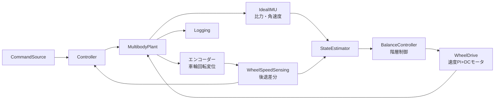

# 玉乗り3WDオムニローバー

`ball_balancing_omni3_multibody_lqi_custom_contact_fullplant.slx` は、直径100 mm、質量285 gの薄肉球、3個のNexus 14108オムニホイール、3個のDFRobot FIT0521エンコーダー付きDCモータ、2枚のCytron MDD3A、上部ロッドで構成する閉ループSimscape Multibodyモデルです。本モデルをシステムの正本とします。

## 正本モデル

`ball_balancing_omni3_multibody_lqi_custom_contact_fullplant.slx` を現行の正式開発モデルとします。機体上部には質量0.50 kg、長さ300 mm、断面20 mm角のロッドを備え、ローバー総質量1.509 kg、球中心からの合成重心高約161 mmとして設計します（フレーム構造は `ball_balancing_omnirover3wd_assembly` をABS素材で簡易再現）。

`ball_balancing_omni3_multibody_lqi_rev1.slx` は実機rev1ハードウェア構成を再現する派生モデルで、車輪駆動を集中トルクではなくFIT0521モータ＋MDD3AドライバのSimscape Electrical回路（PWM duty、エンコーダー量子化341.2 PPR）としてモデル化しています。

球―地面と3組のホイール―球はすべて `Spatial Contact Force` で接続し、ホイール―球接触は `ballbotCustomFriction.m` による異方性摩擦を `Provided by Input` で与えます。

パラメーターはモデルごとに1対1で対応する関数が生成する構造体 `ballbotParams` をモデルワークスペースへ設定します（各モデルの `PreLoadFcn` が未設定時に自動で呼び出します）。

| モデル | パラメーター関数 |
|---|---|
| `ball_balancing_omni3_multibody_lqi_custom_contact_fullplant.slx` | `ballbotFullPlantParameters` |
| `ball_balancing_omni3_multibody_lqi_rev1.slx` | `ballbotRev1Parameters` |

両パラメーター関数とも内部で `ballbotParameters` を呼び、幾何・モータ・接触の基礎値を共有します。`ballbotRev1Parameters` は fullplant パラメーターへ電気系アクチュエータ量（電機子インダクタンス、MDD3A論理・ブリッジ抵抗）と移動/停止繰り返し指令プロファイルを追加します。

## モデル階層



### Controller 内サブシステム

| サブシステム | 役割 | 主な内容 |
|---|---|---|
| `WheelSpeedSensing` | 車輪回転変位の後退差分で輪速を算出 | `WheelRateInputs`、`WheelRateCalculation`、`PreviousWheelDisplacement` |
| `StateEstimator` | 14状態推定器の更新と状態保持 | `EstimatorInputs`、`EstimatorUpdate`、`EstimatorStateMemory`、`SelectEstimate`、`SelectNextEstimatorState`、`SelectYawBiasDiagnostics` |
| `BalanceController` | 指令・推定値から3輪速度指令を生成 | `ControlInputs`、`LqiController`、`LqiFeedbackInputs`、`LqiFeedbackState`、`VelocityIntegralMemory`、`SelectMode`、`SelectWheelSpeedCommand`、`SelectYawBiasReady` |
| `WheelDrive` | 輪速PI＋MDD3A電圧制限＋DCモータで輪トルクを生成 | `SpeedPiMotorInputs`、`SpeedPiAndDcMotor`、`SelectMotorTorque`、`SelectNextSpeedIntegral`、`SpeedIntegralMemory` |

### MultibodyPlant 内サブシステム

| サブシステム | 役割 | 主な内容 |
|---|---|---|
| `Environment` | 世界座標・ソルバー・床面 | `World`、`SolverConfig`、`MechanismConfig`、`GroundFrame`、`GroundPlane` |
| `Ball` | 球剛体と球―床接触 | `BallFreeJoint`、`BallSolid`、`BallGroundContact`、位置・姿勢の物理信号計測 |
| `RoverChassis` | 機体・ペイロード・モータハウジング | `RoverFreeJoint`、`ChassisSolid`、`PayloadRodMount`＋`PayloadRod500g`、`Motor1..3Solid`、位置・加速度・角速度・姿勢の物理信号計測 |
| `WheelAssembly1..3` | 車輪回転自由度・車輪固体・輪―球接触 | `WheelNMount`、`WheelNJoint`、`WheelNSolid`、`WheelNBallContact`、回転変位・接触状態・法線力・すべりの計測変換 |

プラント直下には、輪トルク入力の `TorqueDemux`＋`Torque1..3ToPS`、IMU生成の `IdealIMU`＋`RoverImuMux`、真値生成の `RoverPoseCalculation`／`BallPoseCalculation`、各輪の `WheelNCustomFriction`＋`WheelNFrictionInputs`＋`WheelNRotationVector`（異方性摩擦の物理信号を各WheelAssemblyへ供給）、ログ用To Workspace、および `IMU`／`WheelDisplacement`／`RoverPose`／`BallPose`／`ContactStatus` の各出力ポートがあります。

## 制御構成

制御器は階層構造で、外側から順に速度追従・傾斜安定化・輪速制御の3層とします。

1. `ballbotLqiControllerUpdate` は `p.controller.fullplant.enabled` が真のとき `ballbotFullPlantHierarchyUpdate` へ委譲します。
2. 階層制御は、輪速から `wheelSpeedFromPlanarVelocity` の疑似逆行列で機体平面速度を再構成し、速度外側ループが加速度指令を平面加速度上限0.60 m/s²と最大傾斜4 degへ制限した後、傾斜比例＋角速度微分で平面輪速指令を生成します。
3. 3輪速度指令は `wheelSpeedFromPlanarVelocity` 行列で輪速へ変換し、`maximumWheelSpeedCommand` で飽和します。飽和時は速度積分器を前回値に保持します。
4. `ballbotSpeedPiMotorStep` は輪速PI（`ballbotMdd3aVoltageController`）で電圧を生成し、MDD3A供給電圧と3 A連続電流で制限した後、DCモータモデルで輪トルクへ変換します。トルクは `min(p.controller.tractionLimitedWheelTorque, p.controller.fullplant.motorTorqueLimit)` で制限します。

`p.controller.fullplant.enabled = false` の構成では、`ballbotLqiControllerUpdate` 内部の10状態MIMO LQI（状態：平面速度2・傾斜2・傾斜角速度2・ヨー角速度・輪速3）を直接適用します。LQIゲインは `ballbotDesignLqi.m` が設計し、`fullplant_lqi_design.mat` が存在すればその値を優先します。

## MATLAB関数

| ファイル | モデル内の呼出元 | 役割 |
|---|---|---|
| `ballbotFullPlantParameters.m` | fullplantモデルのパラメーター初期化 | 正本モデル用パラメーター `ballbotParams` を生成 |
| `ballbotRev1Parameters.m` | rev1モデルのパラメーター初期化 | rev1モデル用パラメーター `ballbotParams` を生成 |
| `ballbotParameters.m` | 両パラメーター関数から呼出し | 幾何・モータ・接触・推定・制御の基礎パラメーター |
| `ballbotWheelGeometry.m` | パラメーター初期化 | 球面接触点、転動方向、車軸方向、輪速変換行列 |
| `ballbotDesignLqi.m` | パラメーター初期化 | 縮約10状態プラントのLQIゲイン設計 |
| `ballbotReducedPlantDynamics.m` | `ballbotDesignLqi` から呼出し | 縮約10状態プラントの非線形動力学 |
| `ballbotCommandProfile.m` | `CommandSource`（fullplant） | 時間窓付き速度・ヨー指令プロファイル |
| `ballbotRev1CommandProfile.m` | `CommandSource`（rev1） | 移動/停止繰り返し＋ヨー同時指令プロファイル |
| `ballbotCustomFriction.m` | `WheelAssembly/WheelContact` | 駆動方向とローラー方向を分離した異方性接触摩擦 |
| `ballbotIdealImu.m` / `ballbotImuFromJoint.m` | `MultibodyPlant/IdealIMU` | 6-DOF Joint真値から比力・角速度を生成 |
| `ballbotWheelRateFromDisplacement.m` | `Controller/WheelSpeedSensing` | 車輪回転変位を5 ms後退差分して回転速度を算出 |
| `ballbotEstimatorStep.m` / `ballbotEstimatorUpdate.m` | `Controller/StateEstimator` | IMU・エンコーダー融合、ボール回転・相対位置・ヨー軸ジャイロバイアス推定 |
| `ballbotEstimatorInitialState.m` | 初期値式 | 推定器14状態の初期値 |
| `ballbotTruthGate.m` | `Controller/TruthGate`（rev1、診断用） | `p.estimator.truthFeedbackEnabled` 時に推定値をプラント真値（姿勢・角速度・速度・相対位置）で置換し、推定器起因かを切り分ける |
| `ballbotYawBiasStartupGuard.m` | `BalanceController` 内関数から呼出し | バイアス収束までヨー制御だけを抑止する準備完了ラッチ |
| `ballbotLqiControllerUpdate.m` | `Controller/BalanceController/LqiController` | モード管理・ヨーガード付き輪速指令生成、階層制御への委譲 |
| `ballbotFullPlantHierarchyUpdate.m` | `ballbotLqiControllerUpdate` から呼出し | 速度外側ループ＋傾斜安定化＋輪速変換の階層制御 |
| `ballbotLqiFeedbackState.m` | `Controller/BalanceController` | LQIフィードバック状態ベクトルの組立て |
| `ballbotSpeedPiMotorStep.m` | `Controller/WheelDrive`（fullplant） | 輪速PI・MDD3A電圧制限・DCモータトルク |
| `ballbotSpeedPiDutyStep.m` | `Controller/WheelDrive`（rev1） | 輪速PIからPWM dutyを生成しトラクション限界で制限 |
| `ballbotMdd3aVoltageController.m` | 輪速PI関数から呼出し | 輪速PIからMDD3A電圧と積分器更新を生成 |
| `ballbotMdd3aGateDrive.m` | `WheelDrive`（rev1） | duty指令をMDD3AのPWM/方向ロジック信号へ変換 |
| `ballbotPoseFromJoint.m` | `Logging` | 位置・クォータニオンからxyz/RPY真値を生成 |
| `ballbotRoverInitialPosition.m` | `RoverFreeJoint` 初期位置ターゲット | ローバー初期位置の計算 |
| `ballbotEulerToQuaternion.m` | 補助 | オイラー角からクォータニオン変換 |

推定器の内部状態は14要素で、末尾にヨー軸ジャイロバイアス推定値と低運動継続時間を保持します。制御器へ渡す`estimate(14)`の幅と順序は維持し、4～6番目をバイアス補正後の機体角速度とします。バイアス推定値、学習許可、継続時間は診断信号として扱います。起動時はバイアス収束までヨートルクだけを抑止し、明示的なヨー指令は抑止をバイパスします。

## 実行

モデルを開くだけで `PreLoadFcn` が対応するパラメーター関数を呼び出すため、`ballbotParams` をベースワークスペースへ明示設定する必要はありません。各パラメーター構造体の `parameterSource` フィールドが生成元を記録し、`InitFcn` が不一致・未設定の `ballbotParams` をシミュレーション開始時に自動で再生成します。明示する場合の対応は次のとおりです。

```matlab
cd matlab_ws/ball_balancing_omni3

% 正本モデル（集中トルク駆動）
p = ballbotFullPlantParameters;
assignin("base", "ballbotParams", p);
in = Simulink.SimulationInput( ...
    "ball_balancing_omni3_multibody_lqi_custom_contact_fullplant");
in = in.setModelParameter("StopTime", "4");
out = sim(in);

% rev1モデル（Simscape Electricalモータ/duty駆動）
p = ballbotRev1Parameters;
assignin("base", "ballbotParams", p);
in = Simulink.SimulationInput( ...
    "ball_balancing_omni3_multibody_lqi_rev1");
in = in.setModelParameter("StopTime", "4");
out = sim(in);
```

`ballbotFullPlantParameters.m` の `p.command.velocityWorld` と `p.command.yawRate` を変更するか、`p.command.profileEnabled = true` で時間窓付き指令プロファイルを有効にします。rev1モデルでは `p.command.cyclesEnabled` の移動/停止繰り返しプロファイルが既定で有効です。

## 検証状態

| シナリオ | 結果 |
|---|---|
| 静止・モジュール化後の回帰 | モジュール化前ベースラインと全ログ信号が共通時間グリッドで一致。最大相対差は摩擦力で約4e-3（可変ステップ誤差範囲） |
| モデル更新 | `Ctrl+D` 相当のモデル更新が成功（ode15s） |
| MATLAB単体試験 | `ballbotEstimatorStepTest` 16件、`ballbotParametersTest` 3件、`fullplantDesignArtifactsTest` 6件、`fullplantIdentificationEvidenceTest` 9件が合格 |
| `tests/run_fullplant_regression` | upright・x・yの3ケース合格。xy合成指令は接触維持限界域のためモジュール化後モデルで輪―球接触を一時喪失（再構成前モデルも最小法線力0.04 Nの限界域）。制御再調整後に回帰基準を再生成する |

100 mm球での長時間安定性・速度追従性能の検証は継続中です。既知の残課題と設計経緯は `FULLPLANT_LQI_INVESTIGATION.md` と `FULLPLANT_CUSTOM_CONTACT_CONTROL_REPORT.md` を参照してください。

### トルク/duty直接制御（rev1、進行中）

実測で輪速PIループの追従帯域が約5.6 rad/sと判明し、不安定傾斜極（約6.4 rad/s）を下回るため、傾きチャネルを速度PIから切り離す改造を進行中です。`p.controller.torqueDrive.enabled = true` で `ballbotLqiControllerUpdate` が輪トルク指令を出力し、`ballbotTorqueDutyStep` がモータ式の逆解き（`duty = (R*I + Ke*w)/Vs`）でdutyへ変換します。`enabled = false` では従来の輪速PI経路にフォールバックします。

現状の知見:

- 実プラントのトルク入力B行列を開ループステップで同定し、縮約モデルが傾斜結合を約2.4倍・ヨー結合を約70倍過大評価していることを確認（`p.torqueFit` に反映）。
- 測定B行列上の離散LQR（傾き×1.8、傾斜レート×1.0、ヨー×5にスケーリング）で、ゼロ指令バランスが最大約20秒まで改善（従来は1〜5秒で転倒）。レート項のフルゲイン投入時の約9 Hz発振（電気遅延リング）対策として、ジャイロレート経路に20 ms一次遅れを挿入済み。
- 外側ループは2チャネルに分離して実装済み（`ballbotLqiControllerUpdate` 内）。構造上の要点: 輪トルクは rover+ball 系の内力であり COM を加速できないため、速度追従は重力（リーン目標）経由でしか成立しない。`velocityLeanGain`（デフォルト無効）は速度誤差→傾きセットポイント変換、`positionGain`/`positionDampingGain`（デフォルト無効）は rover-ball 相対位置・相対速度→直接トルク（内部再配分チャネル、s̈≈−8.7c を実測）。
- ボール鉛直スピンは自由モードで、ヨーダンパの同相トルクが角運動量をそこへダンプしてスピンアップする経路を確認済み。
- back-EMF項の輪速ローパスは 80 ms に引き上げ（15 ms ではエンコーダ量子化フリッカが ±0.08 duty ≈ 0.066 N·m のトルクノイズとして残留し、リミットサイクルを励起していた）。
- 真値フィードバック比較実験（`p.estimator.truthFeedbackEnabled` + `TruthGate` ブロック、診断用・既定オフ）の結果: 推定器フィードバックと真値フィードバックで転倒時刻がほぼ同一（約5.3秒）、エンコーダ量子化OFFでも同様に転倒するため、**発散の主因は推定器でも量子化でもない**。推定値傾きは真値を正確に追跡している。
- ヨー角速度フィードバック列（`torqueLqi.stateGain(:,7)`）と `ballYawGain` の同相トルク経路を両方遮断すると、推定器フィードバックでも真値フィードバックでも傾きが機械ゼロのまま約10.5秒保持される。同相トルクがシャーシヨーとボール鉛直スピンの間で角運動量を往復させてエネルギーを蓄積するポンプ機構が、約5秒転倒の支配的な発散源と確定。現在は両チャネルとも既定0で出荷（ヨー指令は開ループ追従のみ）。
- 接触モデルの検証: 輪法線力の崩壊は傾きが準静的な幾何学的脱輪限界（支持三角形アポテム/重心高から約0.13 rad）を超えた後に持続的に発生する。限界以下では法線力は公称値4.07 N×3を維持し、早期脱輪は最大60 ms程度の一過性チャタリングのみ（転倒と因果関係なし）。したがって「理論上ボールから離れうる傾きまで100%接地」という仮定は現行の力ベース接触モデルで既にほぼ満たされており、拘束型へのプラント作り替えは現時点の証拠では不要。
- 残課題: ヨー/ボールスピンチャネル遮断後も約10.5秒で突発的な発散イベントが残る（全信号が機械ゼロから0.2秒以内にボールスピン+脱輪+傾斜発散）。次の解析対象はこの閾値イベントの特定と、傾きが回復可能錐（トルク限界由来で約0.02〜0.03 rad）を超える前に止める外側ループ設計。移動指令試験・ヨー追従はこの残存モードの解決が前提。
- ソルバー感度（重要）: 移動指令時の推定器発散はソルバーの数値ジッタに強く依存する。可変ステップ（VariableStepAuto）+ MaxStep 2e-4 ではIMU比力が滑らかになり、推定姿勢誤差が rms 約0.002 rad まで低下して推定器フィードバックと真値フィードバックの転倒時刻が一致（約4.4秒）。粗い数値設定では推定器経由の高周波ノイズが姿勢ループを励起し、移動開始1.3秒程度で転倒していた。**ソルバー設定を変えた場合は推定器の挙動を再評価すること**。
- 推定器のroll/pitch経路修正: 加速度計「鉛直上」補正の有効条件を `|f|≈g && (水平加速度 ≤ 0.03 || 準静止)` に変更。水平加速度ゲートだけでは姿勢誤差（g・δ に見える）と実加速度を区別できず自己ロックし得るため、車輪速度+ジャイロレートの準静止判定で静止時の補正を維持し、0.03 m/s² ゲート（指令加速度0.06未満）で移動中の幻影傾き a/g 注入を遮断する。なお推定誤差は新ソルバーでは既に小さく、残る転倒は推定器起因ではなくプラント/外側ループ側と切り分け済み。
- 質量ロバスト固定ゲイン（`ballbotRobustTorqueGains`）: 実測B行列を質量族（ペイロード0〜1 kg、車体質量1.0〜2.0 kg）に物理スケーリングし、全候補ゲインを全プラントへ交差適用して最悪閉ループ極半径が最小の固定ゲインを採用。線形解析では固定ゲインが全範囲を安定化するが、軽量側設計のゲインは重量プラントを不安定化することを確認（傾斜権が約8倍差）。ペイロード→質量/重心/慣性の計算は `ballbotPayloadRoverProperties` に単一ソース化。
- 小信号ロバスト制御の再設計（IMUノイズ耐性を考慮）: 旧経験スケーリング ×8/×0.25 は傾き:レート比をLQR設計より32倍硬く歪め、傾き0.004 radでトラクション限界97%を指令するバンバンリミットサイクルだった。現行は傾き×1.8（K≈4.4 Nm/rad、1.0 kg構成の静的保持閾値4.2をクリアする最低余裕）＋レート×1.0（ζ~0.7）で、0.004 rad小信号は限界の43%まで静粛化。更に (a) ジャイロレート出力への一次遅れ（20 ms、傾き帯域で位相損~10°）、(b) リーン要求の重力保持フィードフォワード `leanHoldTorque`（平衡傾きを指令値へ一致させ、フィードバックは偏差のみ=ノイズを増幅しない）、(c) リーン・スルーレート0.05 rad/s（ステップ指令でボールが摩擦加速限界を超えて車体が乗り上げる暴走を防止）、(d) 傾きゲインスケジューリング（指令帯は低ゲイン、錐縁へ近づくと×3まで漸増）を実装。
- 移動中倒立の残課題: 上記すべて適用後も ~3 s 帯で緩やかな傾きドリフト→錐超過転倒が残る。機構は「駆動−ウィリー結合」（輪トルク反作用が車体を前傾させつつボールが車体下から先行脱出、relP負成長+傾き正成長を実測）で、傾き保持と推進を同一3輪トルクに配分する限界。relPos閉ループ・スリップダンパOFF・推進上限絞り・低速指令・重力FFのいずれも単独では打破せず、相対位置自由度を含む結合設計（MIMO再設計）が次の本質課題。
- コマンドプロファイル整合性の修正: `cycleMoveDuration` を10→18 sに延長。旧10 s窓ではランプが moveDuration/2=5 s に頭打ちされ実効加速度0.105 m/s²となり、リーン上限0.008 rad（≈0.078 m/s²相当）を構造的に超過し速度誤差が永久に収束しない設定だった。18 s窓で0.524 m/sを設計加速度0.06 m/s²で8.7 s×2にランプし、リーン要求がキャップ内に収まる。

## 仕様

- [機構仕様](../../specs/hardware_design/mechanism/ball_balancing_omnirover3wd/README.md)
- [制御・状態推定仕様](../../specs/hardware_design/controll/ball_balancing_omnirover3wd/ball_balancing_omnirover3wd-system.md)
