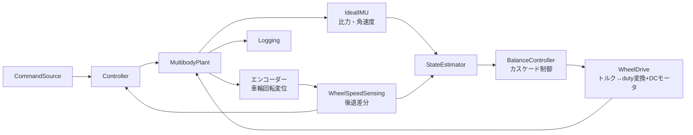

# 玉乗り3WDオムニローバー

> このブランチは MATLAB R2024b 対応版です。`ball_balancing_omni3_multibody_lqi_rev1.slx` は R2024b 形式で保存されており、R2024b (Update 9) で開いて利用できます。

`ball_balancing_omni3_multibody_lqi_rev1.slx` は、直径100 mm、質量285 gの薄肉球（ゴムスプレー被覆を想定）、3個のServoCity/goBILDA 48 mmオムニホイール（φ48 mm、32 g、全幅18 mm、50Aデュロメータのゴムローラー2列）、3個のDFRobot FIT0521エンコーダー付きDCモータ、2枚のCytron MDD3A、上部ペイロードで構成する閉ループSimscape Multibodyモデルです。本モデルをシステムの正本とします。

## 正本モデル

`ball_balancing_omni3_multibody_lqi_rev1.slx` を現行の正式開発モデルとします。実機rev1ハードウェア構成を再現し、車輪駆動はFIT0521モータ＋MDD3AドライバのSimscape Electrical回路（PWM duty、エンコーダー量子化341.2 PPR）としてモデル化しています。搭載電源は Zeee 7.2 V 5000 mAh NiMH パック（0.423 kg、1層目中央配置）で、ドライバ供給電圧は公称 7.2 V、PWM duty 上限は FIT0521 の定格 6 V 平均を超えない値（6/7.2≈0.83）に制限しています。機体上部のペイロードは質量0.50 kg（公称設計点）、フレーム構造は `ball_balancing_omnirover3wd_assembly` をABS素材で簡易再現しています。

球―地面と3組のホイール―球はすべて `Spatial Contact Force` で接続し、ホイール―球接触は `ballbotCustomFriction.m` による異方性摩擦を `Provided by Input` で与えます。

パラメーターは `ballbotRev1Parameters` が生成する構造体 `ballbotParams` をモデルワークスペースへ設定します（`PreLoadFcn` が未設定時に自動で呼び出します）。`ballbotRev1Parameters` は `ballbotFullPlantParameters` → `ballbotParameters` の順で基礎値を引き継ぎ、rev1向けに電気系アクチュエータ量（電機子インダクタンス、MDD3A論理・ブリッジ抵抗）と移動/停止/ヨー繰り返し指令プロファイルを追加します。

| モデル | パラメーター関数 |
|---|---|
| `ball_balancing_omni3_multibody_lqi_rev1.slx` | `ballbotRev1Parameters` |

## モデル階層



### Controller 内サブシステム

| サブシステム | 役割 | 主な内容 |
|---|---|---|
| `WheelSpeedSensing` | 車輪回転変位の後退差分で輪速を算出 | `WheelRateInputs`、`WheelRateCalculation`、`PreviousWheelDisplacement` |
| `StateEstimator` | 14状態推定器の更新と状態保持 | `EstimatorInputs`、`EstimatorUpdate`、`EstimatorStateMemory`、`SelectEstimate`、`SelectNextEstimatorState`、`SelectYawBiasDiagnostics` |
| `BalanceController` | 指令・推定値から3輪トルク指令を生成 | `ControlInputs`、`LqiController`、`LqiFeedbackInputs`、`LqiFeedbackState`、`VelocityIntegralMemory`、`SelectMode`、`SelectWheelSpeedCommand`、`SelectYawBiasReady` |
| `WheelDrive` | トルク→duty変換＋MDD3A電圧制限＋DCモータで輪トルクを生成 | `SelectDutyCommand`、`SpeedPiDuty`、`SpeedPiMotorInputs` |

### MultibodyPlant 内サブシステム

| サブシステム | 役割 | 主な内容 |
|---|---|---|
| `Environment` | 世界座標・ソルバー・床面 | `World`、`SolverConfig`、`MechanismConfig`、`GroundFrame`、`GroundPlane` |
| `Ball` | 球剛体と球―床接触 | `BallFreeJoint`、`BallSolid`、`BallGroundContact`、位置・姿勢の物理信号計測、実行時追加の転がり抵抗負荷（`ballbotRev1PlantAugment`） |
| `RoverChassis` | 機体・ペイロード・モータハウジング | `RoverFreeJoint`、`ChassisSolid`、`PayloadRodMount`＋`PayloadRod500g`、`Motor1..3Solid`、位置・加速度・角速度・姿勢の物理信号計測 |
| `WheelAssembly1..3` | 車輪回転自由度・車輪固体・輪―球接触 | `WheelNMount`、`WheelNJoint`、`WheelNSolid`、`WheelNBallContact`、回転変位・接触状態・法線力・すべりの計測変換 |

## 制御構成

制御器はトルクLQI経路を既定とします（`p.controller.torqueDrive.enabled`）。外側のボール速度→リーン変換と内側のロバスト固定ゲインLQI、プラント誤差を抑え込む輪速サーボ推進の構造です。

1. `ballbotLqiControllerUpdate` は既定のトルクLQI経路を実行します。
2. トルクLQI経路は `ballbotRobustTorqueGains` の固定ゲインでフィードバックし、速度誤差→指令リーンの外ループ（`velocityLeanGain`）で移動を生成します。
3. プラント誤差抑制機構として、輪速整合サーボ推進（`propulsionGain`＋トラクション配分）、フィルタ済み輪速の滑り減衰（エンコーダー量子化フリッカー対策のLPF＋小デッドゾーン）、コモンモード残差除去、ボール垂直スピンブレーキ（`ballYawGain`）、並進ゲート付きヨーダンパーを持ちます。
4. `ballbotTorqueDutyStep` が輪トルクをモータ式 `duty = (R*I + Ke*w)/Vs` でdutyへ変換し、ドライバ連続限界とトラクション限界で飽和します。

LQIゲインは `ballbotRobustTorqueGains` が設計します。実測トルクステップB行列をペイロード族0〜1 kgへスケーリングし、族全体で保持床を満たすロバスト固定ゲインを選択します。

過去の代替制御経路（カスケード `ballbotCascadeUpdate`/`ballbotCascadeGains`、ボールフォース `ballbotBallforceUpdate`）は全指標でトルクLQIに劣後したため削除しました（M1）。ボールフォースはトルクLQIが全く動かせなかった 0.10 m/s ステップへボールを実際に追従させた実績（整定誤差 +0.011 m/s）がありますが、サイクル耐久はトルクLQIが優位です。実験履歴は検証状態の記録と Git 履歴に残ります。

## MATLAB関数

| ファイル | モデル内の呼出元 | 役割 |
|---|---|---|
| `ballbotRev1Parameters.m` | rev1モデルのパラメーター初期化 | rev1モデル用パラメーター `ballbotParams` を生成。`ballbotRev1Parameters(payloadMass, sampleTime)` でペイロードと離散周期（既定 5ms）を一貫再構築可能 |
| `ballbotFullPlantParameters.m` | `ballbotRev1Parameters` から呼出し | ペイロード・接触・幾何の共通パラメーター。`p.fullplant.payload.lateralOffset` でペイロードロッドの横オフセット（CGずれ試験用）を指定 |
| `ballbotParameters.m` | `ballbotFullPlantParameters` から呼出し | 幾何・モータ・接触・推定・制御の基礎パラメーター。`ballbotParameters(sampleTime)` で周期を変更可能 |
| `ballbotWheelGeometry.m` | パラメーター初期化 | 球面接触点、転動方向、車軸方向、輪速変換行列 |
| `ballbotDesignLqi.m` | パラメーター初期化 | 縮約10状態プラントのLQIゲイン設計 |
| `ballbotDesignTorqueLqi.m` | `ballbotRev1Parameters` から呼出し | トルク入力プラントのLQR設計 |
| `ballbotRobustTorqueGains.m` | `ballbotRev1Parameters` から呼出し | 実測B行列の質量族スケーリングとロバスト固定ゲイン選択 |
| `ballbotReducedPlantDynamics.m` | `ballbotDesignLqi` から呼出し | 縮約10状態プラントの非線形動力学 |
| `ballbotTorquePlantDynamics.m` | `ballbotDesignTorqueLqi` から呼出し | トルク入力縮約プラントの非線形動力学 |
| `ballbotPayloadRoverProperties.m` | パラメーター初期化 | ペイロード→質量/重心/慣性の換算 |
| `ballbotRev1CommandProfile.m` | `CommandSource` | 移動/停止繰り返し＋ヨー時間分離指令プロファイル（加減速別レート制限） |
| `ballbotRev1PlantAugment.m` | `ballbotRev1Parameters` から呼出し（実行時） | 球―床転がり抵抗（`External Force and Torque`）と輪軸 Coulomb/静摩擦（`Ideal Torque Source`＋`ballbotShaftFrictionTorque`）を実行時追加（.slx は R2024b 形式を維持・冪等・フラグoffで生成ブロック除去と粘性係数復元） |
| `ballbotShaftFrictionTorque.m` | augment 生成の `WheelShaftFricFcn` から呼出し | 輪軸速度→滑らかな Coulomb/breakaway 摩擦トルク |
| `ballbotRollingResistance.m` | `Ball/BallRollResFcn` | 球速度・球スピン・法線力から転がり抵抗の力/トルクを算出 |
| `ballbotCustomFriction.m` | `WheelAssembly/WheelContact` | 駆動方向とローラー方向を分離した異方性接触摩擦 |
| `ballbotIdealImu.m` / `ballbotImuFromJoint.m` | `MultibodyPlant/IdealIMU` | 6-DOF Joint真値から比力・角速度を生成 |
| `ballbotWheelRateFromDisplacement.m` | `Controller/WheelSpeedSensing` | 車輪回転変位を5 ms後退差分して回転速度を算出 |
| `ballbotEstimatorStep.m` / `ballbotEstimatorUpdate.m` | `Controller/StateEstimator` | IMU・エンコーダー融合、ボール回転・相対位置・ヨー軸ジャイロバイアス推定 |
| `ballbotEstimatorInitialState.m` | 初期値式 | 推定器14状態の初期値 |
| `ballbotTruthGate.m` | `Controller/TruthGate`（診断用） | `p.estimator.truthFeedbackEnabled` 時に推定値をプラント真値で置換 |
| `ballbotYawBiasStartupGuard.m` | `BalanceController` 内関数から呼出し | バイアス収束までヨー制御だけを抑止する準備完了ラッチ |
| `ballbotLqiControllerUpdate.m` | `Controller/BalanceController/LqiController` | モード管理・トルクLQI本体・fullplant経路のディスパッチ |
| `ballbotFullPlantHierarchyUpdate.m` | `ballbotLqiControllerUpdate` から呼出し | 旧階層制御（速度外側ループ＋傾斜安定化＋輪速変換） |
| `ballbotLqiFeedbackState.m` | `Controller/BalanceController` | LQIフィードバック状態ベクトルの組立て |
| `ballbotSpeedPiMotorStep.m` | `ballbotSpeedPiDutyStep` から呼出し | 輪速PI・MDD3A電圧制限・DCモータトルク |
| `ballbotSpeedPiDutyStep.m` | `Controller/WheelDrive` | 輪速PIからPWM dutyを生成（トルクモード無効時のフォールバック） |
| `ballbotTorqueDutyStep.m` | `Controller/WheelDrive` | 輪トルク→duty変換（逆起電力補償・飽和） |
| `ballbotMdd3aVoltageController.m` | 輪速PI関数から呼出し | 輪速PIからMDD3A電圧と積分器更新を生成 |
| `ballbotMdd3aGateDrive.m` | `WheelDrive` | duty指令をMDD3AのPWM/方向ロジック信号へ変換 |
| `ballbotPoseFromJoint.m` | `Logging` | 位置・クォータニオンからxyz/RPY真値を生成 |
| `ballbotEulerToQuaternion.m` | 補助 | オイラー角からクォータニオン変換 |
| `scratch_cycle.m` | 検証用エントリポイント | サイクルシミュレーション実行と `cycle_result_<tag>.mat` 保存 |
| `ballbotBenchmark.m` | 検証用エントリポイント | シナリオ（hold/stepX/yaw/cycle/bias/moveYaw）を実行し G-01〜G-11 指標を採点・要約行を出力 |

推定器の内部状態は14要素で、末尾にヨー軸ジャイロバイアス推定値と低運動継続時間を保持します。制御器へ渡す`estimate`は13要素（モデル内のestimateバスは固定14幅で末尾は未使用パッド）で、4～6番目をバイアス補正後の機体角速度とします。バイアス推定値、学習許可、継続時間は診断信号として扱います。起動時はバイアス収束までヨートルクだけを抑止し、明示的なヨー指令は抑止をバイパスします。

## 実行

モデルを開くだけで `PreLoadFcn` が `ballbotRev1Parameters` を呼び出すため、`ballbotParams` をベースワークスペースへ明示設定する必要はありません。`InitFcn` が不一致・未設定の `ballbotParams` をシミュレーション開始時に自動で再生成します。

GUI で開いてそのまま Run しても正式構成で動きます。ランタイム適用（転がり抵抗・輪軸摩擦・MDD3A 回生モード・MaxStep）は .slx に焼き込めないため `ballbotRev1Parameters` 経由で適用されます。ロード途中のビルドはブロック未解決で適用しきれないため、その場合は `parameterSource` を `-pending` スタンプにして `InitFcn` が sim 開始時に再構築→全適用＋`clear functions`（解釈実行ブロックの `persistent` 状態リセット）します。以後の Run も InitFcn 末尾の `ballbotRev1RuntimeApply` ブロック（ランタイム set_param、ファイル非保存）が同じ適用を再実行するため、連続した Run は毎回初回実行と同一の条件になります。

既定コマンドプロファイルは「移動 12 s → 停止 4 s」を 3 周期繰り返し、停止窓の先頭で 0.2 rad/s×1.0 s のヨー台形を隔周期（cycle 1 と 3）に発行します — 移動・停止・回転が全て繰り返し実行され 49.5 s 完走します（v12 実測モデルで検証済み、ヨー包絡の詳細は制御ロードマップ §3）。ヨー窓は `p.command.cycleYawEvery`/`cycleYawDuration` で調整可能で、`cycleYawDuration=0` で並進のみに戻せます。

注意: 実行時追加ブロックでモデルが変更済み扱いになるため、閉じる際は保存せず破棄してください（`close_system(m,0)`）。R2024b 形式を維持する必要があるため、新しい MATLAB からの保存はできません（R2026a で保存すると R2026a 形式に変わり互換性を失います）。

```matlab
cd matlab_ws/ball_balancing_omni3

% rev1モデル（トルクLQI制御・既定）
ballbotRev1SimConfig;  % MaxStep と MDD3A 回生モードを適用（~4倍高速化）
p = ballbotRev1Parameters;
assignin("base", "ballbotParams", p);
in = Simulink.SimulationInput( ...
    "ball_balancing_omni3_multibody_lqi_rev1");
in = in.setModelParameter("StopTime", "4");
out = sim(in);
```

`.slx` は R2024b 形式を維持する必要があるため（新しい MATLAB では Simscape Electrical ブロックを旧形式へエクスポートできない）、ソルバー・ドライバ設定は `ballbotRev1SimConfig` で適用します。検証スクリプトは `scratch_cycle.m`（ペイロードとフィールドオーバーライドを受理）、`scratch_hold.m`（ゼロ指令保持）、`scratch_move.m`（移動ランプ）、`scratch_perf.m`（実行時間計測）です。`p.command.cyclesEnabled` の移動/停止繰り返しプロファイルが既定で有効です。各スクリプトは `sim` 前に `clear functions` を実行します。モデル内の解釈実行 MATLAB Fcn ブロックの `persistent` 状態は同一 MATLAB セッションのシミュレーション間で残留し、同一パラメーターでも転倒時刻が変わることを確認したためです。

## 検証状態

| シナリオ | 結果 |
|---|---|
| シミュレーション速度 | `ballbotRev1SimConfig` 適用で実行時間 ~4倍改善（MDD3A 回生モードの方程式切替排除が主因） |
| ゼロ指令直立保持（バッテリー搭載・ペイロードなし） | 8 s 完走・転倒なし（tilt 最大 ~0.000 rad — 転がり抵抗が微小ドリフトまで吸収し完全静止） |
| ペイロード 0.5–1.0 kg 保持 | 8 s 完走・転倒なし（0.5 kg: ~0.000 rad、1.0 kg: ~0.010 rad）。静止判定に ~1 s 連続保持の滞留ゲートを追加し、ブラインド帯境界の低速クリープ（~0.025 m/s）を実運動として制御へ残すように改善 |
| 移動フェーズ（ペイロードなし） | 指令 0.12 m/s・μr=0.008 で移動＋停止ウィンドウを完走した実績あり（傾斜 ≤0.011 rad）。実行差で減速コーナー（指令 → 0 近傍）のボール追い越しが ~0.2 m/s 接触壁に達して転倒する既知限界は残る |
| LQI再設計（飽和織り込み lean 帯域・R=4000・輪速オブザーバ）後のサイクル試験 | 指令 0.12 m/s の移動/停止繰り返しで t=25.6 s（cycle 2 減速区間の脱輪）まで生存。旧値への単独復旧はいずれも早期転倒（`tiltStiffenGain=4.0`: 23.9 s、`leanSetpointLimit=0.016`: 21.6 s、輪速オブザーバ無効: 23.2 s）で、再設計3要素が揃った構成が最長。回復モード（mode 2）は各ランで複数回作動し一部復帰。duty は ~0.83 クランプに対し p99≈0.35 で飽和型 bang-bang は解消済み |
| 0.306 m/s 指令サイクル | t=9.3 s で転倒。ボール速度が接触壁を超えて伸びるため、`leanSetpointLimit` ではなく脱輪が限界を支配 |
| プラント実機化（IMUノイズ・量子化・輪軸静/Coulomb摩擦）＋制御器A/B | 同一プラント・同一シナリオで `ballbotBenchmark` 比較。保持: LQI 0.780° vs ballforce 0.754°（同等）。stepX（0.10 m/s）: LQI は整定誤差 -0.105 m/s で全く動かず（輪速サーボが接触拘束に失速）、ballforce は +0.011 m/s へ追従（ボールが実際に指令速度へ到達）。yaw: ballforce 7/8、LQI 6/8。cycle（0.12 m/s 移動/停止）: LQI t=36.6 s、ballforce t=14.9 s でともに転倒。トラクション上限 0.078→0.10 N・m で ballforce は 22.9 s まで改善するが LQI は 13.1 s へ悪化（追加トルクがリミットサイクルを増幅）。ballforce は追従力で優位・cycle 耐久で劣後のため実験経路として保持し、既定はトルクLQI |
| MATLAB単体試験 | `ballbotEstimatorStepTest` 16件、`ballbotParametersTest` 3件が合格 |
| 制御周期スイープ（`ballbotRev1Parameters([], Ts)` で Ts 一貫再構築） | LQI・リアル化プラント。Ts=5ms: cycle t=36.6s 転倒。Ts=2.5ms: 24.4s、Ts=3ms: 29.5s、Ts=1ms: 22.3s と単調ではない。Ts=2ms(500Hz) は既定シードで cycle 52s完走（tilt 1.41°、contact=1.0、5/9合格・残は追従精度系）、再実行で完全一致を確認。ただしノイズシード7では t=33.2s 転倒・シード42では完走と、生存は境界上でノイズ実現値依存。hold（0.786°, 7/7）・stepX（-0.104 m/s 失速）は200Hzと同等、yaw 5/8・bias は量子化ゲート既知課題。1kHzはセンサノイズ増幅で全指標悪化（hold 1.155°, cycle 22.3s）— 周期短縮は遅延低減より量子化/ノイズ増幅が支配する系 |
| CGオフセット頑健性（`p.fullplant.payload.lateralOffset`、実行時にPayloadRodMountへ適用） | ロッド横オフセット10mm（CG横ずれ2.8mm・平衡リーン~1.0°）・15mm（~1.5°）は5s保持成立（平衡リーンへ整定）。20mm（CG 5.6mm・平衡リーン~2.1°）は t=4.1s で転倒: 制御器は tilt=0 を保持しようとして一定重力トルクを輪トルクで相殺→系がオフセット方向へ加速しボールが脱輪する。静的リーン整定点を学習する機構（ヨーバイアス相当のロール/ピッチ版）がなく、~1.5°を超える平衡リーン要求に未対応 → 下記 `staticLeanAdapt` で解決 |
| 静的リーン/CGオフセット学習（`torqueDrive.staticLeanAdapt*`、既定ON gain=0.5） | シグネチャ調査の結論: 静止中の持続平面トルクはほぼゼロ（オフセットは接触摩擦のウェッジが保持）、真のシグネチャは**オフセット方向へのドリフト速度**。設計: 指令0時に estV をローパス→デッドバンド(0.02)→gain 0.5でリーン整定点バイアスへ積分し、`state(3:4)` へ `accelerationDemand` と同じ注入点で引き込む（不足バイアス→オフセット方向ドリフト→バイアス成長の負帰還、真の平衡で自己停止）。安全性: ①アーム条件は「休止突入エッジで lagging estV<0.02」（真の静止から始まった休止のみ。cycleの停止窓は転がったまま突入し不成立→減速コーナーの加速クリープをオフセットと誤学習しない）②ドリフト加速中のみ学習（減速中のコーストは除外）③バイアス注入は指令0時のみ・指令中はリーク減衰④成分クリップ ±0.10 rad。実測: 0mm 0.913°・10mm 1.02°・15mm 3.87°過渡・20mm 4.14°過渡で全て5s保持（従来15/20mm転倒）、cycle は適応有無でビット一致（バイアス更新ゼロ・注入ゼロ）。不採用案: 持続トルク積分（トルク~0で不成立）、ドリフト生積分（バイアス誘起リーン→加速→再積分の正帰還で gain≳1.5発散）、加速度/レート上限のみのゲート（停止窓クリープと区別不能）、積分器→バイアス転送（aDはP+FFで持続値小さく間に合わず） |
| 速度推定改善3案の実装・A/B（量子化フリッカー対策、5ms・LQI） | ①窓積算輪速（`estimator.wheelRateWindowTime`、Nサンプル変位差でフリッカー振幅1/N、フィルタ済み輪速の持続静止ゲート `windowedSolveSustainedRestTime` 経由で運動学求解のみに注入）②T法エンコーダ模擬（`encoder.timedRateEnabled` → `ballbotTimedEncoderRate`、augmentでWheelRateCalculation差替）③速度融合Kalman化（`estimator.velocityFusion='kalman'`、contactConfidenceを観測ノイズ重みに使用）。実測: ①hold 0.651°に改善（現行 0.875°）するが cycle は窓長に関わらず悪化（10ms→31s、20ms→30s、40ms→16.5s、2ms+20ms窓→31.7s、全て現行36.6s以下）：遷移中の窓遅延が脱輪に直結②停止後の最終方向減衰がレートにバイアス化して保持悪化③hold 0.801°同等・cycle 25.7sで現行に及ばず。**全案不採用・既定off維持**（無効時経路は完全一致を確認済み）。エンコーダ量子化のx4係数はデータシート表記が曖昧のため `encoder.quadratureFactor=1` 保留（実機計測待ち） |
| 減速コーナー脱輪の原因追及（cycle転倒箇所の時系列解析） | 転倒は停止フェーズで発生し、停止指令後にボール＋車体が一体で**加速**する（0.12→0.42 m/s、指令0）。機構: 制動には移動方向と逆のリーンが必要だが、リーンで車体を支えるには車輪がボールを移動方向へ蹴る→ボール射出→相対位置発散→脱輪。推定器の車体速度は移動中に真値を~30%過小評価（車輪求解のボール速度は~13%でより正確）し、補正が遅れる。試行した緩和策は全て36.6sを超えず: アンカー強化τ0.1→33.6s、positionLeanチャネル0.05/0.05→32.8s、stopFollowGain 0.3→21.3s（強制動は悪化＝制動リーン自体が射出機構）、ballforce経路→35.5s。**構造的対策が必要**（静止中のボール追従ではなく減速中の運動量移行を直接制御） |
| 減速コーナー対策の第2ラウンド（転倒形態の再特定＋新レバーA/B） | 直前追跡で転倒形態を更新: 致命傷は停止窓で系が ~0.25 m/s のまま転がり続け relPos≈−0.05（ボール5cm先行）を保持したまま**次の移動脚で加速指令が来る**瞬間（tilt 0.046→0.246 rad が 0.25s で発散）。試行は全て不採用: `stopFollowSpeedBoost`（高速時ほぼフリーロール、速度適応制動率）→16.5s、`stopFollowGain=1.02`（車体先行ジオメトリ）→23.2s、`stopFollowRecenterGain`（停止窓の惰行中にrelPosを再センタリング）0.3→15.3s / 0.1→17.4s（追いつき指令も同じ内部運動量交換で、かつ速度積分器を巻き上げる別経路の毒）。結論: **車輪トルクによる車体-ボール間のあらゆる補正は内部運動量交換であり、停止窓内での能動的リセンタリング・制動強化は全て射出方向へ働く**。残る有力方向は (a) 500 Hz 化で補正遅延を物理的に縮める（既定シードで52s完走実績・ただしシード依存）、(b) 移動脚突入時の偏心判定で加速要求を制限するゲート |
| 移動脚突入時の偏心ゲート（`accelRelPosGuardGain=12`、既定ON） | **採用**。停止窓でボール先行（指令方向への relPos 射影が負）のまま突入する移動脚で `accelerationDemand` を `max(floor, 1-gain·偏心度)` に絞り、偏心幾何への急加速を緩和（接触が再センタリングする時間を稼ぐ）。実測（5ms・既定シード）: **cycle 33.6s → 43.8s**（gain掃引 8/10/12/13/14/15/18 → 35/39/44/40/35/41/36s、非単調・軌道レベルの位相依存あり）、hold 0.870°・stepX -0.268 m/s・yaw t=8.64s（全てベースライン同等・yawはもともと~8.6sで転倒する既知限界）。2msでは逆効果（39.0s vs 無ガード~52s）— 高速ループが自力捕捉する領域を絞りすぎるため5ms既定専用。**cycle転倒自体は残存**（t=43.8s・pass 4/9）: 偏心ゲートはトリガー緩和であり脱輪の根本原因（接触包絡・運動量交換構造）は未解決 |
| staticLeanAdapt ロール軸符号修正 | y方向CGオフセットでバイアス注入 `state(3:4) -= [bias(1); -bias(2)]` のチャネル2反転が誤りだったことが判明（bias は `accelerationDemand` のような平面ベクトルではなく tilt 整定点 `[pitch; -roll]` 規約）。反転により +y オフセットで正帰還: 20mm y-offset が適応on t=2.6s / off t=4.7s で転倒。`[bias(1); bias(2)]` に修正後: **y-offset 10mm 0.92°・15mm 1.30°・20mm 1.95°で全て5s保持**（従来x方向のみ検証で y は未テストだった）。x-offset 20mm 4.40°・0mm 0.94°・cycle 43.8sビット一致は不変 |
| M1 デッドパス削除（§1.3全項目）とビット一致検証 | cascade/ballforce 経路・stopFollowSpeedBoost/RecenterGain・torqueSlewLimit・position系/propulsionRelPos系チャネル・窓積算輪速・T法エンコーダ・Kalman融合を削除（全て enabled=false/ゲイン0 のデッドパス、歴史はgit履歴と上表に残存）。検証手法: `ballbotParams` を固定して新旧コード（git HEAD vs 作業ツリー、`code_head/` パスシャドーイング）を同一条件で 49.5 s cycle 実行 → **`res` 構造体がビット一致（`isequal`=1、両者 tTip=15.93 s）**。注意: 検証期間中に質量モデルが外部セッションで BISECT 反復されており、params 非固定の比較はプラント差に汚染される。また `scratch_cycle` は `ballbotRev1SimConfig`（MaxStep + MDD3A 回生モード常時有効）の適用が必須 — 未適用だとブリッジ式切替の代数例外でソルバーが実質停止する（1 シミュレーションで 2万行超の警告） |
| 車輪接触緯度の再設計（65°→40°、既定変更） | **根本原因の特定**。`wheel.contactLatitude` は `design.*` オーバーライドでビルド時一貫変更可能（`ballbotParameters(sampleTime, design)` 追加・幾何/ゲイン派生の前に適用）。緯度掃引の実測（5ms・トルクLQI・リアル化プラント）: 65°→43.8s転倒、60°→41.7s、55°→26.8s、50°→ガードoffで完走(1.85°)、45°→完走0.62°・6/9、**40°→完走0.27°・7/9**、35°→完走0.31°・7/9。機構: 輪法線力 N=mg/(3·sinλ) が緯度低下で増大（40°で+41%）→トラクション限界トルクが上がり、減速コーナーの制動・ボール射出・エンコーダ帯の姿勢ジッタを同時に解消。全シナリオ改善: hold 0.87°→0.19°、yaw 8.6s転倒→完走7/8、stepX 5/8→7/8、bias 6/8、CG20mm 2.06°保持（staticLeanAdapt有効）。偏心ガードは40°でも有効（offで46.4s転倒）のため既定ON維持。**球径拡大の先行実験（110/120/150mmでcycle悪化）は幾何未連動の事後オーバーライドによる非一貫モデルであり無効**—本機構導入後の再試行が必要。CAD側は車輪中心が(半径31mm,z117.6)→(56.7mm,z97.6)へ外下方へ移動、車軸傾きは25°→50°に急化（内向き上向きモーター格納が新たに可能） |
| 車輪接触緯度 40°→33°（案B・内向きモーター格納採用のため既定変更） | λ=33°は案B（モーター内向き格納）の幾何学的成立境界 — 3本の ~67mm モーターが +a_i 方向（内向き上向き57°）で中心軸へ収束し、尾部半径 ~14.7mm → 隣接尾部間隔 ~25mm で Ø24.4 を~1mm残して通過（外向きポッドは33°で尾部が地面接触 z~5mm のため不可）。制御影響評価（5ms・内向きポッド質量モデル・LQI自動再設計）: **cycle 完走0.35°・7/9、hold 0.146°・7/7、yaw 完走7/8、stepX 7/8、bias 6/8、CG20mm 1.62°保持** — λ40（0.27°/0.19°）と同等以上で、CG+20mm上昇（85→105mm）を法線力+18%（9.2→10.9N）と傾斜慣性-42%（質量の中心軸集約）が相殺。既定値でcycle 0.349°・7/9をビット一致確認。質量モデルのポッド値（motorComAboveBall=0.0822 等）は**推定値**で、案BのCAD確定後にFusion実測へ置換要。機構的課題: L1中央にモーター尾部逃げ開口（尾部 z=163mm > デッキ147mm）＋L1中央バッテリー・上部ロッドの再配置が必要（計画書: `specs/.../ball_balancing_omnirover3wd-lambda33-cad-plan.md`） |
| 2ms運転とstaticLeanAdaptの相互作用 | 500 Hz では推定器の速度ラグが小さく、cycle停止窓突入時に estV<0.02 となり学習がアーム → ±0.004 rad級の微小バイアスが休止中に注入され、marginal軌道を摂動（適応off: 52s完走 / on: 23.7s転倒）。対策として静止判定を「lagging estV<0.02 かつ 生輪速由来のボール面速度<0.03」に強化（estimate(9:10)平滑化値は不十分と判明）したが、2msでは初期アーム期の学習自体は残り、結果はビット一致で不変。**5ms既定では cycle に対し適応有無でビット一致（完全に静黙）のため現構成では実害なし**。2ms運転はシード依存の補助経路として注記 |
| M4: Fusion 実測質量モデル（MotorMount_v12）置換 + 全シナリオ回帰 | hold 7/7（0.157°）・**cycle 完走 49.5 s・採点 6/8**（新既定 obs-off で tilt 0.838°・contact 1.000・sep 0・duty 0.24、不達は G02 追従誤差 -0.051 と G07 推定速度誤差 0.025 — G07 は実運動量が増えた副作用で誤差率は旧 obs306 既定より良好、ロードマップ §2 比較表）・stepX 7/8・bias 6/8・CG-20mm 6/7・bounded yaw（0.4 rad/s×1.5 s パルス）5/8・bounded moveYaw（0.15 m/s+0.4 rad/s×1.0 s）5/9 — 全て転倒なし。cycle の毎周期ヨー窓は 0.1–0.6 rad 全て蓄積転倒（制御ロードマップ §3）のため、既定は停止窓ごとの 0.1 rad バースト（`cycleYawEvery=2`）へ変更 — 移動・停止・回転の連続繰り返しが 49.5 s 完走（maxTilt 1.295°）。採点 `cycle` は回帰比較性のためヨー無しにピン留め（ヨー込み既定の採点は 4/8、全て閾値マージン系・転倒なし）。M2 追試で輪速オブザーバの推進抑制（driveGain=306 が荷重応答を ~100 倍過大予測）を特定し `wheelRateObserverEnabled=false` を新既定に |

| lean 上限・速度ランプの λ33 再導出 + mode 0 終端化 | `leanSetpointLimit` 0.009→0.015（65°時代の K_tilt~6.5 N·m/rad に対し現行は ~4.3 で、エッジ要求 ~0.065 N·m＝クランプの ~83% と同水準マージン。静的保持コーンは λ33 で ~0.11 rad と従来計測 ~0.023 より広い）、`accelerationLimit` 0.03→0.06、`decelerationLimit` 0.01→0.03 を採用 — **速度ランプ 5.6 s→2.8 s（2倍速化）**。掃引実測（50 s cycle）: 0.015/0.06/0.03 完走・maxTilt 0.0114（旧構成 0.0119 と同等）、0.02/0.10/0.05 は t=33 s 転倒、0.03/0.15/0.08 は完走するも tilt 0.026 で限界縁。10° 純粋ロール保持は settle 制動上限 0.088→0.147 m/s² の効果で ~15–25 s→**32.7 s** へ改善。併せて mode 0 は fallen→recovery 復帰経路（床バウンス反復フェースプラントの原因）を削除し終端化 — 転倒後は新規ランまで全トルク停止。mode 0 突入でシミュレーション自体も打ち切る |
| 牽引上限の静止荷重定数を λ33 実測へ修正（残存ドリフト機構の再評価） | `tractionLimitedWheelTorque` が 65°時代の静止荷重 4.07 N に依存していた → λ=33 実測静止荷重 **8.45 N/輪**へ置換し牽引上限 0.078→**0.162 N·m**（物理限界 μ=2.0 換算 ~0.41 の 40%、μ_est=1.0・80% ディレートで依然保守的）。`recoveryWheelTorqueLimit` は 2×公称のままでは 0.32 N·m となり 10° 起立が ~0.6 s で転倒（過権限スリップ）したため `max(公称, 0.156)`=0.162 へ再設計。実測: **10° 純粋ロールが 40 s 完走・転倒なし**（旧 ~15–25 s→32.7 s→不転倒。ボールは ~0.5 m/s でドリフトするが機体が追従して支持を失わない）、50 s cycle 完走 maxTilt 0.0132。lean 0.02/accel 0.10 構成も旧 cap では t=33 s 転倒だったものが完走 — 飽和駆動の失敗だったと判明。残存機構「接触トラクションが物理上限」の結論は推定側飢餓による誤同定で、ドリフト減速自体は未達（姿勢追従での不転倒化に留まる） |
| 床・ボール実物モデル更新 + 速度積分廃止→無状態ドラッグFF + 速度包絡の実測確定 | **物理**: 床 μ_s/μ_d 2.0→**1.2**（実機 ~0.8 想定の保守側上乗せ）、転がり抵抗は **0.005–0.015** 帯（フローリング〜短毛絨毯）でロバスト検証、ボール接触はプラ球＋ゴム膜想定で剛性 1e4→**3e4 N/m**・減衰更新。**制御**: 速度積分（車輪トルク経路＝内力で無効、リーン需要経路＝蓄積バイアスで ~0.9 m/s 暴走を反復）を廃止し、**無状態の転がり抵抗フィードフォワード**（平衡リーン角≈摩擦係数の原理で `rf·g` を進行方向へリーン需要に加算、ボール先行時は片側カット）へ置換。併せてコーンフェード・偏心ガード・加速FF・コーストゲートを全て「ブレーキ成分は殺さない」片側適用に修正（従来は傾き超過時に回復需要ごと縮退し逃走をロック）。**実測包絡**: 50 s cycle 完走 maxTilt 0.023、指令 ≤0.3 m/s は rf 全域で生存（rf008+ 追従 ~±12%、rf005 は ~+50% ホットで惰行平衡）、0.4 m/s は rf005 で転倒・rf015 で追従、0.5 m/s は生存も ~0.7 m/s へ超速ロック、**≥0.6 m/s は全摩擦で転倒**（ランプ中のオーバーシュートがモータ無負荷 ~0.97 m/s に到達）。`maxSpeed` は滑り限界 ~0.71 ではなく実証値 **0.30** にキャップ。**残存制限**: プラ球剛性化（3e4）で 10° ロール保持が ~33 s→**~12 s** に短縮（旧軟接触では 32.8 s 生存 — 過渡が速く 5 ms 制御が追随しない物理起因、ソルバー/ゲイン再調整または包絡明記が今後の課題） |

| 誤差状態EKF導入（LSM6DSO仕様）＋運動モデル有効性判定 + maxSpeed 0.40 復帰 | 推定器を旧来の静止時限定加速度補正から**誤差状態EKF**（δθ3軸＋ロール/ピッチ・ジャイロバイアス2軸、共分散伝播＋Joseph形更新＋傾き分散フロア）へ置換。共分散はLSM6DSOデータシート値から導出（ジャイロ 3.8 mdps/√Hz・加速度 75 µg/√Hz ノイズ密度、±2000 dps/±4 g 量子化、シム側IMUモデルも同値へ更新）。運動モデルは**残差への比力注入ではなく重力補正の有効性判定**に使用 — `a_pred = a_ball + relPos_ddot + z_com·θ̈` の3証人（全て姿勢推定非依存）に瞬時の `|ω_rp|`・車輪スルーレートを加えたゲート＋0.30 sデバウンスで、非慣性区間（ランプ・スロッシュ・制動）の更新を構造的に遮断。残差注入は全変種で寄生相殺/自己参照ブートストラップにより保持安定性を損なった実績（maxTilt 0.15–0.72）があり、ゲート側採用が実測で唯一安定。**実測包絡**: 50 s cycle 完走 maxTilt 0.025（旧0.029と同等）、静止保持 maxTilt **0.0023**（旧 ~0.011 の1/5 — 巡航中の動作中重力補正が有効）、**0.40 m/s が rf 0.005/0.008/0.015 全帯で完走**（rf015 追従 0.407、rf008 +11% ホット、rf005 +45% ホットで惰行平衡も生存 — 旧推定器では rf005 が 15.8 s 転倒）。`maxSpeed` を 0.30→**0.40** へ復帰。 |

既知の残課題:

- 高速定速走行の実測包絡: **指令 0.40 m/s が rf 0.005–0.015 全域で完走**（EKF化で姿勢推定の過小読みが解消し、旧来 rf005 で 15.8 s 転倒だったコーナーも生存。rf015 は 0.407 m/s と追従、rf008 で +11%・rf005 で +45% のホット惰行平衡だが転倒なし）。≥0.5 m/s では低摩擦コーナーが先に失敗し、≥0.6 m/s は全摩擦条件でランプ中のボール・オーバーシュートがモータ無負荷速度 ~0.97 m/s に到達して転倒 — 追い越したボールを戻すブレーキが物理的に存在しない領域に入るため、指令側の制限（`maxSpeed=0.40`）が現状の正しい対処。滑り限界 ~0.71 m/s・幾何上限 ~0.81 m/s はハードウェア上界として記録。0.12 m/s の移動/停止サイクルは 50 s 完走（maxTilt ~0.025）で再現性確認済み。λ33内向きポッドの質量モデルは Fusion 実測 MotorMount_v12 値へ置換済み（テスト参照値更新・19/19）。
- 持続ヨー回転は物理包絡外（v12 実測・v9 推定の両質量モデルで再現）: 連続 0.2–0.5 rad/s は 2.6–3.4 s で転倒。生存は総回転角 ~0.4 rad/回以下のバーストのみ（静止発進 1.0 s@0.8・1.5 s@0.4 は完走、1.5 s@0.5・1.5 s@0.8 は転倒）。cycle 内の停止窓ヨーはさらに厳しく毎周期 0.1 rad/窓でも蓄積転倒するため、既定 cycle プロファイルは**隔周期**（`cycleYawEvery=2`）の 0.1 rad バースト — 49.5 s 完走・maxTilt 1.295°（転倒なし）。ヨー窓無しの採点 cycle は 49.5 s 完走・tilt 0.838°（G01 内・6/8）。機構はコモンモードヨートルク→ボール自由 z スピンのポンプ→輪法線力再配分→脱輪で、スピンブレーキ強化・ヨーゲイン×10・エンコーダ分解能×100・輪速/スリップ/推進チャネル個別無効化のいずれでも不変。詳細は制御ロードマップ §3。
- 有効速度帯は狭い: 下はエンコーダー量子化由来の静止判定閾値（フィルタ済み輪速 0.8 rad/s＝ボール ~0.026 m/s未満で速度推定がドレインへ切替わる。境界フリッカー対策として ~1 s 連続静止の滞留ゲート `stillVelocityDrainHoldTime` を追加し、ブラインド帯縁の実クリープを推定速度へ残す）、上は追従ストール。
- λ33 での速度限界（M2 確定版）: 旧「~0.05 m/s の頭打ち」の真因は二段階で解消。第1段は輪速オブザーバの `driveGain=306` が実応答を ~100 倍過大予測していたバグ（`wheelRateObserverEnabled=false` で解消）。第2段は「定常推進チャネルが存在しない」構造的問題 — 車輪トルクは内力でアセンブリ重心を加速できず、リーン駆動のみが外部推力（上限 ~0.26 N < 絨毯抵抗 ~0.32 N）。速度積分による補填は蓄積バイアスで暴走を反復したため廃止し、**無状態ドラッグFF（`dragLeanFeedforward`）**で定常抵抗を賄う設計に確定。上記の実測包絡表を参照。詳細は制御ロードマップ §2。
- LQRの速度状態列は非最小位相経路（ボール逆蹴りで車体前傾）を選択するため既定で無効（`velocityStateFeedback=false`）。速度追従は外側リーンループと輪速サーボ推進が担当。
- 10° ロール・リカバリ包絡はプラ球＋ゴム膜の接触剛性（3e4 N/m）で ~12 s に短縮 — 旧軟接触モデル（1e4 N/m）では ~33 s 生存したが、硬接触の過渡応答が 5 ms 制御ループの追随限界を超える物理起因であり、制御器差分ではない（旧物理へ戻した対照ランで再現）。リカバリ帯域を上げる再調整、または包絡明記のまま実機側で実測検証するかが今後の判断事項。
- ボール鉛直スピンのポンプ機構はコモンモード残差除去＋スピンブレーキ（`ballYawGain=0.06`）で抑制済み（巡航中の傾斜歩行を消去）。
