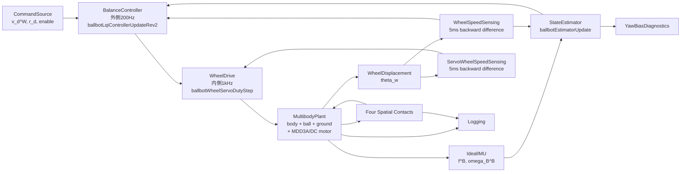
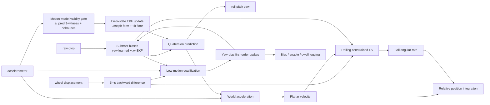

# 玉乗り3WDオムニローバー制御・推定アーキテクチャ

## 状態

| 項目 | 値 |
|---|---|
| ステータス | 実装済み（rev2 マルチレート正本） |
| 最終更新日 | 2026-10-22 |
| 対象モデル | `matlab_ws/ball_balancing_omni3/ball_balancing_omni3_multibody_lqi_rev2.slx` |
| 親仕様 | [システム仕様](ball_balancing_omnirover3wd-system.md) |

## 1. 機能分解



rev2 は制御器を**外側 200 Hz（5 ms）バランス/推定タスク**と**内側 1 kHz（1 ms）車輪サーボタスク**に分割し、Embedded Coder の「Treat each discrete rate as separate task」による NUCLEO-STM32G474RE へのマルチタスク実装を見据えた構成とする。輪速計測は 5 ms 窓を維持する（1 ms 後退差分はエンコーダー量子化 1 カウントあたり ±18.5 rad/s のフリッカーを生じ、逆起電力補償経由で duty にチャタリングを注入して保持を破壊する実績があったため）。`servoSampleTime=5 ms` へオーバーライドすれば単一レート（rev1 同等）動作となることを検証済みである。

## 2. モデル階層

```text
ball_balancing_omni3_multibody_lqi_rev2.slx
├── CommandSource                          % ballbotRev1CommandProfile
│   ├── CommandProfile                     %   指令プロファイル生成
│   ├── Enable                             %   制御有効入力
│   ├── LogCommand                         %   指令ログ
│   └── SimulationTime
├── Controller
│   ├── WheelSpeedSensing                  % 推定/外側制御用 輪速検出（5ms）
│   │   ├── WheelRateInputs                %   変位・前回値の束ね
│   │   ├── WheelRateCalculation           %   ballbotWheelRateFromDisplacement
│   │   └── PreviousWheelDisplacement      %   前回変位メモリ
│   ├── ServoWheelSpeedSensing             % 内側サーボ用 輪速検出（5ms窓維持）
│   │   └── （WheelSpeedSensing と同構成）
│   ├── StateEstimator                     % 14状態推定器（5ms）
│   │   ├── EstimatorInputs                %   推定器入力の束ね
│   │   ├── EstimatorUpdate                %   ballbotEstimatorUpdate
│   │   ├── EstimatorStateMemory           %   14状態メモリ
│   │   ├── SelectEstimate                 %   14幅推定バス（estimate 13要素+末尾未使用パッド）
│   │   ├── SelectNextEstimatorState       %   次回状態
│   │   └── SelectYawBiasDiagnostics       %   診断3信号
│   ├── BalanceController                  % 外側200Hzタスク（5ms）
│   │   ├── ControlInputs                  %   制御入力の束ね
│   │   ├── LqiController                  %   ballbotLqiControllerUpdateRev2
│   │   ├── LqiFeedbackInputs              %   LQIフィードバック入力の束ね
│   │   ├── LqiFeedbackState               %   ballbotLqiFeedbackState
│   │   ├── VelocityIntegralMemory         %   速度積分2状態メモリ
│   │   ├── SelectMode                     %   制御モード取出し
│   │   ├── SelectNextVelocityIntegral     %   次回速度積分取出し
│   │   ├── SelectServoExtra               %   サーボコンテキスト取出し
│   │   ├── SelectWheelSpeedCommand        %   輪速目標取出し
│   │   ├── SelectYawBiasReady             %   準備完了取出し
│   │   └── YawBiasReadyMemory             %   準備完了ラッチ
│   ├── WheelDrive                         % 内側1kHzタスク（1ms）
│   │   ├── SpeedPiDuty                    %   ballbotWheelServoDutyStep
│   │   ├── SpeedPiMotorInputs             %   コンテキスト・輪速・モードの束ね
│   │   ├── SelectDutyCommand              %   duty取出し
│   │   ├── SelectNextSpeedIntegral        %   back-EMFフィルタ状態取出し
│   │   └── SpeedIntegralMemory            %   back-EMFフィルタ状態メモリ
│   ├── ControlCycleDelay                  % 制御出力の1サンプル遅延
│   ├── TruthGate                          % ballbotTruthGate（診断用真値注入）
│   └── ControllerOutputMux / ControllerOutputDemux
├── MultibodyPlant
│   ├── Environment                        % World, SolverConfig,
│   │                                      % MechanismConfig, GroundFrame, GroundPlane
│   ├── Ball                               % BallFreeJoint, BallSolid,
│   │                                      % BallGroundContact, BallRollResFcn,
│   │                                      % 位置・姿勢・速度計測
│   ├── RoverChassis                       % RoverFreeJoint, ChassisSolid,
│   │                                      % PayloadRodMount+PayloadRod500g,
│   │                                      % Motor1..3Solid, 機体運動計測
│   ├── WheelAssembly1..3                  % WheelNMount, WheelNJoint, WheelNSolid,
│   │                                      % WheelNBallContact, DutyCmd→GateDemux
│   │                                      % →GateDrive(ballbotMdd3aGateDrive)
│   │                                      % →MddDriver→DriveMotor→WheelNJoint,
│   │                                      % WheelShaftFricFcn(輪軸摩擦),
│   │                                      % 変位・接触状態・法線力・すべり・
│   │                                      % 電流計測
│   ├── WheelDuty + DutyDemux              % 3輪dutyの物理信号化
│   ├── WheelNCustomFriction               % ballbotCustomFriction
│   │   + WheelNFrictionInputs             %   ＋摩擦入力束ね
│   │   + WheelNRotationVector             %   ＋回転方向成形
│   ├── IdealIMU + RoverImuMux             % ballbotImuFromJoint
│   ├── RoverPoseCalculation               % ballbotPoseFromJoint（機体真値）
│   ├── BallPoseCalculation                % ballbotPoseFromJoint（球真値）
│   └── 接触・輪変位・電流の計測変換群
└── Logging                                % Log* To Workspace
```

## 3. コンポーネントカタログ

| コンポーネント | 実装 | 入力→出力 | レート | DFT | 状態 |
|---|---|---|---:|---|---|
| CommandSource | Simulink Subsystem＋`ballbotRev1CommandProfile.m` | 定数/プロファイル→$v_d^W,r_d,enable$ | 5 ms | Yes | なし |
| WheelSpeedSensing | `ballbotWheelRateFromDisplacement.m`＋Memory | $\theta_w[k],\theta_w[k-1]\rightarrow\omega_w[k]$ | 5 ms | Yes | 前回変位3 |
| ServoWheelSpeedSensing | 同上 | 同上（内側サーボ専用、5 ms 計測窓） | 5 ms | Yes | 前回変位3 |
| StateEstimator | `ballbotEstimatorUpdate.m`→`ballbotEstimatorStep.m`＋Memory＋Selector | IMU,輪速→$\hat z$(14)、診断3信号 | 5 ms | Partial | 推定14状態＋EKF共分散5 |
| BalanceController | `ballbotLqiControllerUpdateRev2.m`＋`ballbotLqiFeedbackState.m`＋Memory＋Selector | $\hat z$,指令,輪速,診断→姿勢トルク(3),輪速目標(3),速度積分(2),mode,ready,settle,enable | 5 ms | Partial | 速度積分2・準備完了1・各種フィルタ状態 |
| WheelDrive | `ballbotWheelServoDutyStep.m`＋Memory | 姿勢トルク,輪速目標,輪速,mode→duty(3),filteredSpeed(3) | 1 ms | Partial | back-EMFフィルタ3・ランプ時計 |
| Environment | World Frame＋Solver Configuration＋Mechanism Configuration＋Infinite Plane | 基準座標・重力・床面 | 連続 | No | なし |
| Ball | Spherical Solid＋6-DOF Joint＋Spatial Contact Force＋`ballbotRollingResistance.m` | 接触力・転がり抵抗→球6DoF | 連続 | No | 球状態 |
| RoverChassis | Simscape Multibody剛体＋6-DOF Joint | 接触・輪反力→機体6DoF | 連続 | No | 剛体状態 |
| WheelAssembly1..3 | Revolute Joint＋Solid＋Spatial Contact Force＋`ballbotMdd3aGateDrive.m`＋MDD3A Hブリッジ＋DC Motor＋`ballbotShaftFrictionTorque.m` | duty→輪トルク・車輪運動 | 連続＋1 ms（GateDrive） | No | 車輪状態・電機子状態 |
| BallGroundContact | Spatial Contact Force | 球・床幾何→接触力 | 連続 | Yes | ペナルティ接触 |
| WheelNBallContact | Spatial Contact Force＋`ballbotCustomFriction.m` | 幾何・すべり→異方性接触力 | 連続 | Yes | ペナルティ接触 |
| IdealIMU | `ballbotImuFromJoint.m`→`ballbotIdealImu.m` | 機体運動→比力・角速度（LSM6DSOノイズ・量子化・バイアス付き） | 連続→5 ms | Yes | なし |
| WheelDisplacement | Revolute Joint position sensing＋PS-Simulink変換 | 車輪運動→$\theta_w$（341.2 PPR量子化） | 連続→5 ms | Yes | なし |
| Logging | To Workspace | 真値・制御信号→timeseries | 連続/5 ms/1 ms | Yes | ログのみ |

## 4. 物理プラント

### 4.1 一般化運動方程式

$$
M(q)\ddot q+C(q,\dot q)\dot q+g(q)
=S^T\tau_w+J_c(q)^TF_c
$$

| 記号 | 定義 |
|---|---|
| $q$ | 機体、ボール、3輪のMultibody一般化座標 |
| $S$ | 3輪Revolute Jointの入力選択行列 |
| $J_c$ | 球–床と3組の輪–球の接触ヤコビアン |
| $F_c$ | 法線力と接線摩擦力 |

$\tau_w$ はDCモータ電気式から生成する駆動トルクであり、理想トルク源ではない。

### 4.2 駆動系（FIT0521＋MDD3A）

各 WheelAssembly 内の電気チェーン:

$$
V_{cmd}=\operatorname{sat}(d_i,\pm d_{max})V_s,\qquad
d_{max}=V_{rated}/V_s=6/7.2\approx0.833
$$

$$
V_{motor}=V_{cmd}-(R_{br,on})I,\qquad
I=\frac{V_{motor}-K_e\omega_w}{R_a+sL_a}
$$

$$
\tau_w=K_tI-B_{visc}\omega_w-\tau_{shaft}(\omega_w)
$$

| パラメーター | 値 | 根拠 |
|---|---:|---|
| モータ | DFRobot FIT0521（6 V定格、減速比34.02、無負荷210 rpm出力） | 実機選定 |
| $R_a$ | 1.875 Ω | 公称諸元（$V_s/I_{stall}$） |
| $K_t$ | 0.3065 N·m/A | 出力軸トルク定数（減速比込み） |
| $K_e$ | 0.2618 V·s/rad | 出力軸逆起電力定数 |
| $L_a$ | 5 mH | 電機子インダクタンス |
| ブリッジ抵抗 $R_{br,on}$ | 0.35 Ω | MDD3A Hブリッジ通過抵抗 |
| 駆動不感帯（植物側） | `drive.deadzonePlantPos/Neg`（輪別・方向別、実測同定値） | duty域クリップとして`ballbotMdd3aGateDrive`が印加 |
| 輪軸摩擦 | Coulomb 0.0199 N·m・静止（breakaway）0.0239 N·m | `ballbotShaftFrictionTorque`（augment追加） |

MDD3AのPWM/方向ロジック（論理High 5 V、enable/reverse/brake閾値 2.5 V）とブリッジON/OFF抵抗は `ballbotMdd3aGateDrive` がゲート信号へ変換する際に適用する。デューティ域の駆動系不感帯は同関数がプラント側不感帯として印加する（制御側補償は `drive.deadzoneCompPos/Neg`、§6.4参照）。

### 4.3 ペナルティ接触

$$
F_n=s(d,w)\max(k_nd+c_n\dot d,0)
$$

$$
F_{t,d}=-\mu_dF_n\tanh\left(\frac{v_d}{v_c}\right),\qquad
F_{t,r}=-\mu_rF_n\tanh\left(\frac{v_r}{v_c}\right)
$$

| 接触 | $k_n$ [N/m] | $c_n$ [N/(m/s)] | $\mu_s=\mu_d$ | $\mu_r$ | 実装 |
|---|---:|---:|---:|---:|---|
| ホイール–ボール | $1.36\times10^{4}$（膜$3\times10^4$∥ローラー層$2.5\times10^4$直列） | 170 | 2.0 | 0.02 | `ballbotCustomFriction.m` |
| ボール–床 | $3.0\times10^{4}$ | 500 | 1.2 | 1.2 | Smooth Stick-Slip |

球–床には転がり抵抗（係数`p.contact.ballGround.rollingFriction`、公称0.008、臨界速度0.005 m/s、スピンスクラブモデル付き）を `ballbotRollingResistance` が External Force and Torque として印加する（`ballbotRev1PlantAugment` 実行時追加）。

### 4.4 球面駆動幾何

$$
{}^B\tau_b=A_\tau\tau_w,\qquad
A_\tau=\frac{R_b}{R_w}
\begin{bmatrix}{}^Ba_1&{}^Ba_2&{}^Ba_3\end{bmatrix}
$$

$\lambda=33$ deg（案B内向きモーター格納の幾何学的成立限界）、$\beta_i=[0,120,240]$ degで $\operatorname{rank}(A_\tau)=3$。

### 4.5 センサー実機化

| センサー | モデル化 | 主値 |
|---|---|---|
| IMU（LSM6DSO相当） | ノイズ密度・量子化・バイアス注入 | ジャイロ 3.8 mdps/√Hz・±2000 dps量子化、加速度 75 µg/√Hz・±4 g量子化 |
| エンコーダー | 変位の量子化 | 341.2 PPR（出力軸）、量子化幅 0.0184 rad |

## 5. 状態推定

| 推定器状態 | 次元 | 更新 |
|---|---:|---|
| $q_{WB}$ | 4 | ジャイロ積分＋誤差状態EKFによる姿勢誤差注入 |
| ${}^Wv_B$ | 3 | 比力のワールド変換と積分（リーク付き）、平面拘束 |
| ${}^W\omega_K$ | 3 | 車輪回転変位の微分値・機体速度・球転がり拘束の正則化最小二乗 |
| ${}^Bp_{B/K,xy}$ | 2 | 機体速度–球中心速度の積分（リーク・上限付き） |
| $\hat b_{g,z}$ | 1 | 認定済み低運動区間だけ一次遅れ更新、飽和・更新量制限 |
| $t_{qual}$ | 1 | 低運動候補の連続成立時間、候補不成立で0 |
| （EKF内部）$\delta\theta,\delta b_{g,xy}$ | 5 | 誤差状態共分散伝播・Joseph形更新（ロール/ピッチ軸バイアスオンライン推定） |



同一サンプル内の順序は、バイアスによるジャイロ補正、EKF予測・更新、姿勢・運動学の計算、低運動判定、次回用バイアス更新とする。バイアス更新は1サンプル状態を介するため、代数ループを形成しない。

## 6. 制御

制御器は**トルク入力LQI**を中核とし、外側 200 Hz タスクが姿勢トルク・運動学的輪速目標・モードを生成し、内側 1 kHz タスクが推進輪速サーボとDCモータ式duty反転を行う。

```mermaid
flowchart LR
  EST[estimate 13] --> MM[Mode manager<br/>0 terminal/1 balance/2 recovery<br/>+elevated authority]
  CMD[v_d^W r_d] --> CL[Coupled v/yaw wheel-rate budget]
  CL --> CH[Follow-through chase<br/>stopFollow/settleFollow]
  EST --> CH
  CH --> LL[Lean-demand outer loop<br/>velocityLeanGain+FF+guards]
  MM --> LQI[Torque LQI<br/>10-state robust fixed gain]
  LL --> LQI
  EST --> LQI
  LQI --> AT[attTorque 3]
  LQI --> WRC[wheelRateCommand 3]
  AT --> SUM[+]
  WRC --> SERVO[Propulsion rate servo<br/>P + headroom share]
  ENC[filteredWheelRate 1kHz task] --> SERVO
  SERVO --> SUM
  SUM --> LIM[torque limit<br/>traction/recovery]
  LIM --> DUTY[duty = (R I + Ke w)/Vs]
  DUTY --> DZ[FR-16 deadzone comp]
  DZ --> CLAMP[±maxDutyCycle]
  CLAMP --> OUT[duty 3]
```

起動直後は`YawBiasReadyMemory=0`とし、$\gamma=1$かつ$|\hat r|\le0.002$ rad/sで1へラッチする。ラッチ前はヨー速度指令だけを0とし、速度追従と傾斜安定化は動作を継続する。明示的な非ゼロヨー指令は起動抑止をバイパスするが、車輪運動によりバイアス学習条件は不成立となる。

### 6.1 信号流れ（外側タスク）

| 段 | 計算 | 実装 |
|---|---|---|
| モード管理 | FALLEN(0,終端)/RECOVERY(2)/BALANCE(1)とヨーバイアス準備完了ラッチ、elevatedAuthority管理 | `ballbotLqiControllerUpdateRev2`→`ballbotYawBiasStartupGuard` |
| 指令成形 | 結合(v, yaw)輪速予算リミッタ、maxSpeed制限、フォロースルーチェイス（指令<ボール速度時にボール追従） | 同上 |
| 速度積分 | ボール速度誤差の条件付き積分（デッドゾーン・リーク・非対称アンワインド。現行は出力非接続の休眠経路） | 同上 |
| 状態組立て | $x=[v_{ball}^B(2);\theta,-\phi;q,-p,r;\omega_w(3)]$（10状態、フィルタ済みレート使用） | `ballbotLqiFeedbackState`＋同上 |
| リーン外側ループ | 速度誤差→リーン整定点（P＋加速度FF＋転がり抵抗FF）、リーン上限・スルー制限・コーンフェード・偏心ガード・コーストゲート・settle専用ゲイン | 同上 |
| 静的リーン適応 | CGオフセット由来ドリフトのリーン整定点バイアス学習（指令0時のみ注入） | 同上（`staticLeanAdapt*`） |
| ヨーチャネル | 指令ゲート付きヨーレート状態、受動ヨーダンパー、ボールzスピンブレーキ | 同上 |
| LQIフィードバック | $\tau_{att}=-K_{10}x$（ロバスト固定ゲイン） | `ballbotRobustTorqueGains`設計値 |

出力レイアウト（12要素、1–7はrev1互換）: `[attTorque(1:3); velocityIntegral(4:5); mode(6); yawBiasReady(7); wheelRateCommand(8:10); settleWitness(11); enable(12)]`。

### 6.2 信号流れ（内側タスク）

| 段 | 計算 | 実装 |
|---|---|---|
| back-EMFフィルタ | 輪速の一次遅れ（時定数1 ms、5 ms計測窓の実測輪速を平滑） | `ballbotWheelServoDutyStep` |
| 推進輪速サーボ | $\tau_{prop}=\operatorname{sat}(K_{prop}(\omega_{w,d}-\hat\omega_w))$、トルクヘッドルーム配分＋最小シェア保証、mode=1のみ・settle中0 | 同上 |
| トルク合成・制限 | $\tau=\operatorname{sat}(\tau_{att}+\tau_{prop},\pm\tau_{lim})$ | 同上 |
| duty反転 | $d=(R_a+R_{br})I+K_e\hat\omega_w)/V_s$、$\pm d_{max}$クランプ | 同上 |
| FR-16補償 | duty符号別デッドゾーン補償加算（ファーム `wheel_servo.cpp` 同等）、再クランプ | 同上 |
| 起動ランプ | `startupTorqueRampTime`（0.4 s）で推進項をソフトスタート | 同上 |

### 6.3 フィードバック極性

| 偏差 | 正の状態 | 必要な球運動 | 制御式の向き |
|---|---|---|---|
| $\theta-\theta_d>0$ | 機体上端が$+X_B$へ傾斜 | 球を$+X_B$側へ転がす | 状態は$[\theta]$で統一 |
| $\phi-\phi_d>0$ | 機体上端が$-Y_B$へ傾斜 | 球を$-Y_B$側へ転がす | 状態は$[-roll]$で統一 |
| $r_d-r>0$ | 正ヨー速度不足 | 3輪を同相に回す | コモンモードトルク（指令時のみ有効） |

### 6.4 デッドゾーン補償（FR-16）

駆動系には輪別・方向別のデューティ域不感帯が存在し（掃引同定値、プラント側は`drive.deadzonePlantPos/Neg`）、制御側は`drive.deadzoneCompPos/Neg`の同定値を符号別にdutyへ加算する。mode 0 では補償・駆動とも0。残留不感帯のオンライン適応PoC（`ballbotDeadzoneAdaptStep`）は名目的動作でもcompがラチェットして転倒したため実運用パスから除去済み（PoCとしてファイルのみ保持）。

### 6.5 代替パス

`p.controller.fullplant.enabled=true` で旧階層制御（`ballbotFullPlantHierarchyUpdate`）へディスパッチできるが、現行既定はトルクLQIであり、階層制御は実験経路としてのみ保持する。`p.controller.torqueDrive.enabled=false` かつ階層無効の場合は `ballbotLqiControllerUpdate` 系の輪速指令LQI経路となる（rev1互換のフォールバック）。

## 7. 数値設計

| 懸念 | 対策 |
|---|---|
| 接触剛性による高速モード | 最大ステップ$10^{-4}$ s（`ballbotRev1SimConfig`適用時 $10^{-3}$）、接触遷移幅$5\times10^{-4}$ m |
| 接触開始時の不連続 | Smooth Spring-Damper、ゼロクロス検出 |
| 接触摩擦DFTループ | 接触ブロックの物理信号解法に閉じ、離散制御ループはMemory/レート分離で切断 |
| 推定最小二乗の特異性 | $H^TH+10^{-8}I$ |
| クォータニオンノルム | 毎ステップ正規化 |
| 加速中の重力方向誤補正 | 運動モデル3証人によるEKF更新可否判定＋0.30 sデバウンス（残差注入は全変種で悪化のため不採用） |
| 一時停止によるバイアス誤学習 | 5条件の連続0.50 s成立後だけ更新 |
| 閾値近傍のチャタリング | 認定後に1.25倍の退出側閾値を使用 |
| 旋回・すべり中の誤学習 | 車輪角速度・比力・機体角速度ゲートで即時停止し、バイアスを保持 |
| バイアス外れ値 | ±0.10 rad/s飽和と$1.0\times10^{-4}$ rad/s/サンプル更新制限 |
| エンコーダー量子化フリッカー | 輪速計測は5 ms窓、サーボ入力はback-EMFフィルタ、レート/輪速状態はLPF、スリップデッドゾーン |
| 駆動不感帯 | FR-16符号別補償（§6.4） |
| 解釈実行persistent残留 | 検証スクリプトが`clear functions`を実行し同一条件を再現 |

## 8. パラメーター管理

| 項目 | 方針 |
|---|---|
| 格納 | `ballbotRev1Parameters.m` が構造体 `p` を生成（基礎値は `ballbotFullPlantParameters.m`→`ballbotParameters.m`、実行時付加は `ballbotRev1PlantAugment.m`） |
| モデル変数 | `ballbotParams`（モデルワークスペース、`PreLoadFcn`/`InitFcn`が自動再構築） |
| 引数 | `ballbotRev1Parameters(payloadMass, sampleTime, designOverrides)` でペイロード・離散周期・設計ノブ（`design.contactLatitude`等）を一貫再構築 |
| チューニング可能 | 接触摩擦・剛性、転がり抵抗、推定ゲイン、低運動閾値、バイアス時定数・上限・準備完了閾値、LQI重み、トルク・デューティ・リーン制限値、デッドゾーン補償値 |
| 固定 | 座標系、3輪番号、行列の符号規約 |
| 設計済みゲイン | `ballbotRobustTorqueGains.m`（実測B行列のペイロード族0–1 kgスケーリングでロバスト固定ゲイン選択）、`ballbotDesignTorqueLqi.m`/`ballbotDesignLqi.m` が起動時に再計算 |

## 9. 既知の制約

| 制約 | 影響 |
|---|---|
| 絶対位置と絶対ヨーは外部基準なし | 長時間ドリフトを閉ループで除去できない |
| エンコーダーは絶対ヨーを観測しない | バイアス補正後もヨー角は初期値からの積分値 |
| 走行中の機体ヨーとボール回転は常時分離不能 | 走行中はバイアスを学習せず前回値を保持 |
| オムニローラーを等価摩擦化 | 12ローラー切替による振動を再現しない |
| 持続ヨー回転は物理包絡外 | 総回転 ~0.4 rad/回以下のバーストに限定（システム仕様 §4） |
| 指令速度上限は実測 0.40 m/s | ≥0.5 m/sは低摩擦側で転倒、≥0.6 m/sは全摩擦で転倒（ボール追い越しを戻すブレーキが物理的に存在しない） |
| 輪速計測は5 ms窓に制約 | 量子化1カウント=±18.5 rad/sのフリッカーを1 ms差分は増幅するため |

## 付録A. 関連文書

- [システム仕様](ball_balancing_omnirover3wd-system.md)
- [状態方程式](ball_balancing_omnirover3wd-state-equations.md)
- [制御・状態推定理論](ball_balancing_omnirover3wd-control-estimation-theory.md)
- [検証計画・ロバスト性受け入れ試験](ball_balancing_omnirover3wd-test-plan.md)
- [仕様変更記録](ball_balancing_omnirover3wd-change-history.md)

## 付録B. API検証メモ

| API/ブロック | 確認内容 | 根拠 |
|---|---|---|
| Spatial Contact Force | 球/凸形状、Infinite Plane、分離、法線ペナルティ、Provided by Input摩擦、接触量出力 | [MathWorks公式](https://www.mathworks.com/help/sm/ref/spatialcontactforce.html) |
| Transform Sensor | 相対フレーム運動の理想計測 | [MathWorks Multibody Dynamics](https://www.mathworks.com/help/sm/multibody-dynamics.html) |
| `Simulink.SimulationInput` | StopTime等をモデル非破壊で上書き | 本ワークスペースのシミュレーション実行方法 |
| `ballbotWheelGeometry` | $A_\tau$のランク3 | MATLAB R2026aで実行確認 |
| `ballbotEstimatorStep` | 静止入力で状態変化0 | MATLAB R2026aで実行確認 |
| `ballbotEstimatorStepTest` | バイアス学習・抑止・上限・再開・起動ガード・インターフェース回帰 | MATLAB R2026aで16件合格 |
| `ballbotParametersTest` | パラメーター整合性 | MATLAB R2026aで3件合格 |
| MDD3A/DC Motor（Simscape Electrical） | duty→ゲート→ブリッジ→モータトルクの回路 | モデル内検証 |
| 実行時ブロック追加 | 転がり抵抗・輪軸摩擦は`ballbotRev1PlantAugment`で冪等追加（.slx は R2024b 形式維持） | InitFcn経由で毎Run再適用 |
