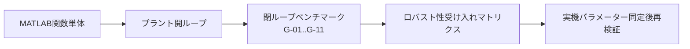

# 玉乗り3WDオムニローバー検証計画・ロバスト性受け入れ試験

## 状態

| 項目 | 値 |
|---|---|
| ステータス | 実装一致版（rev2 対応） |
| 最終更新日 | 2026-10-22 |
| 対象モデル | `matlab_ws/ball_balancing_omni3/ball_balancing_omni3_multibody_lqi_rev2.slx` |
| 親仕様 | [システム仕様](ball_balancing_omnirover3wd-system.md) |

## 1. 検証段階



| 段階 | 合格ゲート | 実装 |
|---|---|---|
| A. MATLAB関数 | 幾何、推定、バイアス学習、パラメーター整合 | `ballbotEstimatorStepTest`、`ballbotParametersTest` |
| B. プラント開ループ | 接触・重力・符号の整合 | §3 |
| C. 閉ループベンチマーク | 6シナリオの G-01..G-11 採点 | `ballbotBenchmark`、§4 |
| D. ロバスト性 | §5 の受け入れマトリクス全項目 | `deadzoneAcceptance`、`deadzoneSweep`、`scratch_ksweep` |

## 2. MATLAB関数検証

`matlab_ws/ball_balancing_omni3/tests/` のクラスベース試験として実装済み。

| ID | 対象 | 内容 | 現状 |
|---|---|---|---|
| U-01..U-16 | `ballbotEstimatorStepTest` | バイアス学習・抑止・上限・再開・起動ガード・インターフェース回帰 | 16件合格 |
| U-17..U-19 | `ballbotParametersTest` | パラメーター構造体の整合・設計依存量の再構築 | 3件合格 |

実行: `runtests('ballbotEstimatorStepTest')`、`runtests('ballbotParametersTest')`。

## 3. プラント開ループ

### 3.1 接触静力学

| ID | 初期条件 | 入力 | 観測 | 合格条件 |
|---|---|---|---|---|
| P-01 | 公称直立 | 全輪duty 0 | 3輪法線力 | 各輪 `p.wheel.normalLoadNominal`（11.2 N）の±20% |
| P-02 | 公称直立 | 全輪duty 0 | 球–床法線力 | $(m_R+m_b)g$ の±10% |
| P-03 | 公称直立 | 全輪duty 0 | 貫通量 | 各接触1 mm未満 |
| P-04 | 公称直立 | 全輪duty 0 | 接触信号 | 4接触すべて1 |

### 3.2 駆動符号

| ID | 入力 | 期待運動 | 合格条件 |
|---|---|---|---|
| P-05 | duty(1) = +0.05 | 球を駆動方向へ転がす | 接触法線力・球速度の符号整合 |
| P-06 | 3輪同相 duty +0.05 | 機体 $+Z_W$ ヨー加速 | $\dot r_B>0$ |

## 4. 閉ループベンチマーク（基本受け入れ試験）

`ballbotBenchmark(scenario, tag, ov, sampleTime, model)` がシナリオを実行し、G-01..G-11 指標を採点して要約行を出力する。既定モデルはrev1のため、rev2 検証では第5引数に `'ball_balancing_omni3_multibody_lqi_rev2'` を渡す。実行は決定論的（パラメーター再生成＋`clear functions` によるpersistentリセット）。

### 4.1 シナリオ定義

| シナリオ | 指令/条件 | 時間 | 対象指標 |
|---|---|---:|---|
| `hold` | ゼロ指令 | 5 s | G-01, G-06, G-08 |
| `stepX` | $v_x:0\to0.10$ m/s（ワールドX） | 15 s | G-02, G-08 |
| `yaw` | 0.4 rad/s×1.5 sバウンドパルス | 10 s | G-03 |
| `cycle` | 移動12 s→停止4 s×3周期（採点はヨー無しにピン留め） | ~50 s | G-01, G-04, G-05, G-06, G-07, G-08 |
| `bias` | ヨージャイロバイアス +0.02 rad/s 注入保持 | 20 s | G-09, G-10, G-11 |
| `moveYaw` | 0.15 m/s X + 0.4 rad/s×1.0 sパルス | 10 s | G-02, G-03 |

### 4.2 合格基準（G-01..G-11）

| ID | 指標 | 合格条件 | 採点式 |
|---|---|---|---|
| G-01 | 姿勢保持 | 最大傾斜 ≤1 deg かつ転倒なし | `maxTilt≤1° && tipTime=NaN` |
| G-02 | 速度整定誤差 | 絶対値 ≤0.01 m/s | `\|settleErr\|≤0.01` |
| G-03 | ヨー速度誤差 | 絶対値 ≤0.05 rad/s | `\|yawErr\|≤0.05`（パルス窓平均） |
| G-04 | 3輪接触率 | ≥0.99 | `mean(all(wheelContact))≥0.99` |
| G-05 | 球–床分離 | 0 s（最大浮遊高さは記録） | `separationTime=0` |
| G-06 | 推定姿勢誤差 | ≤0.5 deg | `maxEstTiltErr≤0.5°` |
| G-07 | 推定速度誤差 | RMS ≤0.02 m/s | `rmsEstVelErr≤0.02` |
| G-08 | アクチュエーター制約 | duty飽和（\|d\|≥0.999）なし、最大duty・輪速を記録 | `~dutySaturated` |
| G-09 | ヨーバイアス収束 | 終端誤差 <0.002 rad/s（収束時間を記録） | `\|biasErrEnd\|<0.002` |
| G-10 | 学習後ヨードリフト | <0.5 deg | `yawDrift<0.5°` |
| G-11 | 運動中誤学習 | バイアス変化を記録 | 診断観察 |

指標の信号が得られない場合は NaN として未採点とする。`moveYaw` は結合リミッタの評価シナリオであり、G-02/G-03 を共用する。

### 4.3 現在のベースライン（λ=33°・Fusion実測質量モデル・rev1/rev2共通プラント）

| シナリオ | 結果 |
|---|---|
| hold | 7/7（maxTilt 0.157°） |
| cycle（ヨー無し採点） | 完走 49.5 s・6/8（G-02 -0.051・G-07 0.025 が閾値未達、転倒なし・tilt 0.838°・contact 1.000・sep 0・duty 0.24） |
| stepX | 7/8 |
| yaw（バウンドパルス） | 5/8 |
| bias | 6/8 |
| CG-20mm | 6/7 |
| moveYaw | 5/9 |

※ cycle 既定プロファイル（隔周期 0.1 rad ヨーバースト込み）は 49.5 s 完走・maxTilt 1.295°・採点 4/8（全て閾値マージン系・転倒なし）。

**回帰ゲート**: パラメーター・制御コードの変更後は hold/cycle/stepX/bias の4シナリオを最低限再実行し、転倒なし・採点がベースラインを下回らないことを合格とする。`scratch_cycle`/`scratch_hold`/`scratch_speed`/`scratch_lean10b` はシナリオ個別実行の補助スクリプト（`ballbotRev1SimConfig` 適用が必須 — 未適用ではブリッジ式切替の代数例外でソルバーが実質停止する）。

## 5. ロバスト性受け入れ試験

ロバスト性は**変更のたびにマトリクス全体を再実行**して担保する。各セルは §4 の採点基準を適用し、転倒しないことを必須合格条件とする（性能劣化は記録して傾向管理）。

### 5.1 デッドゾーン受け入れマトリクス（`deadzoneAcceptance`）

駆動系デッドゾーンの補償効果を検証する。`deadzone_acceptance_results.mat` へ逐次保存。

| 構成 | 設定 | シナリオ |
|---|---|---|
| `nodz` | 補償OFF・プラント不感帯0（ベースライン） | hold/stepX/yaw/cycle |
| `dz_comp` | 補償ON・プラント不感帯=同定値（出荷構成） | 同上 |
| `dz_nocomp` | 補償OFF・プラント不感帯=同定値（無補償比較） | 同上 |

**合格条件**: `dz_comp` が `nodz` と同等の採点を維持し、`dz_nocomp` より劣化しないこと。転倒は不合格。

### 5.2 デッドゾーン不整合スイープ（`deadzoneSweep`）

補償値は同定値で固定し、**プラント側**不感帯を変動させて個体差・摩耗・方向非対称を再現する（補償が追従できない実在ミスマッチ）。hold＋stepX を実行し `deadzone_sweep_results.mat` へ保存。

| ケース | プラント不感帯 | 目的 |
|---|---|---|
| `scale0.5/0.75/1.25/1.5/2.0` | 同定値の一様スケール | 過不足補償の限界 |
| `wheel1x2` | wheel1 のみ2倍 | 単輪偏り |
| `dirSkew` | 正回転1.5倍・負回転0.5倍 | 方向非対称 |

**合格条件**: 全ケース転倒なし。採点・性能劣化は記録する（実測: 不足補償 +25% で転倒・過補償 2 倍は性能劣化のみ — 不足方向が脆弱）。

### 5.3 接触剛性スイープ（`scratch_ksweep`）

輪–球・球–床両接触に同一剛性 $k$ を適用し、減衰は各接触質量（輪 ~0.5 kg、床 ~2.1 kg 等価）で臨界整合する。`ksweep_summary_<tag>.txt` を出力。

| 剛性点 | シナリオ | 合格条件 |
|---|---|---|
| $k\in\{1\times10^{4},3\times10^{4},6\times10^{4}\}$ N/m（＋設計点1.36e4） | hold 5 s、cycle 50 s、0.40 m/s定速、10°ロール | 全点で hold・v040 完走。cycle・roll10 の生存時間を記録 |

**合格条件**: hold 5 s と 0.40 m/s 定速は全剛性点で完走（必須）。cycle・10°ロールは生存時間を記録し、新たな崖（保持時間の非連続な縮小）を検出した場合は原因を評価してから採用可否を判断する（実測: 3e4 以上で 10° 保持が ~13 s の崖に落ちる非単調特性を確認済み — ローラー剛性のベンチ実測で設計点を裏付ける課題がある）。

### 5.4 転がり抵抗帯スイープ

床想定をフローリング〜短毛絨毯の $r_f\in\{0.005,0.008,0.015\}$ で変動させる。

| 指令速度 | 合格条件 |
|---|---|
| 0.12 m/s サイクル | 全帯で完走・転倒なし |
| 0.40 m/s 定速 | 全帯で完走・転倒なし（追従誤差・惰行平衡のバイアスは記録） |
| ≥0.5 m/s | 包絡外（低摩擦側で転倒し得る — 実施しても不合格としない） |

### 5.5 ペイロード族・CGオフセット・床傾斜

| 試験 | 設定 | 合格条件 |
|---|---|---|
| ペイロード族 | `ballbotRev1Parameters(payloadMass)` で 0–1.0 kg | ロバスト固定ゲインの設計範囲内で hold 完走・転倒なし |
| CGオフセット | `p.fullplant.payload.lateralOffset`=10/15/20 mm | `staticLeanAdapt` により5 s保持・平衡リーンへ整定 |
| 床傾斜 | `p.simulation.floorSlopeDeg`=1°（2°以上は包絡外） | 保持・転倒なし |
| 初期傾斜起立 | `p.rover.initialEulerWorld`、5–10°・6方位 | 10°純粋ロールは ~39 s 保持（現構成実績） |
| IMUバイアス注入 | ヨーバイアス +0.02 rad/s（`bias`シナリオ相当） | G-09..G-11 |

### 5.6 数値・再現性

| 試験 | 設定 | 合格条件 |
|---|---|---|
| ノイズシード変動 | `p.imu.noiseSeed` を複数点 | hold/cycle で転倒なし（採点変動は記録 — 境界近傍のシナリオはシード依存を許容） |
| ソルバー感度 | MaxStep $10^{-4}$↔$10^{-3}$（`ballbotRev1SimConfig`） | 同一シナリオで結果が有意に変わらないこと |
| persistentリセット | `clear functions` 前後 | 検証スクリプトは必ず `clear functions` を実行（解釈実行ブロックのpersistent残留で転倒時刻が変わる既知問題） |
| rev1/rev2等価性 | `servoSampleTime` を 5 ms へオーバーライド | rev1 と同一タイミングで一致 |

### 5.7 明示的な包絡外領域

以下は物理包絡外として試験対象から除外し、指令側・運用側で制限する。

| 領域 | 実測限界 | 対処 |
|---|---|---|
| 指令速度 ≥0.5 m/s | 低摩擦側で転倒、≥0.6 m/sは全摩擦で転倒（ボール追い越しを戻すブレーキが物理的に存在しない。滑り限界~0.71・幾何上限~0.81 m/sはハードウェア上界） | `maxSpeed=0.40` で指令制限 |
| 持続ヨー回転 | 連続0.2–0.5 rad/sで2.6–3.4 s転倒（ボールzスピンポンプ→脱輪） | 総回転 ~0.4 rad/回以下のバーストに限定（cycle は `cycleYawEvery=2`・0.1 rad/窓） |
| 床傾斜 ≥2° | 斜面を転がり落ちる | 平坦床の運用条件 |
| 10°ロール・高剛性接触 | 接触剛性3e4以上で保持 ~13 s の崖（帯域でなく内力ブレーキ不能の惰性走行が機構） | 接触剛性のベンチ実測で設計点を裏付け |

## 6. ログ

| ログ名 | 内容 |
|---|---|
| `roverPose` | $x,y,z,\phi,\theta,\psi$ |
| `ballPose` | 球中心位置・姿勢 |
| `imuMeasurement` | 比力・角速度（LSM6DSOノイズ・量子化・バイアス付き） |
| `wheelDisplacement` | エンコーダーが直接計測する3輪回転変位（341.2 PPR量子化） |
| `wheelDuty` | 3輪PWM duty |
| `motorCurrent` | 3輪モータ電流 |
| `estimatedState` | 14幅推定バス（estimate 13要素+末尾未使用パッド） |
| `controllerMode` | 0/1/2 |
| `estimatedYawGyroBias` | $\hat b_{g,z}$ [rad/s] |
| `yawBiasLearningEnabled` | $\gamma$ [0/1] |
| `lowMotionQualificationTime` | $t_{qual}$ [s] |
| `contactStatus` | 球–床+3輪–球 |
| `contactNormalForce` | 4接触法線力 |
| `contactSlip` | 4接触接線速度 |

## 7. 実行方法

```matlab
cd matlab_ws/ball_balancing_omni3

% 基本ベンチマーク（rev2 指定）
r = ballbotBenchmark('hold', 'rev2_hold', {}, [], ...
    'ball_balancing_omni3_multibody_lqi_rev2');

% ロバスト性マトリクス
deadzoneAcceptance('dz_comp');           % 出荷構成 × hold/stepX/yaw/cycle
deadzoneAcceptance('nodz');
deadzoneAcceptance('dz_nocomp');
deadzoneSweep();                          % プラント不感帯変動
scratch_ksweep(1e4); scratch_ksweep(3e4); scratch_ksweep(6e4);  % 接触剛性

% 個別シナリオ
scratch_cycle(50, 'tag');
scratch_hold;
scratch_speed('tag', 0.40, 0.008, 17.2); % 0.40 m/s定速・rf=0.008
scratch_lean10b('tag');                  % 10°ロール
```

全スクリプトは `ballbotRev1SimConfig`（MaxStep・MDD3A回生モード）を適用し、`sim` 前に `clear functions` を実行する。結果は `cycle_result_<tag>.mat`、`deadzone_acceptance_results.mat`、`deadzone_sweep_results.mat`、`ksweep_summary_<tag>.txt` へ逐次保存される。

## 8. 受け入れ判定の運用

| 変更区分 | 必須再実行 | 判定 |
|---|---|---|
| パラメーター値のみ | hold/cycle/stepX/bias | §4.3 ベースラインを下回らない・転倒なし |
| 制御器構造・ゲイン | §4 全シナリオ＋§5.1・§5.4 | 同上 |
| プラントモデル・接触/摩擦/質量 | §4 全シナリオ＋§5 全マトリクス | 同上 |
| ファームウェア連動（duty・デッドゾーン・サーボ） | §4 全シナリオ＋§5.1・§5.2 | 同上＋`wheel_servo.cpp` との対応確認 |

## 9. 関連文書

- [システム仕様](ball_balancing_omnirover3wd-system.md)
- [アーキテクチャ](ball_balancing_omnirover3wd-architecture.md)
- [制御・状態推定理論](ball_balancing_omnirover3wd-control-estimation-theory.md)
- [状態方程式](ball_balancing_omnirover3wd-state-equations.md)
- [仕様変更記録](ball_balancing_omnirover3wd-change-history.md)
