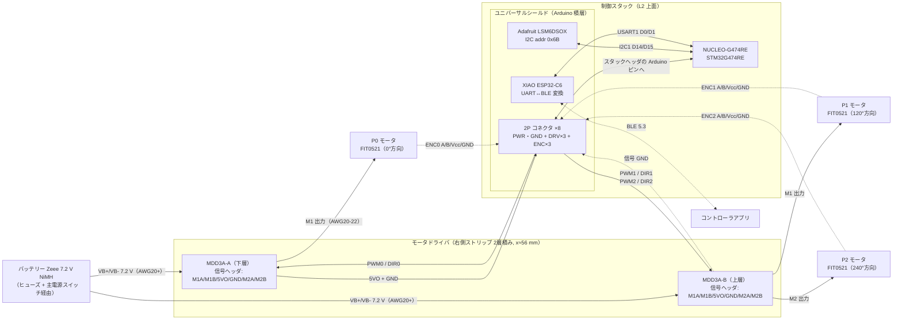
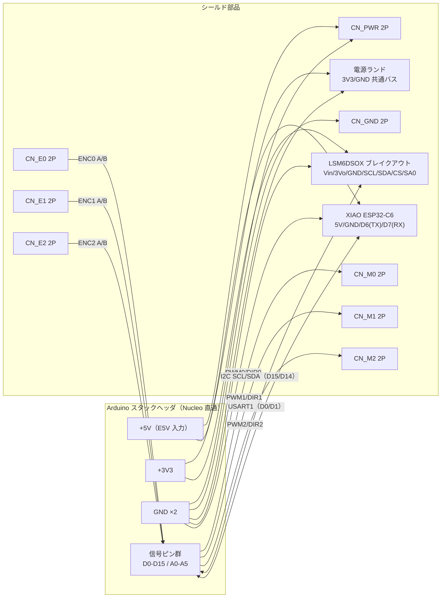

# Nucleoシールド 配線・実装図

作成日: 2026-11-18

NUCLEO-G474RE の Arduino コネクタに積層するユニバーサルシールドのコネクタ割当・配線、および IMU ブレイクアウトの実装位置を定義する。シールドには IMU（Adafruit LSM6DSOX ブレイクアウト）、XIAO ESP32-C6（UART-無線変換）、および 2P コネクタ（モーター駆動・エンコーダ信号をチャネルごとにまとめる）を実装する。IMU 以外の部品の物理配置は本書では規定せず、実装時に実物合わせで決定する。

参照する正本:

- ピンアサイン: `firmware_ws/ball_balancing_omni3_stm32/spec/requirements/hardware_config.md`
- ESP32 側ピンアサイン: `firmware_ws/uart_wireless_converter_esp32/spec/requirements/hardware_config.md`
- 電源・GND 方針・MD 配置: `wiring_specification.md`
- IMU の機体座標・実装穴位置: `nucleo_shield_imu_hole_alignment.md`

## 全体配線図

実線は電源・モーター電力経路、点線は信号 GND・エンコーダ等の小信号経路を示す。

## コネクタ割当

モーター駆動信号（PWM/DIR）とエンコーダ信号（A/B）は 2P コネクタにまとめてシールドへ実装する（ネジ式端子台は廃止）。1 組の信号は同一コネクタ内の隣接ピンに入り、さらにチャネル（モーター）ごとに ENC 用コネクタと駆動用コネクタを隣接させて、1 台分のハーネスを近傍で扱えるようにする。コネクタの型番・ピンピッチは実部品で確定する。

### コネクタ一覧（計 8 個・16 ピン）

| コネクタ | ピン順（1→2） | 信号 | 相手側ハーネス |
|---|---|---|---|
| CN_PWR | 1:+5V_IN、2:GND | MD-A 5VO 給電 | MDD3A-A 信号ヘッダ（5VO/GND） |
| CN_M0 | 1:PWM0、2:DIR0 | P0 駆動 | MDD3A-A M1A/M1B |
| CN_M1 | 1:PWM1、2:DIR1 | P1 駆動 | MDD3A-B M1A/M1B |
| CN_M2 | 1:PWM2、2:DIR2 | P2 駆動 | MDD3A-B M2A/M2B |
| CN_GND | 1:GND、2:GND | MD-B 信号 GND | MDD3A-B GND |
| CN_E0 | 1:A、2:B | P0 エンコーダ | FIT0521 ハーネス（A/B） |
| CN_E1 | 1:A、2:B | P1 エンコーダ | 同上 |
| CN_E2 | 1:A、2:B | P2 エンコーダ | 同上 |

- チャネル配置: 同一チャネルの ENC コネクタと駆動コネクタは隣接させ、1 台分のハーネスが近傍で完結するようにする。さらに P0（0°方向・MD-A 担当）の CN_E0・CN_M0・CN_PWR をひとまとめ、P1/P2（120°/240°方向・MD-B 担当）の CN_E1・CN_M1・CN_GND・CN_M2・CN_E2 をひとまとめにして、2 台のドライバへのハーネス引き回しを分離する。Arduino ピン側では MD-B 担当の信号が D5〜D12 の連続ブロックに収まる（M1=D5〜D8、M2=D9〜D12）。
- MD-A ハーネス（5VO・GND・M1A・M1B）は CN_PWR + CN_M0 の 4 ピンに、MD-B ハーネス（M1A・M1B・GND・M2A・M2B）は CN_M1・CN_GND・CN_M2 の 6 ピンに分岐する。MDD3A 側信号ヘッダのピン順と同じ並びにすると分岐が直線的になる。
- エンコーダの Vcc/GND はコネクタに含めず、従来どおりシールドの電源ランド（3V3/GND 母線穴）へ半田付けする。
- MD の MxA/MxB は正転/逆転（CW/CCW）2 入力である（H,L=正転 / L,H=逆転 / 同値=停止）。MxA・MxB とも PWM 駆動とし、duty の符号で駆動脚を切り替える（`hardware_config.md`、`mdd3a_motor.md`）。MxB 用の PWM ピンはエンコーダ占有タイマ（TIM1/2/3）を避けて選定済み（M0B=TIM8_CH1N、M1B=TIM15_CH1＝モルフォ CN10-28、M2B=TIM8_CH2）。
- FIT0521 の 6 芯ハーネスは、モーター線 2 本（M+/M-）を MDD3A のモーター出力端子へ、エンコーダ線 4 本をシールドへ分岐させる（A/B を CN_Ei へ、Vcc/GND を電源ランドへ）。
- 実装時はシールド外周寄りにコネクタを並べ、嵌合時の外形が基板縁や隣接部品と干渉しないことを実物で確認する。

## ピン対応表（Nucleo ↔ シールド内行き先）

| Arduino ピン | STM32 | 信号 | シールド上の行き先 |
|---|---|---|---|
| A0 | PA0 | ENC0_A（TIM2 CH1） | CN_E0-1 |
| A1 | PA1 | ENC0_B（TIM2 CH2） | CN_E0-2 |
| A2 | PA4 | 予備（未使用） | — |
| A5 | PC0 | 非常停止入力（EXTI） | 予備（外部 SW 用に残す） |
| D0 | PC5 | USART1 RX | XIAO D6（GPIO16 TX） |
| D1 | PC4 | USART1 TX | XIAO D7（GPIO17 RX） |
| D2 | PA10 | 予備（未使用） | — |
| D3 | PB3 | M0B（TIM8 CH1N、逆転PWM） | CN_M0-2 |
| D4 | PB5 | M0A（TIM17、正転PWM） | CN_M0-1 |
| D5 | PB4 | M1A（TIM16、正転PWM） | CN_M1-1 |
| D6 | PB10 | 予備（未使用） | — |
| D7 | PA8 | ENC1_A（TIM1 CH1） | CN_E1-1 |
| D8 | PA9 | ENC1_B（TIM1 CH2） | CN_E1-2 |
| D9 | PC7 | M2B（TIM8 CH2、逆転PWM） | CN_M2-2 |
| D10 | PB6 | M2A（TIM4、正転PWM） | CN_M2-1 |
| D11 | PA7 | ENC2_B（TIM3 CH2） | CN_E2-2 |
| D12 | PA6 | ENC2_A（TIM3 CH1） | CN_E2-1 |
| D13 | PA5 | 状態 LED | Nucleo 基板上 LED（配線不要） |
| D14 | PB9 | I2C1 SDA | IMU SDA |
| D15 | PB8 | I2C1 SCL | IMU SCL |
| CN10-28 | PB14 | M1B（TIM15 CH1、逆転PWM） | CN_M1-2 |
| +5V | — | E5V（5 V 入力） | CN_PWR-1、XIAO 5V ピン |
| +3V3 | — | 3.3 V 出力 | 電源ランド（ENC Vcc×3）、IMU Vin、IMU CS/SA0 |
| GND | — | 共通 GND | CN_PWR-2、CN_GND、電源ランド、IMU/XIAO GND（両ピン使用） |

- 注記: ボード回路図の「PMW」印は Arduino analogWrite 互換ピン（D3/D5/D6/D9/D10/D11）を示し、D4 には付いていない。ただし PB5 は STM32G474 の AF に TIM17_CH1 を持つため、Zephyr で TIM17 を直接駆動する本設計では D4 からの PWM 出力は電気的に有効（`nucleo_g474re.overlay` の `tim17_ch1_pb5`）。表記上の非対応を避けて PMW 印ピンへ揃える場合は、PWM0 を D6（PB10/TIM2_CH3）または D9（PC7/TIM3_CH2・TIM8_CH2）に移す選択肢があるが、`hardware_config.md` と overlay の変更を伴う。
- 注記: PWM ピンは空きタイマチャネルの制約で決まる（MxA: TIM17→D4、TIM16→D5、TIM4_CH1→D10。MxB: TIM8_CH1N→D3、TIM15_CH1→CN10-28、TIM8_CH2→D9）。駆動信号ペアがヘッダ上で隣接するよう配置（M0=D3+D4、M1=CN10-27+CN10-28、M2=D9+D10）。コネクタのピン順は全チャネル「1:MxA、2:MxB」で統一する。

## シールド内配線図

ネットとして整理すると次の 3 レール + 信号群になる。

- **+5V レール**: CN_PWR-1（MD-A 5VO 入力）→ Nucleo +5V ピン（E5V として給電）→ XIAO 5V ピンへ分岐。
- **3V3 レール**: Nucleo +3V3 ピン → 電源ランド（エンコーダ Vcc ×3 はここへ半田付け）、IMU Vin、IMU CS / SA0（High 固定）。
- **GND ネット**: Nucleo GND ピン 2 個を基準に、CN_PWR-2 / CN_GND / 電源ランド（ENC GND ×3）/ IMU GND / XIAO GND を共通接続する。
- **信号群**: ピン対応表の配線対象 16 本（PWM/DIR×6、ENC A/B×6、I2C×2、UART×2）。非常停止（A5）は予備として残す。

### IMU（LSM6DSOX）配線

9P 列（シルク左→右: Vin, 3Vo, GND, SCL, SDA, DO, CS, I1, I2）と 5P 列（SCX, SDX, CS, DO, GND）のうち、接続するのは次の通り。

| IMU ピン | 接続先 | 備考 |
|---|---|---|
| Vin | +3V3 レール | 基板上 LDO 経由で 3-5 V 対応。ロジック電源と同一にする |
| GND | GND ネット | 5P 列側の GND も同ネット（予備アンカーとして使える） |
| SCL | D15 / PB8 | I2C1。プルアップはブレイクアウト内蔵 |
| SDA | D14 / PB9 | 同上 |
| DO（9P 列） | +3V3 | SDO/SA0 兼用ピン。High → I2C アドレス 0x6B（overlay `reg=<0x6b>` と一致）。基板裏ソルダジャンパで代替可 |
| CS（9P 列） | +3V3 直結 | I2C モードを確定させるため High 固定（外付け抵抗は不要） |
| I1 / I2（INT1/INT2） | NC | 5 ms 周期ポーリングのため未使用 |
| 3Vo | NC | ブレイクアウト LDO 出力（予備） |
| 5P 列（SCX/SDX/CS/DO/GND） | NC | センサーハブ機能用。GND のみ必要に応じて利用 |

### XIAO ESP32-C6 配線

| XIAO ピン | 接続先 | 備考 |
|---|---|---|
| 5V | +5V レール | 内蔵レギュレータで 3.3 V 生成 |
| GND | GND ネット | |
| D6（GPIO16、UART0 TX） | Nucleo D0 / PC5（USART1 RX） | 115200 8N1 |
| D7（GPIO17、UART0 RX） | Nucleo D1 / PC4（USART1 TX） | DTS で bias-pull-up 済み |
| その他 D ピン / 3V3 | NC | |

## IMU 実装位置

IMU ブレイクアウトは機体原点に実装する（`nucleo_shield_imu_hole_alignment.md` を正本とする）。実装位置はユニバーサルシールドの 2.54 mm グリッド穴座標 (C, R) と機体座標 (x, y) の両方で指定する。はんだ付け時は基準穴から格子を数えて位置を決める。

- 機体座標（+X は P0 モータ方向、−Y は ST-LINK 側）: IMU センサー中心を原点 (0, 0) に固定。基板外形 25.4 × 17.78 mm（x = −12.7〜+12.7、y = −8.89〜+8.89）。
- グリッド穴座標: 基準穴 (0, 0) = IMU 9P 列（JP1）の中央穴（SDA）= 機体座標 (0, −6.35)。穴座標→機体座標の換算は **x = 2.54×C mm、y = 2.54×R − 6.35 mm**。
- 向き: シルク面を上、VIN 側を −X に向ける（180° 回転する場合は全 C 座標の符号が反転する点に注意）。JP1（9P 列）= R=0、JP2（5P 列）= R=+5。

| 穴 (C, R) | 機体座標 (x, y) mm | リード | 接続 |
|---|---|---|---|
| (−4, 0) | (−10.16, −6.35) | VIN | +3V3 |
| (−3, 0) | (−7.62, −6.35) | 3Vo | NC |
| (−2, 0) | (−5.08, −6.35) | GND | GND |
| (−1, 0) | (−2.54, −6.35) | SCL | D15/PB8 |
| (0, 0) | (0, −6.35) | SDA | D14/PB9（基準穴） |
| (+1, 0) | (+2.54, −6.35) | DO (SA0) | +3V3 → アドレス 0x6B |
| (+2, 0) | (+5.08, −6.35) | CS | +3V3 → I2C モード |
| (+3, 0) | (+7.62, −6.35) | I1 (INT1) | NC |
| (+4, 0) | (+10.16, −6.35) | I2 (INT2) | NC |
| (−2, +5) | (−5.08, +6.35) | SCX | NC |
| (−1, +5) | (−2.54, +6.35) | SDX | NC |
| (0, +5) | (0, +6.35) | CS | NC |
| (+1, +5) | (+2.54, +6.35) | DO | NC |
| (+2, +5) | (+5.08, +6.35) | GND | NC |

- DO/CS の +3V3 接続はジャンパ線で 3V3 ランドへ引く。基板裏の SA0 半田ジャンパを使えば DO の配線は省略可能。
- JP2 列の位置（C = −2〜+2）は 9P 列中央に揃える仮配置であり、実基板でのピン位置を実測確認する。
- (C, R) 座標は IMU 中央穴を (0,0) に置く理論グリッド。採用シールドの実グリッドとの位相ずれは実装前に実物で確認する。

## 5V / GND ルール（MD 側との接続）

- **5V は MDD3A-A の 5VO のみから取る**。CN_PWR-1 → Nucleo 5V ピン（E5V）→ XIAO 5V へ分岐する。MDD3A-B の 5VO ピンは未接続とし、**2 台の 5VO 同士は絶対に接続しない**（独立レギュレータ出力の直結による環流・損傷防止）。
- **GND は両方の MDD3A からつなぐ**。MD-A は CN_PWR-2、MD-B は CN_GND（2 ピンとも GND）でシールド GND ネットへ接続する。MD の PWM/DIR 入力は自身の GND を基準にするため、信号と同じハーネスで GND を近接して引くのが目的である。両 MD の GND はバッテリー（-）の VB- 経由でも共通化されるが、信号基準としての低インピーダンス経路をシールド側にも確保する。
- 結果として GND ネットは「バッテリー(-) ⇄ MD-A ⇄ MD-B ⇄ シールド（Nucleo/IMU/XIAO/ENC）」の全結合となり、信号基準が統一される。

## 未確認事項

- **IMU 基板（確定）**: Adafruit LSM6DSOX ブレイクアウトを機体原点実装する方針で確定。購入リスト `nucleo_board_selection_and_purchase_list.md` 側も更新済み。
- **コネクタ（方針確定）**: 信号ペアは 2P コネクタにまとめる（ネジ式端子台案は廃止）。型番・ピンピッチ（2.54 mm 相当を想定）は実部品で確定する。
- **駆動信号の隣接化（確定）**: DIR を GPIO 再割当して全チャネル隣接ペア化し、ENC ペアも M1=D7/D8・M2=D11/D12 へ再割当して M1=D5〜D8・M2=D9〜D12 の連続ブロック化を実現（M0=D3+D4+A0/A1、M1=D5+D6+D7/D8、M2=D9〜D12）。`hardware_config.md`・`nucleo_g474re.overlay` 反映済み。D2・A2 は予備ピン化。
- XIAO の供給経路（XIAO 5V ピン vs 3V3 直結）: BLE 時は数十 mA で 5V レール（MD-A 5VO 200 mA 予算）内に収まる見込み。Wi-Fi モード時のピーク ~300 mA は予算超過のため、その場合はバッテリー直結の独立 5 V レギュレータ（BEC）追加を検討する（ESP32 側 `hardware_config.md` の未確定事項と同じ）。
- FIT0521 エンコーダ線の色分けと A/B 極性は実物で確認する。
- XIAO README の UART ピン記述（D6=RX/D7=TX）は `hardware_config.md`・overlay コメント（D6=TX/D7=RX、ESP32-C6 IO_MUX デフォルトと一致）と逆になっているため、正本は hardware_config.md とする。
- 非常停止（A5/PC0）はコネクタ未割当。外部ラッチスイッチを使う場合は予備コネクタ（2P 追加）を検討する。
