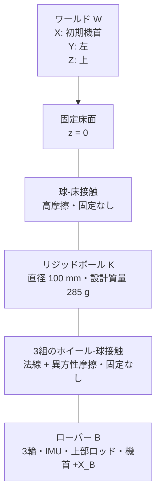
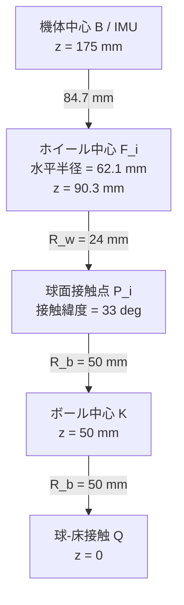

# 玉乗り3WDオムニローバー機構仕様

## システム構成

## 座標系

| 記号 | 原点 | 軸 |
|---|---|---|
| $W$ | 床面基準 | $+X_W$: 初期機首、$+Y_W$: 左、$+Z_W$: 上 |
| $B$ | 機体中央のIMU | $+X_B$: 機首、$+Y_B$: 左、$+Z_B$: 上 |
| $K$ | ボール中心 | 初期状態で $W$ と平行 |
| $F_i$ | ホイール $i$ 中心 | $+Z_{F_i}$: 車軸、$+X_{F_i}$: 駆動転動方向 |

## 初期配置

| 量 | 記号 | 値 | 単位 |
|---|---:|---:|---:|
| ボール半径 | $R_b$ | 0.050 | m |
| ホイール半径 | $R_w$ | 0.024 | m |
| ホイール接触緯度 | $\lambda$ | 33 | deg |
| ホイール方位角 | $\beta_i$ | 0, 120, 240 | deg |
| 車軸回転角 | $\phi$ | 0 | deg |
| ボール中心から機体中心までの高さ | $h_B$ | 0.125 | m |
| 機体中心初期座標 | ${}^Wp_B$ | $[0,0,0.175]^T$ | m |
| 機体初期姿勢 | $[\phi_0,\theta_0,\psi_0]^T$ | $[0,0,0]^T$ | deg |
| 上部ロッド長さ | $L_p$ | 0.300 | m |
| 上部ロッド断面 | $w_p\times w_p$ | $0.020\times0.020$ | m |
| 上部ロッド中心の機体原点からの高さ | $h_p$ | 0.165 | m |
| ローバー合成重心の球中心からの高さ | $h_{COM}$ | 0.2010 | m |

$$
{}^Bn_i=
\begin{bmatrix}
\cos\lambda\cos\beta_i\\
\cos\lambda\sin\beta_i\\
\sin\lambda
\end{bmatrix},\quad
{}^Bt_i=
\begin{bmatrix}
-\sin\beta_i\\
\cos\beta_i\\
0
\end{bmatrix},\quad
{}^Ba_i={}^Bn_i\times{}^Bt_i
$$

車軸方向は $a_i=n_i\times t_i$（$\phi=0$ の同軸配置）とし、モータは車輪中心から内向き（$+a_i$ 方向・上向き）に延びる内向き格納（案B）とする。外向き配置ではモータ先端が外形を支配し大直径化するため、モータを機体内部へ収める案Bを採用した。案Bでは3本のモータ尾部が中心軸へ収束するため幾何学的に $\lambda\lesssim33^\circ$ でのみ成立し、境界値の $\lambda=33^\circ$ を採用した。

$$
{}^Bp_{F_i}=(R_b+R_w){}^Bn_i-
\begin{bmatrix}0\\0\\h_B\end{bmatrix}
$$

| 派生寸法 | 値 |
|---|---:|
| ホイール中心の水平配置半径 $(R_b+R_w)\cos\lambda$ | 62.1 mm |
| ホイール中心のボール中心からの高さ $(R_b+R_w)\sin\lambda$ | 40.3 mm |
| ホイール中心の機体中心からの下がり量 | 84.7 mm |
| 隣接ホイール間クリアランス | 62.1 mm |
| 機体最大外形半径（フレーム径支配） | 約 84 mm（直径 167.5 mm） |
| モータフェース位置（車軸方向 $s$） | +20.6 mm |

## 構成部品

| 部位 | 採用品 | 数量 | 主要仕様 | モデル値の出典 |
|---|---|---:|---|---|
| ボール | リジッドボール XL（設計基準） | 1 | 直径100 mm、質量285 g、高グリップ表面 | 公開仕様。直径、質量、慣性、摩擦は入手後に実測 |
| オムニホイール | Nexus Robot 14108 | 3 | 直径48 mm、幅25.1 mm、8ローラー、約39–40 g、負荷上限2 kg | `cad/parts/omniwheel_14108.step`（形状モデル） |
| DCギヤードモータ | DFRobot FIT0521 | 3 | 6 V、210 rpm、10 kgf·cm、ストール3.2 A、52 × $\phi$24.4 mm、96 g | [DFRobot公式仕様](https://wiki.dfrobot.com/fit0521/) |
| モータドライバ | Cytron MDD3A | 2 | 2チャネル/枚、4–16 V、3 A連続・5 Aピーク/チャネル、PWM最大20 kHz、PWM/DIR入力 | [Cytron公式仕様](https://my.cytron.io/p-3amp-4v-16v-dc-motor-driver-2-channels) |
| IMU | 理想6軸IMU | 1 | 3軸比力、3軸角速度、機体中央配置 | シミュレーションセンサー |
| エンコーダー | FIT0521内蔵2相Hall | 3 | 3.3/5 V、出力軸341.2 PPR、各輪回転変位（回転速度は制御器内で微分） | DFRobot公式仕様。実機のカウント逓倍方式は受入試験で確定 |
| 上部ロッド | 角柱バラスト | 1 | 質量0.500 kg、長さ300 mm、断面20 mm角、機体上面中央へ剛体固定 | `ball_balancing_omni3_multibody_lqi_custom_contact_fullplant.slx` の正式仕様 |
| フレーム L1 | 3Dプリント円板 Ø160×3 mm | 1 | 中央穴Ø20、スペーサM3穴6(Ø3.5、パターン {0,±60,±120,180})、モータマウント用 Ø3.5穴4×3組（(44.5,±29)+(62,±29) 位置）、モータ尾部逃げ穴Ø48×3 | `cad/parts/Frame_L1.step/.stl` |
| フレーム L2 | 3Dプリント円板 Ø160×3 mm | 1 | スペーサM3穴6(Ø3.5、パターン {0,±60,±120,180})＋中央Ø20、旧充填スタブ除去済み | `cad/parts/Frame_L2.step/.stl` |
| フレーム L3 | 3Dプリント円板 Ø160×3 mm | 1 | スペーサM3穴6(Ø3.5、パターン {0,±60,±120,180})、**中央穴なし**（Ø20 は不要のため充填）、旧充填スタブ除去済み | `cad/parts/Frame_L3.step/.stl` |
| スペーサ | M3×50 mm 相当(OD6.2・ボアØ3.2) | 12 | 2段×6本、L1–L2間とL2–L3間、M3ボルト+Ø6ワッシャ | `cad/parts/Spacer_M3x50.step/.stl` |
| モータマウント | MotorMount_v23（3Dプリント、長方形プレート締結角筒一体成型、各ステーション1個） | 3 | λ33専用の単一ソリッド角筒マウント。外形は締結プレートと同寸（y±24・n′±24＝48 mm角）の厚壁角筒（側壁/床壁9 mm・フレーム側壁7 mm、内空30×32）でモーター胴体を包み、車軸側端をフェイス板（s′=14–18.45）で閉塞。板は両面フラット（平ネジ採用のため Ø25 ボス＋Ø6.0 ワッシャーポケットは除去済み）、PCD17 同軸 Ø2.9 貫通×4(M2.5)＋中央 Ø8 ノーズ逃げ＋内面 Ø18.4 カウンターボア座面。フレーム側の筒壁（n′=17–24）を s′=64 まで延長して L1 下面へ届かせ、水平締結プレートを一様長方形（x=34–72.5・y=±34・z=141–147）へ拡張して接続。プレート上の垂直 Ø3.5 (44.5,±29)+(62,±29)×4でFrame_L1と M3 ボルト＋Ø6ワッシャ＋ナット挟み締結。内端U字スロット（x=33–53・y±13.5）は尾部コネクタ逃がし。プレート内端（x=34）・外端（x=72.5）より先の材料は垂直カット、フレーム側の斜め隙間を楔充填し、モーター端部下端角はボール・ホイール接線に平行な面で面取り（締結プレート面をベッド伏せ印刷面とする意図）。モーターは尾部開口から挿入、締結は板貫通 M2.5×4（ギアボックス前面タップ）＋角筒による胴体拘束 | `cad/parts/MotorMount_v23.step/.stl` |
| ホイールアダプタ | WheelAdapter_v4（3Dプリント） | 3 | λ33同軸のスルーボア管（外径 Ø11.9・ボア Ø4.2・軸長 13.4 mm、車軸 s′=−6.4〜+7.0）。FIT0521軸Ø4 Dカット→ホイールボアØ12変換。軸方向位置は実機ハブのDカット止めネジで確定 | `cad/parts/WheelAdapter_v4.step/.stl` |

## 質量・慣性予算

| 構成 | 単体質量 | 数量 | 小計 |
|---|---:|---:|---:|
| 機体フレーム・電装・支持部（下記内訳） | 0.502 kg | 1 | 0.502 kg |
| FIT0521モータ | 0.096 kg | 3 | 0.288 kg |
| 14108ホイール | 0.039 kg | 3 | 0.117 kg |
| 上部ロッド | 0.500 kg | 1 | 0.500 kg |
| ローバー合計 |  |  | 1.407 kg |
| 100 mmリジッドボール（設計基準） | 0.285 kg | 1 | 0.285 kg |

機体フレーム・電装・支持部 0.502 kg の内訳（`ball_balancing_omnirover3wd_assembly` の構造を簡易再現、フレーム素材はすべてABS ρ=1.05 g/cm³、部品質量はSTEPソリッド体積換算）：

| 部品 | 質量 | 配置高さ（床面基準） |
|---|---:|---|
| フレーム L1/L2/L3 Ø160×3 | L1 実測 46.2 g・L2 実測 62.2 g・L3 換算 63.2 g（L3 は中央穴充填で体積 60.146 cm³） | z = 148.5 / 201.5 / 254.5 mm |
| スペーサ M3×50(OD6.2) | 1.16 g ×12 | r = 65 mm、2段、回転パターン {0,±60,±120,180} |
| MotorMount_v23（長方形プレート締結角筒・楔充填＋接線平行面取り・フラットフェイス板） | 53.3 g ×3 | 重心 z ≈ 128.7 mm |
| WheelAdapter_v4 | 0.26 g ×3 | 重心 z ≈ 90 mm |
| バッテリー（L1搭載、代表値） | 120 g | z ≈ 156 mm |
| MDD3A ×2（L1搭載） | 30 g | z ≈ 153 mm |
| Nucleo+IKS4A1（L2搭載） | 90 g | z ≈ 206 mm |
| 配線・その他 | 10 g | z ≈ 160 mm |

上部ロッドを含むローバー合成重心は球中心から 107.5 mm 上方に位置する。シャーシ集中質量の慣性はモーメント [3.82e-3, 3.82e-3, 3.32e-3] kg·m²（`ballbotParameters.m` 実測反映後の値）でモデル化する。LQI設計には合成重心高と合成傾斜慣性を使用し、ホイール配置には機体原点の幾何高さ125 mmを使用する。

$$
I_b=\frac{2}{3}m_bR_b^2I_3
=4.750\times10^{-4}I_3\ \mathrm{kg\,m^2}
$$

慣性は薄肉球殻を保守側の初期値としている。実物の内部質量分布を同定し、一様中実球相当$2.85\times10^{-4}I_3\ \mathrm{kg\,m^2}$との範囲で制御ロバスト性を確認する。

## 接触仕様

| 接触 | 法線モデル | 接線モデル | 分離 |
|---|---|---|---|
| ボール–床 | $F_n=s(d,w)(k_nd+c_n\dot d)$ | Smooth stick-slip、$\mu_s=0.90$、$\mu_d=0.80$ | 可能 |
| ホイール–ボール | $F_{n,i}=s(d_i,w)(k_nd_i+c_n\dot d_i)$ | 駆動方向 $\mu_d=0.75$、ローラー方向 $\mu_r=0.02$ | 可能 |

| パラメーター | ホイール–ボール | ボール–床 | 単位 |
|---|---:|---:|---:|
| 法線剛性 | $2.0\times10^5$ | $3.0\times10^5$ | N/m |
| 法線減衰 | 250 | 180 | N/(m/s) |
| 遷移幅 | $5.0\times10^{-4}$ | $5.0\times10^{-4}$ | m |
| 臨界すべり速度 | $5.0\times10^{-3}$ | $5.0\times10^{-3}$ | m/s |

## 駆動制約

$$
\tau_{motor,stall}=10\times\frac{9.80665}{100}=0.981\ \mathrm{N\,m}
$$

$$
\tau_{continuous}=\tau_{motor,stall}\frac{3.0}{3.2}=0.919\ \mathrm{N\,m}
$$

$$
N_{i,nom}=\frac{m_Rg}{3\sin\lambda}=7.012\ \mathrm{N},\qquad
\tau_{contact,max}=\mu_dN_{i,nom}R_w=0.1262\ \mathrm{N\,m}
$$

| 制約 | 下限 | 上限 | 支配要因 |
|---|---:|---:|---|
| 無負荷輪速 | -21.99 rad/s | 21.99 rad/s | FIT0521、210 rpm @ 6 V |
| 連続指令輪トルク | -0.919 N·m | 0.919 N·m | MDD3A 3 A連続定格をFIT0521のトルク定数へ換算 |
| 短時間軸トルク | -0.981 N·m | 0.981 N·m | FIT0521ストールトルク。連続運転には使用しない |
| PWM周波数 | 0 kHz | 20 kHz | MDD3A入力上限 |

## センサー・配線インターフェース

| ID | 位置 | 出力 | 単位 | 正方向 |
|---|---|---|---|---|
| IMU | $B$ 原点 | $[f_x,f_y,f_z,p,q,r]$ | m/s², rad/s | $B$ 軸右手系 |
| ENC1 | $F_1$ 車軸 | $\omega_1$ | rad/s | $+a_1$ |
| ENC2 | $F_2$ 車軸 | $\omega_2$ | rad/s | $+a_2$ |
| ENC3 | $F_3$ 車軸 | $\omega_3$ | rad/s | $+a_3$ |

MDD3Aは2チャネル品であるため、基板Aのチャネル1/2をM1/M2、基板Bのチャネル1をM3へ割り当て、基板Bのチャネル2は未使用とする。モータ電源は6 V、ロジックGND・エンコーダGND・MDD3A GNDは共通化する。各モータのPWMとDIRは独立信号とし、非常停止では全PWMを0へ設定する。

## 製作・受入条件

| ID | 条件 | 受入値 |
|---|---|---:|
| M-01 | 3輪方位角誤差 | ±0.5 deg以内 |
| M-02 | 接触緯度誤差 | ±1.0 deg以内 |
| M-03 | 3接触点の半径方向位置差 | 0.5 mm以内 |
| M-04 | IMU原点と機体幾何中心のずれ | 1.0 mm以内 |
| M-05 | 機首マーキングと $+X_B$ のずれ | ±0.5 deg以内 |
| M-06 | ボール直径 | 100 mm。3軸測定値と真球度を記録 |
| M-07 | ボール質量・慣性 | 組込み前に実測しモデル更新 |
| M-08 | 静止時3輪法線荷重差 | 平均の±10%以内 |
| M-09 | ホイール、締結部、配線を含む最大外形 | 直径180 mm以内（内向き格納の実測 Ø167.5 mm、フレーム径が支配） |
| M-10 | FIT0521出力軸1回転のエンコーダーカウント | 341.2 PPR公称値との誤差を記録し、x1/x2/x4デコード方式を確定 |
| M-11 | MDD3A連続電流 | 各使用チャネル3.0 A以下 |
| M-12 | 上部ロッド質量 | $0.500\ \mathrm{kg}$、実測値を記録 |
| M-13 | 上部ロッド長さ・断面 | $300\ \mathrm{mm}$、$20\times20\ \mathrm{mm}$ |
| M-14 | 上部ロッド中心軸と$+Z_B$の傾き | ±0.5 deg以内 |

## CADアセンブリ

Fusion 360 プロジェクト `nenecchi/ball-balancing-omni-rover` 内の `ball_balancing_omnirover3wd_assembly`。全オカレンスは数値検証済みの配置で固定され、モータ3個（ステーション別 FIT0521_P0/P1/P2）・マウント（MotorMount_v23 ×3オカレンス）・WheelAdapter_v4の3オカレンスを含む。ボールキャスターは廃止した。エクスポートは `cad/ball_balancing_omnirover3wd_assembly.f3d` / `.step` / `.stl`、個別部品は `cad/parts/`（STEP＋STL）。

### レイアウト（Z上向き、単位 mm）

| 部品 | 位置 |
|---|---|
| ボール Ø100 | 中心 z = 50、球-床接触 z = 0 |
| ホイール中心 $F_i$ | 水平半径 62.1、z = 90.3、方位 0/120/240 deg |
| 車軸 $a_i$ | $\phi=0$（同軸・内向き上向き 57°）。ホイール平坦面は $+a_i$ 側（モータ側） |
| モータ | フェース $s=+20.6$ mm（内向き・上向き、水平面に対し57°）。尾部は Frame_L1 の Ø48 穴を貫通（先端 z ≈ 154） |
| フレーム L1 | Ø160×3、z = 147–150、尾部逃げ穴 Ø48×3 |
| フレーム L2 / L3 | Ø160×3、z = 200–203 / 253–256 |
| スペーサ M3×50(OD6.2/ボアØ3.2) | r = 65、回転パターン {0,±60,±120,180}×2段 |

### 3Dプリント設計メモ

- MotorMount_v23 はλ33専用の角筒一体成型マウントで、締結プレート面（Frame_L1 接触面）をベッド伏せにする姿勢が基本。フレーム側楔充填で伏せ時に筒のフレーム側端がベッドへ届き、モーター端部下端角はボール・ホイール接線に平行な面で面取り。解析面のみ・不要凹凸なし — サポート要否はスライサー確認
- 締結仕様：ギアボックス前面への締結が唯一のモーター保持手段。モーターは柱間から挿入し、前面ボスを板の Ø18.4 カウンターボア座面へ収容。板の PCD17 同軸 Ø2.9 貫通穴×4を通して、フラットなホイール側板面から M2.5 平ネジをモーター前面タップへ締結する。中央に Ø8 ノーズ逃げ穴。フレームL1との固定はマウント締結プレート（一様長方形 x=34–72.5・y=±34）の Ø3.5 垂直穴×4（(44.5,±29)+(62,±29) mm）と L1 板の同位置穴を通す M3 ボルト＋Ø6ワッシャ＋ナットの挟み締結（プレート上面 z=147 が L1 下面に面一密着、プレート下面側にナット回り空間あり）。全3モーターはコネクタ干渉回避のため車軸まわり180°回転済み
- WheelAdapter_v4 はλ33同軸のスルーボア管（外径 Ø11.9、ボア Ø4.2、軸長 13.4 mm）。Ø4出力軸へ係合し、軸方向位置は実機ハブのDカット止めネジで確定する
- 穴は印刷後のリーマ・ドリル通しを想定。公差クーポンの試刷で実寸を確認する

### 検証結果

- 全ペアのワールド空間干渉チェック（Fusion BRepブール演算 op1=交差、オカレンス座標ボディ）：**全15組合せで 0 mm³**（マウント/モータ/ホイール/アダプタ/Frame_L1/ボール、全3ステーション）
- 最大外形：直径 167.5 mm（M-09適合）。フレーム径が支配
- ホイール–ボール：接触緯度 33.0°（3輪とも）、球心–ホイール中心距離 74.0 mm で接線接触
- 隣接ホイール間クリアランス：62.1 mm
- ギアボックス締結：マウント Ø2.9 穴×4がモータPCD17タップ（±8.5 mm）と同軸（実測一致）、フラット板面に M2.5 平ネジ頭を着座
- フレームL1締結：マウント締結プレートの Ø3.5 穴×4（(44.5,±29)+(62,±29) mm）が L1 板穴と同軸、プレート上面 z=147 はL1下面に面一、プレート下面側にナット回り空間あり
- モータ軸：Ø4出力軸がアダプタボア Ø4.2 へ係合（シャフト先端 s′≈1.3 mm、アダプタ区間 s′=−6.4〜+7.0）

## 機構変更の影響

FIT0521は従来サーボと外形、出力軸、取付方法が異なるため、既存のRotramaサーボマウント用CADは製作用として使用しない。本設計は $\phi=0$ の同軸配置で、モータを車輪中心から内向き（$+a_i$ 方向・上向き）に延ばす内向き格納（案B）とした。車軸回転の影響（駆動方向の接線からのずれ、ヨー制御権低下）を排除できる。駆動方向は水平接線 $w_i=a_i\times n_i$ のままなので、従来の車輪速度–ボール角速度マッピングをそのまま適用できる。

内向き格納はモータ先端を機体内部へ収め、最大外形をフレーム径Ø160近傍（実測Ø167.5 mm）まで縮小できる。3本のモータ尾部が中心軸へ収束する構造上、低緯度化で尾部同士が干渉し、幾何学的成立限界は $\lambda\approx33^\circ$ であったため境界値を採用した。フレーム板はØ160 mmを維持し、外形を超えるのはホイールの底部張出しのみである。

各モータポッドは MotorMount_v23（長方形プレート締結角筒マウント）経由でFrame_L1へ締結する構成とし、従来検討していたボールキャスターによるボール面の第2接点支持は廃止した。モーターの保持はギアボックス前面M2.5タップへのボルト締結と角筒による胴体拘束で担う（実機ハブのDカット止めネジがシャフトを保持するためアダプタ側の止めネジ構造は不要）。

FIT0521向けのモーター固定パーツ（MotorMount_v23 長方形プレート締結角筒）はFusion 360アセンブリ内で設計・検証済み（詳細は `cad/fit0521_motor_mount_report.md`）。この配置での最大外形は直径167.5 mmでM-09（180 mm以内）を満たす。

## 参照

| 資料 | 用途 |
|---|---|
| [DFRobot FIT0521](https://wiki.dfrobot.com/fit0521/) | モータ、エンコーダー、外形の公称仕様 |
| [Cytron MDD3A](https://my.cytron.io/p-3amp-4v-16v-dc-motor-driver-2-channels) | 電源、チャネル、電流、PWM仕様 |
| [MathWorks: Spatial Contact Force](https://www.mathworks.com/help/sm/ref/spatialcontactforce.html) | ペナルティ接触、分離、接触量計測 |
| [Lalほか: Hardware and control design of a ball balancing robot](https://busoniu.net/files/papers/ddecs19.pdf) | 3輪・球・車体の機構構成 |
