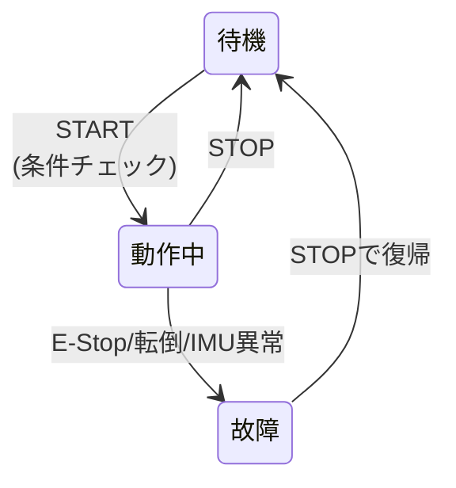

<div class="grid grid-cols-2 gap-8 items-center">
<div>

<div class="text-4xl font-bold leading-snug">
ボールの上で倒立する<br/>
3輪オムニローバーを作った話
</div>

<div class="mt-8 text-xl opacity-80">

ボール Ø100 mm の上に乗って転がりながらバランスを取るロボット。
シミュレーション設計 → 実機 → PCアプリ操作まで全部自作した話。

</div>
</div>
<div>

<div class="text-center">

<div class="text-xs opacity-60 mt-1">CADレンダリング（組立モデル）</div>
</div>

</div>
</div>

<div class="abs-br m-6 text-sm opacity-60">nenecchiCV ｜ 技術交流会資料</div>

---
layout: center
---

# どんなロボット？

<div class="grid grid-cols-2 gap-6 items-center">
<div>

<svg viewBox="0 0 440 500" style="width:100%;max-width:330px;display:block;margin:auto" xmlns="http://www.w3.org/2000/svg">
  <rect x="40" y="466" width="360" height="4" fill="#78716c"/>
  <line x1="60" y1="470" x2="48" y2="480" stroke="#a8a29e" stroke-width="2"/>
  <line x1="110" y1="470" x2="98" y2="480" stroke="#a8a29e" stroke-width="2"/>
  <line x1="160" y1="470" x2="148" y2="480" stroke="#a8a29e" stroke-width="2"/>
  <line x1="210" y1="470" x2="198" y2="480" stroke="#a8a29e" stroke-width="2"/>
  <line x1="260" y1="470" x2="248" y2="480" stroke="#a8a29e" stroke-width="2"/>
  <line x1="310" y1="470" x2="298" y2="480" stroke="#a8a29e" stroke-width="2"/>
  <line x1="360" y1="470" x2="348" y2="480" stroke="#a8a29e" stroke-width="2"/>
  <circle cx="220" cy="418" r="50" fill="#dbeafe" stroke="#3b82f6" stroke-width="2.5"/>
  <circle cx="220" cy="418" r="3" fill="#3b82f6"/>
  <rect x="146" y="293" width="5" height="21" fill="#9ca3af"/>
  <rect x="289" y="293" width="5" height="21" fill="#9ca3af"/>
  <rect x="146" y="215" width="5" height="75" fill="#9ca3af"/>
  <rect x="289" y="215" width="5" height="75" fill="#9ca3af"/>
  <rect x="140" y="313.5" width="160" height="7.5" rx="2" fill="#4b5563"/>
  <rect x="140" y="290" width="160" height="3" rx="1.5" fill="#6b7280"/>
  <rect x="140" y="212" width="160" height="3" rx="1.5" fill="#6b7280"/>
  <rect x="192" y="215" width="56" height="34" fill="none" stroke="#059669" stroke-width="1.5" stroke-dasharray="4 3"/>
  <rect x="196" y="219" width="48" height="26" rx="3" fill="#a7f3d0" stroke="#059669" stroke-width="1.5"/>
  <rect x="246" y="270" width="32" height="20" rx="2" fill="#fecaca" stroke="#ef4444" stroke-width="1.5"/>
  <rect x="208" y="284" width="12" height="6" fill="#f87171" stroke="#ef4444" stroke-width="1"/>
  <line x1="282" y1="378" x2="242" y2="312" stroke="#9ca3af" stroke-width="24" stroke-linecap="round"/>
  <line x1="242" y1="312" x2="233" y2="297" stroke="#6b7280" stroke-width="10" stroke-linecap="round"/>
  <line x1="158" y1="378" x2="198" y2="312" stroke="#9ca3af" stroke-width="24" stroke-linecap="round"/>
  <line x1="198" y1="312" x2="207" y2="297" stroke="#6b7280" stroke-width="10" stroke-linecap="round"/>
  <circle cx="282" cy="378" r="24" fill="#fde68a" stroke="#d97706" stroke-width="2.5"/>
  <circle cx="282" cy="378" r="4" fill="#d97706"/>
  <circle cx="158" cy="378" r="24" fill="#fde68a" stroke="#d97706" stroke-width="2.5"/>
  <circle cx="158" cy="378" r="4" fill="#d97706"/>
  <circle cx="261.9" cy="390.7" r="3" fill="#dc2626"/>
  <circle cx="178.1" cy="390.7" r="3" fill="#dc2626"/>
  <line x1="220" y1="418" x2="261.9" y2="390.7" stroke="#dc2626" stroke-width="1.5" stroke-dasharray="4 3"/>
  <line x1="220" y1="418" x2="272" y2="418" stroke="#dc2626" stroke-width="1.5" stroke-dasharray="4 3"/>
  <path d="M 242 418 A 22 22 0 0 0 238.4 406" fill="none" stroke="#dc2626" stroke-width="1.5"/>
  <text x="247" y="410" style="font-size:14px" fill="#dc2626" font-weight="bold">λ=33°</text>
  <rect x="210" y="46" width="20" height="166" fill="#d1d5db" stroke="#6b7280" stroke-width="1.5"/>
  <path d="M 210 46 l 5 -8 l 5 8 l 5 -8 l 5 8 z" fill="none" stroke="#6b7280" stroke-width="1.5"/>
  <text x="240" y="60" style="font-size:13px" fill="#374151">おもりロッド 0.5 kg</text>
  <line x1="96" y1="356" x2="136" y2="372" stroke="#9ca3af" stroke-width="1"/>
  <text x="10" y="352" style="font-size:13px" fill="#374151">オムニホイール Ø48 ×3</text>
  <line x1="52" y1="432" x2="172" y2="424" stroke="#9ca3af" stroke-width="1"/>
  <text x="18" y="440" style="font-size:13px" fill="#374151">ボール Ø100</text>
  <line x1="316" y1="298" x2="300" y2="292" stroke="#9ca3af" stroke-width="1"/>
  <text x="312" y="294" style="font-size:13px" fill="#374151">3層フレーム</text>
  <line x1="316" y1="238" x2="248" y2="234" stroke="#9ca3af" stroke-width="1"/>
  <text x="312" y="242" style="font-size:13px" fill="#374151">バッテリ 7.2 V</text>
  <line x1="316" y1="262" x2="280" y2="272" stroke="#9ca3af" stroke-width="1"/>
  <text x="312" y="266" style="font-size:13px" fill="#374151">Nucleo+IMU</text>
  <line x1="76" y1="304" x2="150" y2="330" stroke="#9ca3af" stroke-width="1"/>
  <text x="14" y="300" style="font-size:13px" fill="#374151">モータ内向き 57°</text>
</svg>

</div>
<div>

**ボールの上に乗った機体が、3つのオムニホイールでボールを転がして姿勢と移動を制御するロボット**

- 常に不安定 — 制御が止まれば即転倒
- 前後左右どの方向にもそのまま進める（オムニの利点）
- 上におもりロッド（0.5 kg）— 要求トルク↑＋ペイロード変動のロバスト検証用

**やりたかったこと**: シミュレーションで設計 → 実機に移植 → BLE で操作、を一気通貨で

**今日の流れ**: ハード → シミュレーション → 実機ソフト → アプリ

</div>
</div>

<div class="mt-8 text-center text-lg">
質量 ~1.9 kg（全備） / 制御周期 外側 200 Hz・内側 1 kHz / Nucleo-G474RE<br/>
<span class="text-base opacity-80">実機は組立済み — 倒立制御の実機検証はこれから（シミュで潰せる不安は先に潰す方針）</span>
</div>

---
layout: section
---

# ハードの話

機構・部品・3Dプリントフレーム

---

# 機構：なぜ「接触緯度33°」なのか

<div class="grid grid-cols-2 gap-6">
<div>

ホイールはボールの上側を斜め下向きに押さえる位置に置く — この接触点の「仰角」を**接触緯度 λ** と呼ぶ。

**モータの格納方法が全てを決めた**

- モータを外向きに付けると、モータのお尻が一番外側に出て機体がデカくなる
- → **内向き・上向き 57°で機体内部に収める**
- すると3本のモータ尾部が中心軸に向かって収束する
- 緯度を下げるほど尾部同士がぶつかる… **幾何学的限界が <span style="color:#dc2626">λ≈33°</span>**

</div>
<div>

<svg viewBox="0 0 460 250" style="width:100%;max-width:430px;display:block;margin:auto" xmlns="http://www.w3.org/2000/svg">
  <g>
    <rect x="14" y="66" width="196" height="118" rx="8" fill="none" stroke="#ef4444" stroke-width="1.5" stroke-dasharray="6 4"/>
    <rect x="64" y="104" width="96" height="7" rx="2" fill="#4b5563"/>
    <line x1="58" y1="152" x2="14" y2="152" stroke="#9ca3af" stroke-width="16" stroke-linecap="round"/>
    <line x1="166" y1="152" x2="210" y2="152" stroke="#9ca3af" stroke-width="16" stroke-linecap="round"/>
    <circle cx="112" cy="180" r="42" fill="#dbeafe" stroke="#3b82f6" stroke-width="2.5"/>
    <circle cx="72" cy="152" r="17" fill="#fde68a" stroke="#d97706" stroke-width="2"/>
    <circle cx="152" cy="152" r="17" fill="#fde68a" stroke="#d97706" stroke-width="2"/>
    <text x="112" y="52" style="font-size:13px" fill="#ef4444" font-weight="bold" text-anchor="middle">× 外向き</text>
    <text x="112" y="238" style="font-size:11px" fill="#6b7280" text-anchor="middle">モータのお尻が外形を支配</text>
  </g>
  <g>
    <rect x="296" y="66" width="124" height="118" rx="8" fill="none" stroke="#16a34a" stroke-width="1.5" stroke-dasharray="6 4"/>
    <rect x="310" y="104" width="96" height="7" rx="2" fill="#4b5563"/>
    <line x1="322" y1="152" x2="344" y2="118" stroke="#9ca3af" stroke-width="16" stroke-linecap="round"/>
    <line x1="394" y1="152" x2="372" y2="118" stroke="#9ca3af" stroke-width="16" stroke-linecap="round"/>
    <circle cx="358" cy="180" r="42" fill="#dbeafe" stroke="#3b82f6" stroke-width="2.5"/>
    <circle cx="318" cy="152" r="17" fill="#fde68a" stroke="#d97706" stroke-width="2"/>
    <circle cx="398" cy="152" r="17" fill="#fde68a" stroke="#d97706" stroke-width="2"/>
    <text x="358" y="52" style="font-size:13px" fill="#16a34a" font-weight="bold" text-anchor="middle">○ 内向き 57°</text>
    <text x="358" y="238" style="font-size:11px" fill="#6b7280" text-anchor="middle">外形 = フレーム径 Ø167.5</text>
  </g>
</svg>

</div>
</div>

<div class="mt-4 flex items-center gap-5">
<div>

<svg viewBox="0 0 130 130" style="width:120px;display:block" xmlns="http://www.w3.org/2000/svg">
  <circle cx="65" cy="65" r="56" fill="#f8fafc" stroke="#94a3b8" stroke-width="1.5" stroke-dasharray="4 3"/>
  <g transform="rotate(0 65 65)"><rect x="51" y="14" width="28" height="14" rx="4" fill="#fde68a" stroke="#d97706" stroke-width="1.5"/></g>
  <g transform="rotate(120 65 65)"><rect x="51" y="14" width="28" height="14" rx="4" fill="#fde68a" stroke="#d97706" stroke-width="1.5"/></g>
  <g transform="rotate(240 65 65)"><rect x="51" y="14" width="28" height="14" rx="4" fill="#fde68a" stroke="#d97706" stroke-width="1.5"/></g>
  <g stroke="#ef4444" stroke-width="1.5" stroke-dasharray="3 2">
    <line x1="65" y1="28" x2="65" y2="65"/>
    <line x1="33" y1="83.5" x2="65" y2="65"/>
    <line x1="97" y1="83.5" x2="65" y2="65"/>
  </g>
  <circle cx="65" cy="65" r="4" fill="#ef4444"/>
</svg>

</div>
<div class="text-base">

上面から見ると3輪は120°配置（赤=モータ尾部の収束方向）。

実はこれが性能にも効いた — **λ を下げると法線力が増えてトラクション限界が上がる**（シミュの話に続く）

</div>
</div>

---

# 中身の構成（ざっくり）

<div class="grid grid-cols-2 gap-6 items-start">
<div class="text-sm">

| 部位 | 部品 | 一言 |
|---|---|---|
| 制御 | NUCLEO-G474RE | Cortex-M4F 170 MHz・FPU |
| IMU | LSM6DSOX | 機体原点（回転中心）に自作シールド — 加速度の邪魔項が消える |
| <span style="white-space:nowrap">モータ</span> | FIT0521 ×3 | 6 V・210 rpm・エンコーダ付き |
| 駆動 | MDD3A ×2 | PWM/DIR（4ch中3ch使用） |
| 電源 | NiMH 7.2 V | 単一バッテリ |
| 無線 | ESP32-C6 | UART↔BLE 変換器（これも自作） |

<div class="mt-3 text-sm">

3層円板フレーム（3Dプリント）にモータ・電装・バッテリを積層 — 外形 Ø167.5 mm

</div>
</div>
<div>

<div class="border-2 border-dashed border-gray-400 rounded-lg bg-gray-50 flex items-center justify-center text-gray-400" style="height:270px">
組立済み実機の写真<br/>（後で差し替え）
</div>

</div>
</div>

---
layout: section
---

# シミュレーションの話

Simscape Multibody で作った正本モデル

---

# モデルの考え方：実機をそのまま写す

<div class="grid grid-cols-2 gap-6">
<div>

**「制御器のテストベッド」として作った閉ループモデル**

- ボール・機体・ホイールを剛体として組んだマルチボディ
- 球-床・輪-球の接触は全部**分離可能**（脱輪・滑りが起きる）
- モータは FIT0521 + MDD3A の電気回路モデル（PWM duty → 電機子電流 → トルク）
- エンコーダ量子化・IMU比力出力・駆動不感帯・転がり抵抗・輪軸摩擦まで入っている

つまり **「シミュレーションで動く制御器が、ほぼそのまま実機でも動く」** を目指した。

</div>
<div>

<svg viewBox="0 0 460 220" style="width:100%;max-width:440px;display:block;margin:auto" xmlns="http://www.w3.org/2000/svg">
  <defs>
    <marker id="ah3" markerWidth="8" markerHeight="8" refX="7" refY="4" orient="auto">
      <path d="M0,0 L8,4 L0,8 z" fill="#374151"/>
    </marker>
  </defs>
  <rect x="8" y="60" width="92" height="56" rx="8" fill="#f3f4f6" stroke="#6b7280" stroke-width="1.5"/>
  <text x="54" y="82" style="font-size:12px" fill="#374151" text-anchor="middle">指令生成</text>
  <text x="54" y="98" style="font-size:10px" fill="#6b7280" text-anchor="middle">CommandSource</text>
  <rect x="146" y="52" width="128" height="72" rx="8" fill="#dbeafe" stroke="#2563eb" stroke-width="2.5"/>
  <rect x="142" y="48" width="136" height="80" rx="10" fill="none" stroke="#2563eb" stroke-width="1.5" stroke-dasharray="5 4"/>
  <text x="210" y="80" style="font-size:13px" fill="#1d4ed8" text-anchor="middle" font-weight="bold">制御器</text>
  <text x="210" y="96" style="font-size:10px" fill="#3b82f6" text-anchor="middle">推定 + LQI + モード管理</text>
  <text x="210" y="112" style="font-size:10px" fill="#2563eb" text-anchor="middle" font-weight="bold">← この中身を実機に写す</text>
  <rect x="330" y="52" width="122" height="72" rx="8" fill="#dcfce7" stroke="#16a34a" stroke-width="2"/>
  <text x="391" y="76" style="font-size:13px" fill="#15803d" text-anchor="middle" font-weight="bold">プラント</text>
  <text x="391" y="92" style="font-size:9px" fill="#15803d" text-anchor="middle">MultibodyPlant</text>
  <text x="391" y="106" style="font-size:9px" fill="#16a34a" text-anchor="middle">剛体・接触・モータ電気</text>
  <text x="391" y="118" style="font-size:9px" fill="#16a34a" text-anchor="middle">＋センサ実装模擬</text>
  <line x1="100" y1="80" x2="138" y2="80" stroke="#374151" stroke-width="1.8" marker-end="url(#ah3)"/>
  <line x1="274" y1="80" x2="322" y2="80" stroke="#374151" stroke-width="1.8" marker-end="url(#ah3)"/>
  <text x="298" y="72" style="font-size:10px" fill="#6b7280" text-anchor="middle">duty</text>
  <path d="M 391 124 L 391 160 L 210 160 L 210 132" stroke="#374151" stroke-width="1.8" fill="none" marker-end="url(#ah3)"/>
  <text x="300" y="152" style="font-size:10px" fill="#6b7280" text-anchor="middle">IMU・輪パルス（実機と同じ観測だけ返す）</text>
  <rect x="8" y="150" width="92" height="40" rx="8" fill="#f3f4f6" stroke="#6b7280" stroke-width="1.5"/>
  <text x="54" y="174" style="font-size:11px" fill="#6b7280" text-anchor="middle">Logging</text>
  <path d="M 452 110 L 452 170 L 104 170" stroke="#9ca3af" stroke-width="1.5" fill="none" marker-end="url(#ah3)" stroke-dasharray="4 3"/>
</svg>

<div class="mt-3 text-sm">

指令 → 制御器 → プラント → 推定器 → 制御器 の閉ループ。実機に写すのは制御器の中身だけ — プラントは「実機そのもの」として振る舞う側。

</div>

</div>
</div>

<div class="mt-4 text-sm opacity-80">
パラメーターは関数が一元生成。モデルを開いて Run するだけで正式構成になる。
</div>

---

# 接触のモデル化：オムニホイールは異方性

<div class="grid grid-cols-2 gap-6">
<div>

**ホイール-ボール接触の摩擦は方向で全然違う**

$$F_t=-\mu_dF_n\tanh(v_d/v_c)\,d-\mu_rF_n\tanh(v_r/v_c)\,r$$

<div class="flex items-center gap-4 mt-2">

<svg viewBox="0 0 110 90" style="width:96px;flex-shrink:0" xmlns="http://www.w3.org/2000/svg">
  <circle cx="28" cy="45" r="24" fill="#fde68a" stroke="#d97706" stroke-width="2"/>
  <path d="M 40 25 A 24 24 0 0 1 52 45" fill="none" stroke="#d97706" stroke-width="2" marker-end="url(#ahw)"/>
  <defs><marker id="ahw" markerWidth="7" markerHeight="7" refX="6" refY="3.5" orient="auto"><path d="M0,0 L7,3.5 L0,7 z" fill="#d97706"/></marker></defs>
  <text x="28" y="49" style="font-size:12px" fill="#92400e" text-anchor="middle" font-weight="bold">d</text>
  <rect x="66" y="28" width="36" height="34" rx="10" fill="#fde68a" stroke="#d97706" stroke-width="2"/>
  <line x1="62" y1="76" x2="106" y2="76" stroke="#d97706" stroke-width="2" marker-start="url(#ahw)" marker-end="url(#ahw)"/>
  <text x="84" y="49" style="font-size:12px" fill="#92400e" text-anchor="middle" font-weight="bold">r</text>
</svg>

<div>

- 駆動転動方向 d: $\mu_d$ = <span style="color:#d97706;font-weight:bold">0.4</span>（ここでボールを蹴る、実機ボール想定値）
- ローラー自由方向 r: $\mu_r$ = <span style="color:#2563eb;font-weight:bold">0.02</span>（ほぼ滑らか）
- 輪–球接触で実に **20 倍差**

</div>
</div>

この「蹴れる方向」と「滑る方向」の分離がオムニホイールの本質。
ここを等方性摩擦で書くと、オムニとしての運動が再現されない。

</div>
<div>

**他にも入れた実装要素**

- 球-床の転がり抵抗（静止時の微小ドリフトを吸収する効果あり）
- 輪軸の Coulomb + 静摩擦
- 駆動不感帯（小dutyでモータが動かないゾーン — 後で大問題になる）

これらはモデルを直接編集せず、実行時にブロック追加する augment 方式（冪等・オフ切替可）で実装。

</div>
</div>

---

# 推定器：加速度計は「信用していい時だけ」使う

<div class="grid grid-cols-2 gap-6">
<div>

**玉乗り機の最大の罠**

加速度計の比力 = 重力 + 実加速度。
このロボットは**動作原理上ほぼ常時加速している**。

無条件に「加速度計 = 重力」で姿勢を補正すると、幻影の傾斜（$a/g$ 相当）へ推定が引っ張られる。
シミュ上で実際にやったら推定が **±1.8 rad（≈±103°）まで振れた**（終了閾値 35° の約3倍）。

</div>
<div>

**解決：重力補正は「更新可否の判定」に使う**

加速度計・推定姿勢と独立な3証人（エンコーダ運動学・相対位置・ジャイロ微分）から予測加速度 $a_{pred}$ を構成し、**0.30 s 静寂な時だけ**重力補正を注入。ゲートが閉じている間はジャイロ伝播のみで短時間のドリフトは微小、開いた時に重力へ引き戻す — 動作中も推定は漂わない。

```text
動いている間 → ジャイロ単独伝播
止まった・定常 → 重力補正 ON
```

</div>
</div>

<div class="mt-4 p-3 bg-green-50 border-l-4 border-green-500 rounded text-lg">
静止保持の傾き誤差 <strong>~1/5</strong>（0.011 → 0.0023 rad）— 骨格は14状態推定器＋誤差状態EKF、ヨーバイアスは静止区間だけ漏れ積分で学習
</div>

---

# 制御器：トルクLQI + 速度の外側ループ

<div class="grid grid-cols-2 gap-6">
<div>

**速度 → 姿勢 → トルクの入れ子構造**

- 「ボール速度 → 目標リーン」の速度ループ
- 「姿勢 → トルク」の**トルクLQI**（姿勢トルクを直接出力 → 1 kHz層が輪速で実行）
- プラント誤差対策: 輪速整合サーボ・滑り減衰・<span style="white-space:nowrap">ヨースピンブレーキ</span>を追加

**ゲイン設計が面白いところ**
モデル上のトルクステップ応答で同定した B 行列をペイロード族 0〜1 kg へスケーリングして、**族全体で安定な固定ゲイン**を選ぶ（ロバスト設計）。

カスケード制御・ボールフォース制御も試したが全指標で負けたので削除。

</div>
<div>

**トルク → duty の変換は物理式で**

$$\tau=K_tI,\qquad duty=\frac{R_aI+K_e\omega_w}{V_{supply}}$$

<div class="text-sm">

目標トルク → 電流 → duty をモータ式で逆に解く（逆起電力補償・電流計測なし。不感帯は別経路で補償）。定格・トラクション限界で飽和。

**モード管理**

| 傾き | モード |
|---|---|
| <5° | 通常 BALANCE |
| 5–35° | RECOVERY（権限拡大・2°未満で復帰） |
| ≥35° | 終了（全トルク0・ラン打ち切り） |

</div>

</div>
</div>

---

# 実機を意識した制御器の分割（rev2）

実機では「重い計算をゆっくり・速い応答を高速に」分けたい。
→ 同じプラントで制御器だけ **外側 200 Hz / 内側 1 kHz** に分割したのが rev2。

<div class="grid grid-cols-2 gap-6 mt-2">
<div>

- **外側 200 Hz**: 推定・LQI・モード管理 → 姿勢トルク・輪速目標を出力
- **内側 1 kHz**: 輪速サーボ + duty変換 + 不感帯補償

出力はZOHで内側に渡す。実機のマルチタスク実装の先取り検証。

</div>
<div>

**ここでハマった話**

輪速計測も 1 ms に高速化したら転倒した。
<span style="white-space:nowrap">エンコーダ量子化</span>で1カウント = **±18.5 rad/s** のフリッカーが生じ、EMFフィードフォワード経由で duty がチャタリング。

→ **計測は 5 ms 窓のまま、actuation だけ 1 kHz** が正解だった。

</div>
</div>

<div class="mt-4 p-3 bg-green-50 border-l-4 border-green-500 rounded text-lg">

結果（シミュレーション）: rev2 は **hold 完走・cycle 50 s 完走・定速包絡 0.20 m/s 全域完走**

</div>

---

# 作ってみて分かったこと

<div class="grid grid-cols-2 gap-6">
<div>

**減速コーナーで脱輪する問題**

「移動→停止」繰り返しで、**停止直前にボールが射出されて脱輪する**。

原因: 制動には逆方向のリーンが必要 → そのリーンを支えるため車輪がボールを前に蹴る → ボール射出。

<svg viewBox="0 0 460 118" style="width:82%;display:block;margin:0 auto" xmlns="http://www.w3.org/2000/svg">
  <defs>
    <marker id="arc" markerWidth="8" markerHeight="8" refX="7" refY="4" orient="auto"><path d="M0,0 L8,4 L0,8 z" fill="#ef4444"/></marker>
    <marker id="abl" markerWidth="8" markerHeight="8" refX="7" refY="4" orient="auto"><path d="M0,0 L8,4 L0,8 z" fill="#2563eb"/></marker>
  </defs>
  <g>
    <line x1="14" y1="92" x2="146" y2="92" stroke="#78716c" stroke-width="2"/>
    <circle cx="72" cy="74" r="18" fill="#dbeafe" stroke="#3b82f6" stroke-width="2"/>
    <rect x="48" y="30" width="48" height="26" rx="4" fill="#e5e7eb" stroke="#6b7280" stroke-width="1.5"/>
    <circle cx="64" cy="58" r="6" fill="#fde68a" stroke="#d97706" stroke-width="1.5"/>
    <circle cx="88" cy="58" r="6" fill="#fde68a" stroke="#d97706" stroke-width="1.5"/>
    <line x1="100" y1="42" x2="132" y2="42" stroke="#2563eb" stroke-width="2" marker-end="url(#abl)"/>
    <text x="80" y="110" style="font-size:10px" fill="#6b7280" text-anchor="middle">移動中</text>
  </g>
  <g>
    <line x1="160" y1="92" x2="292" y2="92" stroke="#78716c" stroke-width="2"/>
    <circle cx="212" cy="74" r="18" fill="#dbeafe" stroke="#3b82f6" stroke-width="2"/>
    <g transform="rotate(14 226 60)"><rect x="202" y="30" width="48" height="26" rx="4" fill="#e5e7eb" stroke="#6b7280" stroke-width="1.5"/></g>
    <circle cx="222" cy="58" r="6" fill="#fde68a" stroke="#d97706" stroke-width="1.5"/>
    <line x1="230" y1="82" x2="262" y2="82" stroke="#ef4444" stroke-width="2" marker-end="url(#arc)"/>
    <text x="226" y="110" style="font-size:10px" fill="#6b7280" text-anchor="middle">制動: 逆リーンの反力でボールを蹴る</text>
  </g>
  <g>
    <line x1="306" y1="92" x2="438" y2="92" stroke="#78716c" stroke-width="2"/>
    <circle cx="404" cy="74" r="18" fill="#dbeafe" stroke="#3b82f6" stroke-width="2"/>
    <line x1="360" y1="74" x2="392" y2="74" stroke="#ef4444" stroke-width="2.5" marker-end="url(#arc)"/>
    <g transform="rotate(-38 336 74)"><rect x="312" y="62" width="48" height="24" rx="4" fill="#fecaca" stroke="#ef4444" stroke-width="1.5"/></g>
    <text x="372" y="110" style="font-size:10px" fill="#ef4444" text-anchor="middle" font-weight="bold">ボール射出 → 脱輪</text>
  </g>
</svg>

<strong>車輪トルクでの補正は全部「内部運動量交換」</strong> — 全案撃沈。

</div>
<div>

**効いた対策**

- **接触緯度を下げる**（旧案 65°→33°）: 法線力↑でトラクション限界↑、ボール射出も解消 → 33°でサイクル完走 <span class="text-sm opacity-70">←4枚目のモータ格納限界が、ここでも効いた</span>
- **移動開始時の偏心ゲート**: ボールが前に出た状態で急加速しないよう絞る → 生存時間 33.6→43.8 s
- **静リーン学習**: CGずれがあるとドリフトする速度を見て<span style="white-space:nowrap">リーン</span>整定点を学習 → ±20 mm オフセットでも保持

</div>
</div>

<div class="mt-3 p-2 bg-green-50 border-l-4 border-green-500 rounded text-base">

**直立保持・cycle 50 s 完走・転倒なし** まで到達（rev2・シミュレーション結果）

</div>

---

# 動作イメージ（シミュレーション）

<div class="border-2 border-dashed border-gray-400 rounded-lg bg-gray-50 flex items-center justify-center text-gray-400 mt-8" style="height:340px">
Simscape 可視化アニメーション / 走行軌跡プロット<br/>（後で差し替え）
</div>

<div class="mt-4 text-center text-base opacity-80">
移動 → 停止 → ヨー回転を繰り返す cycle シナリオの動作中の様子
</div>

---

# 「実機で一発で動く」を目指した受入テスト

<svg viewBox="0 0 940 296" style="width:100%;display:block;margin:0 auto" xmlns="http://www.w3.org/2000/svg">
  <text x="8" y="20" style="font-size:11px" fill="#6b7280">テストマトリクス概略 — 行：受入シナリオ × 列：掃引条件（各セル＝1シミュレーション）</text>
  <g style="font-size:10.5px" fill="#4b5563" text-anchor="middle">
    <text x="137" y="44">公称</text>
    <text x="197" y="28">不感帯</text><text x="197" y="44">構成×3</text>
    <text x="347" y="28">不感帯</text><text x="347" y="44">倍率×7</text>
    <text x="512" y="28">接触</text><text x="512" y="44">剛性×4</text>
    <text x="617" y="28">床条件</text><text x="617" y="44">×3</text>
    <text x="722" y="28">ペイロード</text><text x="722" y="44">0–1 kg</text>
    <text x="812" y="28">設置</text><text x="812" y="44">誤差×2</text>
    <text x="872" y="28">ノイズ</text><text x="872" y="44">シード×2</text>
  </g>
  <g stroke="#d1d5db" stroke-width="1" stroke-dasharray="3 3">
    <line x1="152" y1="52" x2="152" y2="266"/>
    <line x1="242" y1="52" x2="242" y2="266"/>
    <line x1="452" y1="52" x2="452" y2="266"/>
    <line x1="572" y1="52" x2="572" y2="266"/>
    <line x1="662" y1="52" x2="662" y2="266"/>
    <line x1="782" y1="52" x2="782" y2="266"/>
    <line x1="842" y1="52" x2="842" y2="266"/>
  </g>
  <g fill="#f1f5f9">
    <rect x="124" y="58" width="776" height="22" rx="3"/>
    <rect x="124" y="84" width="776" height="22" rx="3"/>
    <rect x="124" y="110" width="776" height="22" rx="3"/>
    <rect x="124" y="136" width="776" height="22" rx="3"/>
    <rect x="124" y="162" width="776" height="22" rx="3"/>
    <rect x="124" y="188" width="776" height="22" rx="3"/>
    <rect x="124" y="218" width="776" height="22" rx="3"/>
    <rect x="124" y="244" width="776" height="22" rx="3"/>
  </g>
  <line x1="124" y1="214" x2="900" y2="214" stroke="#9ca3af" stroke-width="1" stroke-dasharray="5 4"/>
  <g stroke-width="1.5">
    <g fill="#bbf7d0" stroke="#16a34a">
      <rect x="124" y="58" width="26" height="22" rx="3"/><rect x="154" y="58" width="26" height="22" rx="3"/><rect x="184" y="58" width="26" height="22" rx="3"/><rect x="214" y="58" width="26" height="22" rx="3"/>
      <rect x="454" y="58" width="26" height="22" rx="3"/><rect x="484" y="58" width="26" height="22" rx="3"/><rect x="514" y="58" width="26" height="22" rx="3"/><rect x="544" y="58" width="26" height="22" rx="3"/>
      <rect x="664" y="58" width="26" height="22" rx="3"/><rect x="694" y="58" width="26" height="22" rx="3"/><rect x="724" y="58" width="26" height="22" rx="3"/><rect x="754" y="58" width="26" height="22" rx="3"/>
      <rect x="784" y="58" width="26" height="22" rx="3"/><rect x="814" y="58" width="26" height="22" rx="3"/><rect x="844" y="58" width="26" height="22" rx="3"/><rect x="874" y="58" width="26" height="22" rx="3"/>
    </g>
    <g fill="#fde68a" stroke="#d97706">
      <rect x="244" y="58" width="26" height="22" rx="3"/><rect x="274" y="58" width="26" height="22" rx="3"/><rect x="394" y="58" width="26" height="22" rx="3"/><rect x="424" y="58" width="26" height="22" rx="3"/>
    </g>
    <g fill="#fecaca" stroke="#dc2626">
      <rect x="304" y="58" width="26" height="22" rx="3"/><rect x="334" y="58" width="26" height="22" rx="3"/><rect x="364" y="58" width="26" height="22" rx="3"/>
    </g>
    <g fill="#bbf7d0" stroke="#16a34a">
      <rect x="124" y="84" width="26" height="22" rx="3"/><rect x="154" y="84" width="26" height="22" rx="3"/><rect x="184" y="84" width="26" height="22" rx="3"/><rect x="214" y="84" width="26" height="22" rx="3"/>
    </g>
    <g fill="#fde68a" stroke="#d97706">
      <rect x="244" y="84" width="26" height="22" rx="3"/><rect x="274" y="84" width="26" height="22" rx="3"/><rect x="394" y="84" width="26" height="22" rx="3"/><rect x="424" y="84" width="26" height="22" rx="3"/>
    </g>
    <g fill="#fecaca" stroke="#dc2626">
      <rect x="304" y="84" width="26" height="22" rx="3"/><rect x="334" y="84" width="26" height="22" rx="3"/><rect x="364" y="84" width="26" height="22" rx="3"/>
    </g>
    <g fill="#bbf7d0" stroke="#16a34a">
      <rect x="124" y="110" width="26" height="22" rx="3"/><rect x="154" y="110" width="26" height="22" rx="3"/><rect x="184" y="110" width="26" height="22" rx="3"/><rect x="214" y="110" width="26" height="22" rx="3"/>
      <rect x="124" y="136" width="26" height="22" rx="3"/><rect x="154" y="136" width="26" height="22" rx="3"/><rect x="184" y="136" width="26" height="22" rx="3"/><rect x="214" y="136" width="26" height="22" rx="3"/>
      <rect x="454" y="136" width="26" height="22" rx="3"/><rect x="484" y="136" width="26" height="22" rx="3"/><rect x="514" y="136" width="26" height="22" rx="3"/><rect x="544" y="136" width="26" height="22" rx="3"/>
      <rect x="574" y="136" width="26" height="22" rx="3"/><rect x="604" y="136" width="26" height="22" rx="3"/><rect x="634" y="136" width="26" height="22" rx="3"/>
      <rect x="844" y="136" width="26" height="22" rx="3"/><rect x="874" y="136" width="26" height="22" rx="3"/>
      <rect x="124" y="162" width="26" height="22" rx="3"/>
      <rect x="124" y="188" width="26" height="22" rx="3"/>
      <rect x="124" y="218" width="26" height="22" rx="3"/>
      <rect x="454" y="218" width="26" height="22" rx="3"/><rect x="484" y="218" width="26" height="22" rx="3"/><rect x="514" y="218" width="26" height="22" rx="3"/><rect x="544" y="218" width="26" height="22" rx="3"/>
      <rect x="574" y="218" width="26" height="22" rx="3"/><rect x="604" y="218" width="26" height="22" rx="3"/><rect x="634" y="218" width="26" height="22" rx="3"/>
      <rect x="124" y="244" width="26" height="22" rx="3"/><rect x="454" y="244" width="26" height="22" rx="3"/><rect x="484" y="244" width="26" height="22" rx="3"/>
    </g>
    <g fill="#fde68a" stroke="#d97706">
      <rect x="514" y="244" width="26" height="22" rx="3"/><rect x="544" y="244" width="26" height="22" rx="3"/>
    </g>
  </g>
  <g style="font-size:12px" fill="#374151" text-anchor="end" font-family="ui-monospace,monospace">
    <text x="114" y="73">hold</text>
    <text x="114" y="99">stepX</text>
    <text x="114" y="125">yaw</text>
    <text x="114" y="151">cycle</text>
    <text x="114" y="177">bias</text>
    <text x="114" y="203">moveYaw</text>
  </g>
  <g style="font-size:11px" fill="#374151" text-anchor="end">
    <text x="114" y="233">定速 0.40 m/s</text>
    <text x="114" y="259">初期傾斜 10°</text>
  </g>
  <g style="font-size:11px" fill="#374151">
    <rect x="124" y="279" width="14" height="11" rx="2" fill="#bbf7d0" stroke="#16a34a" stroke-width="1.5"/>
    <text x="144" y="288">実行・自動採点</text>
    <rect x="246" y="279" width="14" height="11" rx="2" fill="#fde68a" stroke="#d97706" stroke-width="1.5"/>
    <text x="266" y="288">劣化・崖を記録</text>
    <rect x="368" y="279" width="14" height="11" rx="2" fill="#fecaca" stroke="#dc2626" stroke-width="1.5"/>
    <text x="388" y="288">転倒検出 → 対策へ反映</text>
    <rect x="534" y="279" width="14" height="11" rx="2" fill="#f1f5f9" stroke="#d1d5db" stroke-width="1"/>
    <text x="554" y="288">対象外</text>
    <text x="900" y="288" text-anchor="end" fill="#6b7280" style="font-size:10.5px">下2行はロバスト試験用の追加プロファイル</text>
  </g>
</svg>

<div class="grid grid-cols-2 gap-6 mt-2">
<div>

**要求をシナリオ化して自動採点**

- シナリオ 6 種 × G-01〜G-11 の採点指標（シナリオに適用される分で合否）
- IMUノイズ・エンコーダ量子化・駆動不感帯・摩擦は全部プラント入り

</div>
<div>

**条件をグリッドサーチしてロバスト性を確認**

- 床摩擦・接触剛性・不感帯スケール（×0.5〜×2.0・<span style="white-space:nowrap">輪差</span>）・ペイロード 0〜1 kg を掃引
- → 「想定外の条件でも倒れないか」を実機投入前に網羅

</div>
</div>

<div class="mt-3 p-2 bg-green-50 border-l-4 border-green-500 rounded text-base">

変更のたびにマトリクス全セルを再実行してロバスト性を担保 — シミュで潰せる不安はシミュで潰す方針

</div>

---
layout: section
---

# 実機ソフトの話

STM32 + Zephyr での実装

---

# 正本モデルを C++ へ写す — AI駆動開発

<div class="grid grid-cols-2 gap-6">
<div>

**Simulink rev2 を「そのまま」C++に写す**

数式・ゲート条件は変えず、MATLAB の「入力→内部状態→出力」をメンバ関数・メンバ変数へ写像。外側 200 Hz / 内側 1 kHz の分割もそのまま周期スロットへ。

環境は Zephyr 4.3 / NUCLEO-G474RE。ハード資源は devicetree で宣言。

</div>
<div>

**実装はほぼAIエージェントに書かせている**

- `spec/` が正本: 要求(FR/NFR) → 基本設計 → 詳細設計 → 実装 の順で整合を保つ仕様駆動
- `AGENTS.md` + `.agents/instructions/` が<span style="white-space:nowrap">エージェント</span>への作業指示書（層構造・C++縛り・テスト作法まで文書化）
- **spec がそのままAIへのコンテキスト**になるので、人間は要求とレビューに集中できる
- 「静的解析常時クリーン」「ビルド・テストの自動実行」を要求化 → AIが自律で検証まで回せる

</div>
</div>

---

# タスク構成：1スレッドで3タスク分周

<div class="grid grid-cols-2 gap-6">
<div>

TIM6 の 1 kHz 割込が基準 — ISR は `k_sem` を渡すだけで、処理は制御スレッドが各 1 ms スロット内で直列実行。

- **内側 1 ms**: ZOH → サーボ → duty → PWM
- **外側 5 ms**: IMU → 輪速 → 推定 → LQI
- **診断 200 ms**: LED・デバッグUART出力（BLEテレメトリは別系統）

単一スレッドなのでタスク間共有は自然に排他。実行時間は DWT で計測、オーバーランは計数（追いつき実行はしない — 位相が歪むので）。

</div>
<div>

<svg viewBox="0 0 460 150" style="width:100%;max-width:440px;display:block;margin:auto" xmlns="http://www.w3.org/2000/svg">
  <g stroke="#d1d5db" stroke-width="1" stroke-dasharray="3 3">
    <line x1="100" y1="20" x2="100" y2="96"/><line x1="265" y1="20" x2="265" y2="96"/><line x1="430" y1="20" x2="430" y2="96"/>
  </g>
  <text x="100" y="14" style="font-size:11px" fill="#9ca3af" text-anchor="middle">0</text>
  <text x="265" y="14" style="font-size:11px" fill="#9ca3af" text-anchor="middle">5 ms</text>
  <text x="430" y="14" style="font-size:11px" fill="#9ca3af" text-anchor="middle">10 ms</text>
  <g fill="#f87171">
    <path d="M 97 24 l 3 -6 l 3 6 z"/><path d="M 130 24 l 3 -6 l 3 6 z"/><path d="M 163 24 l 3 -6 l 3 6 z"/><path d="M 196 24 l 3 -6 l 3 6 z"/><path d="M 229 24 l 3 -6 l 3 6 z"/><path d="M 262 24 l 3 -6 l 3 6 z"/><path d="M 295 24 l 3 -6 l 3 6 z"/><path d="M 328 24 l 3 -6 l 3 6 z"/><path d="M 361 24 l 3 -6 l 3 6 z"/><path d="M 394 24 l 3 -6 l 3 6 z"/><path d="M 427 24 l 3 -6 l 3 6 z"/>
  </g>
  <text x="96" y="26" style="font-size:10px" fill="#ef4444" text-anchor="end">ISR 1 kHz</text>
  <!-- 1 ms slot = 33 px. 各スロット内で直列実行 -->
  <g stroke-width="1.5">
    <rect x="102" y="38" width="20" height="40" rx="3" fill="#93c5fd" stroke="#2563eb"/>
    <rect x="124" y="38" width="7" height="40" rx="2" fill="#86efac" stroke="#16a34a"/>
    <rect x="135" y="38" width="7" height="40" rx="2" fill="#86efac" stroke="#16a34a"/>
    <rect x="168" y="38" width="7" height="40" rx="2" fill="#86efac" stroke="#16a34a"/>
    <rect x="201" y="38" width="7" height="40" rx="2" fill="#86efac" stroke="#16a34a"/>
    <rect x="234" y="38" width="7" height="40" rx="2" fill="#86efac" stroke="#16a34a"/>
    <rect x="267" y="38" width="20" height="40" rx="3" fill="#93c5fd" stroke="#2563eb"/>
    <rect x="289" y="38" width="7" height="40" rx="2" fill="#86efac" stroke="#16a34a"/>
    <rect x="300" y="38" width="7" height="40" rx="2" fill="#86efac" stroke="#16a34a"/>
    <rect x="333" y="38" width="7" height="40" rx="2" fill="#86efac" stroke="#16a34a"/>
    <rect x="366" y="38" width="7" height="40" rx="2" fill="#86efac" stroke="#16a34a"/>
    <rect x="399" y="38" width="7" height="40" rx="2" fill="#86efac" stroke="#16a34a"/>
  </g>
  <g style="font-size:10px">
    <rect x="102" y="108" width="10" height="10" rx="2" fill="#93c5fd" stroke="#2563eb"/>
    <text x="118" y="117" fill="#374151">外側 5 ms（5スロットに1回）</text>
    <rect x="250" y="108" width="10" height="10" rx="2" fill="#86efac" stroke="#16a34a"/>
    <text x="266" y="117" fill="#374151">内側 1 ms（毎スロット）</text>
  </g>
  <text x="265" y="140" style="font-size:11px" fill="#6b7280" text-anchor="middle">同じスロットに2タスクある時は順番に直列実行 — 並列ではない</text>
</svg>

リンク処理（UART受信・応答）は**別スレッド**で非同期 — 実時間ループを邪魔しない。

</div>
</div>

---

# リンクが切れても転ばない設計

<div class="grid grid-cols-2 gap-6">
<div>

**動作状態**



- 動作開始条件: IMU正常・E-Stop解除・バイアス収束・傾き <5°
- 待機→動作で推定器リセット・起動は 0.4 s トルクランプ

</div>
<div>

**リンク切れのとき**

- `SET_VELOCITY` が 500 ms 来ない → 指令0
- UART アイドル 1 s 超 → 指令0 + 購読リセット
- **リンク断絶でも「動作中」を維持してその場保持**（待機に落ちるとバランスを捨てて転ぶ）
- E-Stop は GPIO 割込で即検出 → 全トルク0

</div>
</div>

---

# 特徴的な機能要求（抜粋）

<div class="grid grid-cols-2 gap-6">
<div>

**調整・同定まわり**

- **パラメータ調整**: BLE越しに動作値へ即反映（LQIゲイン30要素も）
- **`SAVE_PARAMS`**: 気に入った値をフラッシュへ確定保存
- **不感帯自動同定**: 車体を持ち上げて duty 三角掃引 → 補償値を自動算出 <span class="text-sm opacity-70">←8枚目の「後で大問題」の実機側の答え</span>

</div>
<div>

**計測・検証まわり**

- **テレメトリ購読**: 姿勢・オドメトリ・ログをイベント配信（100 msバッチ）
- **オンボードテスト**: 倒立制御なし別ビルドで部品単体を実機検証
- **shell**: `bb status` / `bb telem` で内部状態を即参照

</div>
</div>

<div class="mt-4 p-3 bg-green-50 border-l-4 border-green-500 rounded text-lg">

実機に触りながら調整・検証できる機能を、実装より先に**要求として立てた** — 実機調整の往復が激減

</div>

---
layout: section
---

# アプリの話

Tauri + Next.js で作った操縦アプリ

---

# 操作用アプリ（Tauri + Next.js）

<div class="grid grid-cols-2 gap-6">
<div>

**構成 — PCアプリ1本で操作〜調整まで**

- Tauri 2（Rust + Next.js）/ BLE は ESP32-C6 の UART↔BLE変換器経由
- ジョイスティック2本で速度指令、数値入力で位置目標を指示、地図に軌跡・自位置を表示
- パラメータ編集 → 即反映 / 保存、不感帯<span style="white-space:nowrap">同定ウィザード</span>、**全画面に緊急停止ボタン常設**
- 通信は独自バイナリ rev C（同期 + CRC16 再同期）。詳細は spec 側

<svg viewBox="0 0 440 96" style="width:100%;display:block;margin:8px auto 0" xmlns="http://www.w3.org/2000/svg">
  <defs>
    <marker id="ah2" markerWidth="8" markerHeight="8" refX="7" refY="4" orient="auto">
      <path d="M0,0 L8,4 L0,8 z" fill="#374151"/>
    </marker>
  </defs>
  <rect x="4" y="24" width="112" height="48" rx="8" fill="#dbeafe" stroke="#2563eb" stroke-width="1.5"/>
  <text x="60" y="44" style="font-size:12px" fill="#1d4ed8" text-anchor="middle" font-weight="bold">アプリ</text>
  <text x="60" y="60" style="font-size:8px" fill="#3b82f6" text-anchor="middle">Tauri + Next.js</text>
  <rect x="164" y="24" width="112" height="48" rx="8" fill="#fef3c7" stroke="#d97706" stroke-width="1.5"/>
  <text x="220" y="44" style="font-size:12px" fill="#b45309" text-anchor="middle" font-weight="bold">ESP32-C6</text>
  <text x="220" y="60" style="font-size:8px" fill="#d97706" text-anchor="middle">UART↔BLE変換</text>
  <rect x="324" y="24" width="112" height="48" rx="8" fill="#dcfce7" stroke="#16a34a" stroke-width="1.5"/>
  <text x="380" y="44" style="font-size:12px" fill="#15803d" text-anchor="middle" font-weight="bold">G474</text>
  <text x="380" y="60" style="font-size:12px" fill="#16a34a" text-anchor="middle">制御本体</text>
  <line x1="112" y1="42" x2="160" y2="42" stroke="#374151" stroke-width="1.8" marker-end="url(#ah2)"/>
  <line x1="160" y1="58" x2="112" y2="58" stroke="#374151" stroke-width="1.8" marker-end="url(#ah2)"/>
  <text x="136" y="16" style="font-size:10px" fill="#6b7280" text-anchor="middle">BLE (NUS)</text>
  <line x1="272" y1="42" x2="320" y2="42" stroke="#374151" stroke-width="1.8" marker-end="url(#ah2)"/>
  <line x1="320" y1="58" x2="272" y2="58" stroke="#374151" stroke-width="1.8" marker-end="url(#ah2)"/>
  <text x="296" y="16" style="font-size:10px" fill="#6b7280" text-anchor="middle">UART 115200</text>
</svg>

</div>
<div>

<div class="border-2 border-dashed border-gray-400 rounded-lg bg-gray-50 flex items-center justify-center text-gray-400" style="height:150px">
アプリ画面: RC操縦 / 軌跡<br/>（後で差し替え）
</div>
<div class="border-2 border-dashed border-gray-400 rounded-lg bg-gray-50 flex items-center justify-center text-gray-400 mt-3" style="height:150px">
アプリ画面: パラメータ調整<br/>（後で差し替え）
</div>

</div>
</div>

<div class="mt-3 text-sm opacity-80">
ファーム側の「実機に触りながら調整できる」要求を、そのまま画面として受けている構成。Rust 側の protocol/ble/robot は Tauri 非依存で cargo test 可能。
</div>

---
layout: center
---

# まとめ

<div class="text-left mt-4 text-lg">

- **ハード**: モータ内蔵配置の幾何限界 λ=33° を採用したら制御性能にも効いた
- **シミュレーション**: 「加速度計は信用していい時だけ」が推定の核心。受入シナリオ×条件グリッドサーチでロバスト性を事前確認
- **実機**: Simulink正本の写像 + spec駆動のAI開発 + リンク切れても転ばない安全設計
- **アプリ**: Tauri で操作・監視・パラメータ調整・不感帯同定まで完結

</div>

<div class="mt-6 text-base flex items-center gap-8">
<div class="flex-1">

**実機の現在地**: 組立済み・オンボード系統検証フェーズ（tick/IMU は PASS、E-Stop・エンコーダ方向は確認中）。倒立制御の実機検証はこれから。

ソース・spec 一式は GitHub に公開:<br/>github.com/nenecchiCV/ball-balancing-omni-rover

</div>
<div class="text-center">

<div class="text-xs opacity-60 mt-1">リポジトリ</div>
</div>
</div>

---
layout: end
---

# ご清聴ありがとうございました

質問・ツッコミ歓迎です
